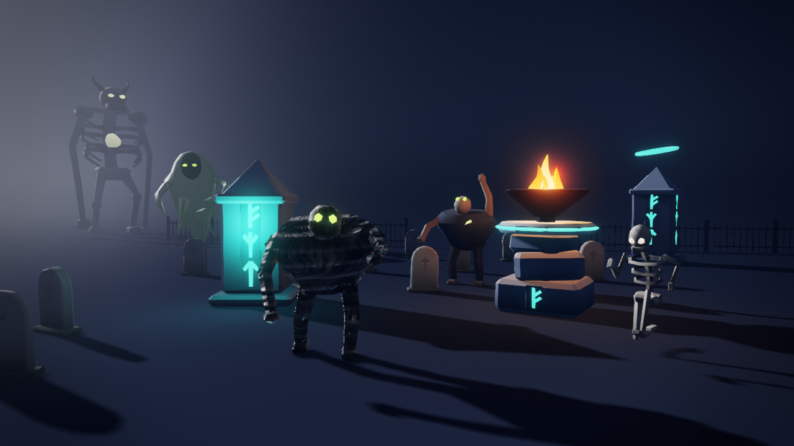

# Specula roadmap: M0 onwards

The plan for building Specula, a zero-dependency, agent-native game engine. Each step has a checkbox and the reason it
is there. Decisions, architecture and risks are in [ENGINE_PLAN.md](ENGINE_PLAN.md). The context for a new conversation
is in [HANDOFF.md](../HANDOFF.md). Design research is in [design/](design/), and the engine comparison is in
[research/ENGINE_SURVEY.md](research/ENGINE_SURVEY.md). Items marked ➕ were added by that survey (2026-10-13).

**Legend:** `[x]` done and verified · `[ ]` to do.

Everything in this file was agreed with the owner on 2026-10-13. That includes the items Claude proposed: physics,
skeletal animation, headless playtests, batch edits, procedural modelling, the review queue and the swarm track.
**Nothing is optional.** This is a long-term project, and the owner accepts how long the road to production is.

---

## The owner's direction (2026-10-13)

> "This is meant to allow games to be iterated rapidly via AI agent swarms."
>
> "For devs that just want AI agents such as yourself and your swarm to complete entire game... This is it."
>
> "I'd like it to make it easier to make games that are actually optimised to run on lower platforms, as too many games
> are made through Unreal Engine and it's caused a lot of efficiency issues."

What that means for the engine:
- **Swarm-first.** An agent swarm must be able to take a game from design doc to shipped build. The swarm track is the
  **primary** track, and every milestone serves it.
- **Humans are optional, never locked out.** Devs edit art or anything else only if they want to, with a Rust UI they
  can click, point, draw and drag in (3D gizmos included). Every human edit goes through the same protocol as agents,
  so it is journaled and undoable too.
- **Efficient by default.** Games made with Specula should run well on modest hardware: integrated GPUs and handhelds.
  The engine treats performance as something agents can see and budgets they must meet.
- **Taste is part of the product.** The engine gives agents a structured way to apply taste (a style bible, contact
  sheets, critique loops) and gives the owner the final say.

**Direction, 2026-10-17:**

> "I'm trying to make it so you don't have to manually code a game. Same with any other AI agents. Especially going to
> be helpful for AI agent swarms where you only need to focus on building a game, testing physics, doing all the shit
> that you can do, and humans can still work on building stuff manually only if they want to."
>
> "The primary thing is that this engine makes it easier for you and other AI agents to build a game via code, and
> using it as a tool to build worlds [...] But also, to really set up the taste [...] bringing it close to realistic
> engine in Unreal Engine. Just more efficient and not requiring a lot of power."
>
> "Many developers are still focused on the human/AI models rather than AI-agent native ways."

What that adds:
- **Gameplay as data first, code as the escape hatch.** Behaviours, rules, events, state machines, physics and
  animation are configured through tools as journaled, claimable, undoable data. Agents write code (hot-reloaded
  modules) only for what no building block covers, and a recurring need for code means a building block is missing.
- **Taste is engineered, not hoped for:** style rules the engine checks, critique loops, and fidelity that climbs
  toward Unreal-class realism without Unreal's hardware bill.
- **Agent-native, not human tools with AI bolted on.** Every system is designed for agents first (data, bounded
  responses, verification as data); the human editor is a client of the same protocol.

## Why this order: what a swarm needs

| # | What a swarm needs | Without it | Where it lands |
|---|---|---|---|
| 1 | **See the work.** Agents check what they built against ground truth. | Agents report success on blank or broken frames. | M0 (sight); M2 (occlusion, exact bounds) |
| 2 | **Edit safely in parallel.** Many agents in one world, none overwriting another. | Swarms corrupt each other's work; humans referee. | **M1** |
| 3 | **Iterate fast.** Change logic, reload and test in seconds; playtest headless at scale. | Agents wait on rebuilds; QA is manual. | M3 |
| 4 | **Produce content at volume.** Assets and levels built and checked by agents. | The art pipeline needs a large team. | M2 (tier 1), M4 |
| 5 | **Cheap human direction.** One person sets taste and rules; agents are held to them. | The human reviews everything and becomes the bottleneck. | M4 (style, review queue), M5 (editor) |

---

## Path to production: how to get there fastest

**This section is the plan of 2026-10-13, kept as it was written.** What changed since: the first release
(M6, the proto-1.0) is for Windows and macOS, with Linux and the Steam Deck after it (owner, 2026-11-14 and
2026-11-16); the game it ships is Sepulcra, free, as the demo; and the lanes gave way to one builder
(2026-11-12). [M6](#m6-ship) has the current order.

**Production v1.0 meant:** a commercial PC game, built mostly by agent swarms on Specula, shipped on Steam for Windows
and Steam Deck (Linux), passing Steam Deck Verified (full controller support, legible text, at least 30 fps at 800p).
Consoles, mobile, web and multiplayer come after v1.0 (see the engine survey, §4).

**Milestones are feature groups, not a strict sequence.** After M1, the work splits into **lanes** that subagent
swarms build in parallel, because each lane is its own crate behind a contract. The **phases** below set what must be
true before moving on. Each phase takes only the slice of each lane that the owner's game needs at that point.

```
Phase A  Foundation          M1 (sequential: world, claims, journal, determinism, perf_frame)
            │
Phase B  Playable slice      ┌ Render lane    M2 basics: materials, shadows, post, instancing, text atlas
            (lanes in        ├ Sim lane       M3 core: module host, SDK, input actions, P1–P2 physics, saves
             parallel)       ├ Anim lane      A1–A2
            │                ├ Content lane   procedural tier 1, stage, contact sheets
            │                ├ Interface lane UI T1–T3, menus, WAV audio
            │                └ Swarm lane     task board, role templates, playtest swarms
            │   Gate: a 10–15 minute playable slice of the owner's game, within budget on the integrated GPU,
            │         with a headless replay suite passing
Phase C  Production          Every lane to the game's full needs: nav/AI, P3–P4, A3–A4, tiers 2–4, GI baking,
            │                VFX, streaming, audio buses, editor, localisation, accessibility, Linux/Deck
            │   Gate: content-complete game; budgets met on the iGPU and the Deck
Phase D  Ship                export, packaging, Steam (owner decision), Deck Verified, soak tests, release
```

**What makes it fast:**
1. **The game is the forcing function.** Build each feature only to the depth the game needs, without breaking a
   foundation. The first game should be scoped to the engine's strengths: stylised, shape-driven art, procedural
   environments, single-player, Latin-script languages first. That alone removes years of work: no complex shaping,
   no netcode, no photoreal pipeline.
2. **Swarms build the engine, not just the game.** Each lane is a crate with a contract, as in M0 (4 subagents in
   worktrees). Phase B runs 5–6 lanes at once, and an independent reviewer agent attacks each lane before its gate.
3. **Verification is automatic.** Headless tests, replay hashes, `perf_frame` budgets and `ui_check` let agents prove
   their work without a human in the loop for every change. The owner reviews at gates and in the review queue.
4. **Everything is data.** Recipes, worlds, animation graphs, UI screens, effects and string tables are all text
   files. Agents edit text far faster and more reliably than binary assets.

**Owner decisions that affect speed:**
- **None is open** (2026-11-16; the art style, size, languages and Steamworks were decided on 2026-10-22). The
  one list is [Open owner decisions](../HANDOFF.md#open-owner-decisions) in HANDOFF.md.
- [x] **First game's genre:** a 3D tower defence on a shattered slab, working title *Sepulcra*
  ([games/sepulcra/DESIGN.md](../games/sepulcra/DESIGN.md)), chosen 2026-10-13 with
  [GAME_SELECTION.md](GAME_SELECTION.md).
- [x] **v1.0 platforms:** Windows + Steam Deck (owner, 2026-10-13), with macOS after v1.0. Replaced on
  2026-11-14: Windows and macOS first, then Linux and the Deck, natively.
  **Mobile (Android, iOS) comes later**, after M6, once the owner is ready to learn it. Foundation F6 keeps the
  engine portable so that port stays cheap.

---

## Foundations: in force from M1 onwards, in every milestone

These are not milestones. They are rules every milestone is built and reviewed against, because each one is expensive
or impossible to bolt on later.

- [ ] **F1. Swarm-first.** Every new tool is designed for many concurrent agents:
  - bounded, paged responses
  - attributable to an agent
  - safe under claims and versions
  - usable in a batch
- [ ] **F2. Determinism.** The same seed and the same inputs give the same simulation, bit for bit.
  - Fixed timestep and a seeded engine RNG.
  - No iteration over randomly-ordered `HashMap`s in simulation code, and our own trig functions.
  - State hashes taken every tick.

  Design: [design/DETERMINISM.md](design/DETERMINISM.md).
  *Why from the start:* headless playtests, replays, bug reproduction and future multiplayer all depend on it, and
  retrofitting determinism means rewriting every system.
- [ ] **F3. Low-end performance.** The reference low-end device is the Intel integrated GPU in the dev machine
  (`--adapter integrated`). Every milestone's exit proof runs on it as well as on the RTX 4090.
  - Performance is visible to agents (`perf_frame`) and budgeted in `perf.toml`, so a budget miss is an error.
  - Pipelines are built at load time, never mid-game. That avoids the shader-compilation stutter common in big-engine
    games.
- [ ] **F4. Physics and animation designed in.** Before they're implemented, the world model reserves what they need:
  - a fixed simulation tick
  - a transform hierarchy that can hold skeletons
  - collider and body components
  - a skinned vertex format

  Designs: [design/PHYSICS.md](design/PHYSICS.md), [design/ANIMATION.md](design/ANIMATION.md).
- [ ] **F5. Humans optional, never locked out.** Every engine feature is reachable through the protocol first. The
  human UI is a client of that protocol.
- [ ] **F6. Portable by design, mobile included** (owner, 2026-10-13: mobile later, but make a later port easy now).
  Nothing in the engine may assume a desktop, x86 or a keyboard:
  - **Platform seam.** Window/surface, input, file access and app lifecycle go through `specula-platform` traits.
    Mobile apps get suspended, lose their GPU surface and read assets from a package, not loose files. Supporting
    *suspend/resume* and *surface lost/recreated* from M1 costs little on Windows and is painful to retrofit.
  - **Input is actions, not keys** (M3), with **touch as a first-class device** next to mouse and gamepad. UI layout
    handles DPI, aspect ratio and safe areas (M5).
  - **Tile-GPU friendly rendering.** Android has Vulkan natively, but its GPUs are tile-based. The render graph uses
    correct load/store ops, avoids needless mid-frame readbacks, and keeps to a mobile-safe Vulkan feature subset.
    iOS uses the Metal backend already planned for macOS.
  - **Compressed textures by target** (BC on PC, ASTC/ETC2 on mobile), chosen by the asset packer, never hardcoded.
  - **Determinism across x86 and ARM** (F2): our own maths functions, and a replay-hash test on an ARM target when
    one is available (Apple Silicon, Android).
  - **CI guard:** `cargo check` for `aarch64-linux-android`, so every crate keeps compiling for mobile, as rule 4 does
    for non-Windows.
  - **Known hard part:** linking for Android and iOS without external tools (the NDK linker, Xcode signing) collides
    with hard rule 3. That gets researched before the port; don't solve it now.

---

## Primary track: the swarm (grows with every milestone)

The goal is a swarm that can build an entire game while the owner directs. Each item lands with the milestone in
brackets.

- [x] **Agent identity and roles** (M1): sessions carry agent id, name and role; `agent_hello`.
  *Done 2026-10-13:* identity keys and resume tokens (claims and undo survive reconnects).
- [x] **Claims, versions and journal** (M1): the safety layer (see M1).
  *Done 2026-10-13:* region/subtree claims with leases, `expect_version`, `world_history` / `world_changes` /
  `world_undo`. M1 exit proof: four agents built separate districts at once, and all five intrusions were refused.
- [x] **Batch edits, `world_batch`** (M1): many changes per call, all or nothing.
  *Why:* fewer round trips means fewer tokens, and the world never holds half-finished work.
- [x] **Response budgets** (M1, enforced from then on): every tool response is bounded and paged.
  *Why:* swarm cost scales with tokens per call.

**Swarm communication** (owner, 2026-10-17: agents in a swarm must know what's been done, so nothing overwrites
anything, "much to the frustration of the parent agent"). Today, claims, versions and the journal protect *world*
entities only; everything else is the gap.

- [x] **Everything through the protocol** (M3: text project data; M4: binary assets). Recipes, UI screens, sounds,
  style files, Lex rules and module sources get the same claims, versions, journal and undo as world entities. Then
  imported images, models and audio follow with the asset studio.
  *M3 progress 2026-10-18:* Lex rules (stored as world entities). Recipes, UI screens, sounds and style files remain.
  *M3 part done 2026-10-22:* `project_*` tools (`project_list`, `project_read`, `project_write`, `project_patch`,
  `project_delete`, `project_mount`) put recipes, UI screens and themes, sounds, style files and module sources under
  the same claims, versions, journal (`Change::File`, with its own text budget) and undo. Each file is validated by
  kind. The disk is kept in sync atomically: a human's outside edit is imported as `disk` and never overwritten, and
  files the engine can't read are held. Only real modules mount, and their manifests and compile-time paths are
  checked (rustc's dep-info after every build). `logic_build {fix: true}` commits fixes as the caller.
  `scripts/project_check.py`; design: [design/PROJECT_DATA.md](design/PROJECT_DATA.md). M4 (binary assets) remains.
  *Why:* two agents editing one recipe file today can silently clobber each other.
  *M4 part done 2026-10-30:* `project_upload` (chunked, resumable PNG, GLB/glTF and WAV) with the same claims, versions, journal and undo (design/PROJECT_DATA.md).
- [x] **Task board** (M3; planned for M1–M2, not built): `task_post`, `task_take`, `task_update`, `task_done`.
  - Tasks are linked to claims and journal entries.
  - The parent assigns work; children report status, blockers and questions.
  - Undone and blocked work is visible to everyone.
  *Done 2026-10-18:* `task_*` tools (dependencies, owners, blockers, questions, a change feed); each agent's current task gathers its journal entries; saved as `board.json` beside the world.

  *Why:* claims protect data; the board shares intent, so two agents don't both build the tavern.
- [x] **Intents and notes** (M3): before working, an agent declares its planned scope ("rework the east gate"), and
  overlaps with other intents or claims are flagged *before* any edit. Agents can also leave notes on entities, files
  and tasks for whoever comes next, as handoffs.
  *Done 2026-10-18:* `intent_declare`/`intent_list`/`intent_clear` (overlaps flagged before any edit; `claim_take` adds `intent_warnings`), `note_add`/`note_list`/`note_delete`.
- [x] **Conflict help** (M3: diffs; M4: merges). A refused write carries what changed: theirs, yours and the common
  original. In M4, a suggested three-way merge for text data, where the engine knows the schema.
  *M3 part done 2026-10-18:* `stale_version`, `claimed` and `claims_overlap` refusals carry `conflict {base, theirs, yours, overlap, rebase}`.
  Project files get the same help: JSON-path diffs for JSON files, line hunks otherwise, with overlap (2026-10-22).
  *M4 part done 2026-10-29:* structural three-way merge offers on stale world_set, world_batch and lex_edit, and `merge_suggest`.
- [x] **Roll-ups for parents** (M3): `world_changes` summarised per agent or task ("child 3 finished the walls: 42
  changes, 2 refused, 1 open question"), so a parent reads a report, not a log.
  *Done 2026-10-18:* `world_rollup {by: agent|task}`.
- [x] **Resource leases** (M3, with headless playtest swarms): ports, GPU time and scratch folders leased per agent,
  for swarms that run their own engines.
  *Why:* this session's lanes clobbered a shared scratch folder, one killed other lanes' engines, and engines
  collided on ports.
  *Done 2026-10-18:* `lease_*` tools: ports (checked against the OS listener table, never a wildcard bind), advisory GPU ms per second, scratch folders.
- [x] ➕ **Disk footprint budget** (owner, 2026-10-22: sort it out "before it impacts someone else's system ...
  especially when they have even less space"). A swarm must not fill the operator's disk. Measured on 2026-10-22:
  about 30 build folders (one per lane and reviewer, each 5-15 GB) took a 1 TB drive from 340 GB free to full, and a
  lane's link failed with "No space left on device".
  - Disk use reported as data (`engine_info.disk`): free space, and the engine's own caches, captures, saves,
    journals, module build output and scratch leases.
  - A budget from `perf.toml [disk]`, with the oldest captures, cache entries and scratch pruned first. Agents are
    warned before a write would cross the budget, and refused (structured) below a free-space floor.
  - Module builds share one Cargo target per module, and `logic_build` drops stale artefacts.
  - Scratch leases expire and are cleaned up.
  - A swarm guide in the docs: shared targets for lanes, `-j` limits, and cleaning merged lanes.
  *Why:* operators with small disks shouldn't find out the hard way, and cleanup done under pressure is how real
  work gets deleted.
  *Done 2026-10-30:* one disk book for every writer, a `perf.toml [disk]` budget, a free-space floor, safe pruning, review evidence kept with each world (design/DISK.md).
- [ ] **Role templates** (M1, growing): builder, reviewer, playtester, art director, sight-skeptic, performance
  auditor. They live in `.claude/agents/`, with Grok equivalents when used.
- [x] ➕ **Tool kits by job** (owner, 2026-11-12: "knowing which ones to get for a specific task", as a carpenter
  or machinist knows their tools). Families sort the tools by what they are; kits sort them by the job: a menu, a
  level, a character's motion, a balance pass, a cutscene, a translation. A kit names its few tools, the order they
  are used in and the check that says the job is done, and `tools_catalog {kit}` / `tools_activate {kit}` bring it
  in one call. Every tool also carries tags that cut across families (reads, writes, checks, costly, needs a
  grant). With it: `world_spawn` and `world_set` share their component schemas, so a kit costs a few thousand
  tokens, not twenty thousand. *Measure:* tokens an agent spends before its first correct call, per job, in the
  evals. Before the M5 exit proof.
  *Done 2026-11-12:* 21 kits (`toolkits.rs`); `kit:NAME` wherever families are; `tools_catalog {kits, kit, tag}`;
  tags derived from the authority table; `world_set` listed by reference beside `world_spawn`. Measured: the
  median kit lists 13.0 KB with the core (about 3,200 tokens) against 85.5 KB for the builder role
  ([design/TOOLS.md](design/TOOLS.md)). The tokens-to-first-correct-call measure is part of "Measured leverage".
- [x] **Headless playtest swarms** (M3): many headless engines on separate ports, each run by an agent testing one path,
  with results gathered into one report.
  *Why:* this is where swarms beat studios. QA scales with agents, not headcount.
  *Done 2026-10-18:* `scripts/playtest_swarm.py` (tasks on the board, leased ports and scratch folders, a fresh
  `--headless --paused` engine to record and another to verify each replay, one report).
- [x] **Review queue** (M4): agents submit finished work with captures attached; the owner approves or rejects batches.
  *Done 2026-10-29:* see M4's review queue.
- [ ] **Director pattern** (M4–M5): one lead agent turns the game design doc into tasks, assigns roles and tracks
  progress on the board, with the owner as final reviewer.
  *Why:* this is the "agents complete the entire game" path.
- [x] **Swarm frame floor as a setting** (M3; owner, 2026-10-17): the window's minimum frame rate while agents are
  backed up (today the constant `BUSY_FRAME`, 60 fps, in `crates/specula/src/schedule.rs`) becomes a setting
  (`perf.toml` and a tool) that the controller (lead) AI sets before it deploys a swarm, from the operator's
  hardware: low- and mid-spec laptops keep the window fluid at the swarm's expense; high-spec machines and cloud
  hardware can trade frames for agent throughput.
  *Why:* the right trade depends on how strong the human operator's machine is.
  *Done 2026-10-18:* `perf.toml [swarm] frame_floor_fps` and `swarm_settings` (lead or director only), 20-240 fps, with a hardware hint. iGPU, 64 agents: floor 30 gives 13% more agent ops, floor 20 30% more (`perf/drills/20261018-*`).
- [ ] **Auth before any non-localhost bind** (before any remote agent): per-agent tokens, with claims tied to tokens.
- [ ] **Scale drills** (every milestone from M1): 16, then 64 concurrent agents. Measure throughput, conflict rate,
  token cost and reject reasons.
  *M3 progress 2026-10-18:* 16- and 64-agent drills exercise the board, intents, leases and conflict help (`perf/drills/20261018-*`).
- [ ] **Cost and progress dashboard** (M5): tokens per agent, tasks done, rejects. Shown in the editor.
- [ ] **The swarm, seen by humans** (M5): the editor shows the task board, intents, claims, notes and roll-ups live,
  so a human can see who is doing what, step in, or hand a task to an agent. Same protocol, no separate system.

---

## M0: loop end-to-end (Windows, Vulkan). Done 2026-10-12

**Goal:** an AI agent connects to a live, native engine with no third-party code, builds something and sees it.
**Why first:** it proves the riskiest part (zero-dep Vulkan, Win32 and MCP all hand-written) before anything is built on
top of it.

- [x] **Workspace reset to zero dependencies.** CI fails if `Cargo.lock` lists anything outside the workspace.
  *Why:* zero-dep is only real if a machine enforces it.
- [x] **Rust toolchain's own linker** (`link-self-contained=yes`).
  *Why:* no MinGW, MSVC or LLVM install is needed. The owner wanted a custom linker; the toolchain linker gives the same
  "no third party" result today, and a custom linker stays on the long-term list.
- [x] **All OS and driver calls via `raw-dylib`**, each DLL declared by exactly one crate.
  *Why:* no import libraries from anyone. Windows-gnu silently drops a second crate's imports of the same DLL, so
  `specula-sys` owns `kernel32`.
- [x] **`specula-core`**: JSON, math, base64, CRC/Adler, DEFLATE and inflate, PNG encode and decode.
  *Why:* every later system needs these, and there are no crates to borrow.
- [x] **Win32 window and message loop** (raw FFI), pumped on its own thread.
  *Why:* dragging a window would otherwise freeze every agent.
- [x] **Vulkan 1.3**: runtime-loaded, validation and sync validation, both GPUs listed, offscreen targets, swapchain.
  *Why:* explicit state and validation give agents structured errors to debug from.
- [x] **One pipeline** (lit, coloured mesh), **reversed-Z with an infinite far plane**.
  *Why:* worlds of any size keep depth precision. A first attempt fitted the near plane to the world, and a distant
  object broke nearby ones.
- [x] **Readback to PNG** plus a JSON "sight packet" of subjects, screen boxes and distances.
  *Why:* the image is for the model's eyes; the packet is ground truth to check those eyes against.
- [x] **HTTP/1.1 and MCP server** (`initialize`, `tools/list`, `tools/call`).
  *Why:* MCP is how Claude Code, Grok and other clients plug in with no adapter.
- [x] **Tools**: `world_spawn`, `world_set`, `world_list`, `world_delete`, `sight_frame`, `engine_info`. Names use
  underscores because Claude Code rejects dots.
- [x] **Proof:** two Python MCP sessions built one scene. Claude Code itself connected, built, looked and confirmed
  boxes to within 1–2 px, with 0 validation errors.
- [x] **Hardening:** three adversarial review rounds; `scripts/window_check.py` on every GPU; CI on windows-msvc,
  windows-gnu and ubuntu.
  *Why:* the owner wanted nothing left open before M1. The reviews found 3 blockers and 13 other issues, all fixed. The
  list is in ENGINE_PLAN.md.

**Carried forward from M0** (known limitations, not bugs):
- [x] **No occlusion.** A hidden object still reports a screen box. → M2 ID buffer (done: `visible_px`, `occluded`).
- [x] **Sphere boxes are about 30% loose**, because the boxes are projected bounding boxes. → M2 (done:
  `screen_box_exact`).
- [x] **One far-away object shrinks an auto-framed view to a dot.** → M2: frame by clusters or ignore outliers.
  *Done 2026-11-05:* `sight_frame`'s auto camera leaves out far outliers (only with 8 or more subjects, at most a quarter, and only when keeping them would draw the main cluster under 32 px) and names them in the packet (`camera.framing`). The window's own auto camera still fits everything.
- [x] **Throughput is vsync-paced** (about 60 calls/s per agent with a window open). → M1: batch tool, and commands
  applied separately from present (done 2026-10-17: calls served between presents, `crates/specula/src/schedule.rs`;
  numbers in `perf/drills/`).
- [x] **A 257th open connection gets a TCP reset** instead of an HTTP 503. → M1 (done: 503 with `Retry-After`;
  `connection_limit_answers_503_not_a_reset` in `crates/specula-protocol/tests/mcp_http.rs`).
- [x] **No persistence.** Everything built is lost when the engine closes. → **first item of M1** (done: text world
  files, `world_save` / `world_load`, autosave with `--world NAME`).
- [ ] **Watch the MCP revision.** MCP revision 2026-07-28 drops `initialize` and sessions; we serve 2025-11-25 (plus
  06-18 and 03-26). Revisit when clients move. Pinned by `version_negotiation` and `supported_revisions_are_pinned` in
  `crates/specula-protocol/tests/mcp_http.rs`; when to move is an [open owner decision](../HANDOFF.md#open-owner-decisions).

---

## M1: world model, multi-agent and determinism. Done (2026-10-13)

**Goal:** many agents build one world at the same time, safely. The world survives restarts. The simulation clock is
deterministic from day one.
**Why now:** swarm need #2, plus foundations F2 and F4. Every later milestone multiplies agent output, and without
claims and versions more agents just means more collisions.

**Persistence first:**
- [x] **Text world files: save and load** (`world_save`, `world_load`, autosave). Deterministic ordering; one file per
  top-level subtree so git diffs stay small and different agents' areas don't merge-conflict.
  *Why first:* the game project starts now, and greybox work must not vanish on exit.
  *Done 2026-10-13:* `world.json` is the single commit point (generation files, fsync, crash-tested at every step); autosave on a worker thread; bit-exact floats.
- [x] **Hierarchy and paths**: parent/child entities, readable paths (`/world/village/house_03`), local transforms.
  *Why:* claims, persistence, skeletons (F4) and agents' mental models all work on trees.

**Entity model:**
- [x] **Components**: transform, mesh, material/colour, name, tags, and free-form `props` (JSON) for game data until M3
  modules define real components. Collider and body components are reserved (F4).
  *Why:* agents need to attach meaning ("door", "spawn_point") before logic exists.
  *Done 2026-10-13:* tags, props, reserved collider and body; values validated by the world itself.
- [x] **Commands applied at tick boundaries**, separately from present, so throughput isn't vsync-paced.
  *Done 2026-10-17 (pre-M3 cleanup):* the window serves calls between presents, in arrival order and before the next
  tick, sized from the display's refresh and the frame's own work; under a backlog it keeps 60 fps. One agent:
  500-1,270 calls/s windowed (was about 110-230); 64 agents: frame pacing p95 about 19 ms (was 0.4-2.5 s stalls).
- [x] **`world_batch`**: many commands in one call, applied atomically.
- [x] **`world_query`**: filter by path prefix, tag, region (AABB) or creator; paged results.
  *Why:* `world_list` returns everything, and at 10k entities that overflows an agent's context.

**Determinism groundwork (F2):**
- [x] **Fixed-tick simulation clock**: the tick number is the only time the simulation knows. Rendering interpolates.
  *Done 2026-10-13:* `game::Clock` (pause, step, scale; `time_control`). Hosted games tick on it; rendering gets `alpha`.
- [x] **Seeded engine RNG** in `specula-core`, with a separate stream per system.
  *Done 2026-10-13:* `specula_core::rng` (PCG32, named streams, integer chances).
- [x] **Deterministic maths** in `specula-core`: our own `sin`, `cos`, `atan2`, `exp`, `ln`, and no reliance on the
  platform maths library.
  *Why:* Rust's `f32::sin` and similar call the platform maths library. The msvc and gnu builds link different ones,
  so results can differ in the last bit between our own CI jobs.
  *Done (2026-10-13):* `specula_core::dmath`. The `f32` functions are correctly rounded:
  - one-argument functions: an exhaustive 2³² scan, with the near-midpoint cases checked by a 120-digit oracle;
  - atan2, pow and hypot: random samples checked by the same oracle.

  The `f64` ones are within 1–2 ulp. Golden bits are pinned by the tests. `math.rs` uses it for its trig.
- [x] **Ordered containers in simulation code.** No dependence on `HashMap` iteration order, which Rust randomises
  per process.
  *Done 2026-10-13:* the world uses ordered maps; Sepulcra's sim bans `HashMap`/`HashSet` with clippy.
- [x] **`world_hash`**: a hash of simulation state per tick.
  *Done 2026-10-13:* `world_hash` tool with a per-tick ring of (tick, hash) and a replay `verify`.
- [x] **Journal-replay test**: replaying a journal reproduces the same hash, in CI.
  *Done 2026-10-13:* `crates/specula/tests/journal_replay.rs` (GPU-free, pinned hash, runs on every CI job).

**Safe concurrency:**
- [x] **Agent identity**: session → agent id, name and role (from MCP `clientInfo` or `agent_hello`).
  *Done 2026-10-13:* `agent_hello`; attribution is `created_by`/`modified_by`.
- [x] **Journal**: append-only, agent-attributed, and tick-stamped. `world_history`, and `world_undo` scoped to your
  own changes by default.
  *Why:* swarms make mistakes at volume, so undo has to be surgical. Tick stamps make the journal a replay log (F2).
  *Done 2026-10-13:* two bounded rings (agents, game); game changes coalesced per tick; undo as a unit with conflict errors.
- [x] **Versions**: per-entity versions with an optional `expect_version`. A stale write is rejected with the current
  state.
- [x] **Claims**: on a subtree path or a region, as leases with a time limit that expire if the agent disappears.
  Writes outside your claim are rejected unless co-claimed.
  *Done 2026-10-13:* paths and regions, leases, session-bound identities; checked step by step for batches, undo, game tools and ancestor moves (4 adversarial review rounds).
- [x] **Change feed**: `world_changes(since)` for polling, plus MCP notifications where clients support them.
  *Done 2026-10-13:* polling with cursors and gap reporting; MCP push notifications still to do.

**Performance from the start (F3):**
- [x] **`perf_frame`**: CPU tick time, GPU time per pass (timestamp queries), draw count, triangle count, GPU memory.
  *Why:* agents can only optimise what they can see.
  *Done 2026-10-13:* per-pass GPU timestamps, CPU record/submit, draws, triangles, culled, pipelines after warm-up, memory and heap budgets, frame pacing, sim tick cost, structured budget errors.
- [x] **Reference run on the Intel integrated GPU** in the exit proof.
  *Done 2026-10-13:* `perf_frame` and `scripts/perf_baseline.py` run on both GPUs.

**Scale:**
- [x] **Connection limit returns HTTP 503**, not a reset. Scale drill with 16+ concurrent agents.
  *Done 2026-10-13:* 503 with Retry-After; `scripts/swarm_drill.py` at 16 and 64 agents with a 22-case attack phase (0 leaked).

**Exit proof:**
- [x] 4+ agents (Claude Code subagents) build separate districts at once.
  *Done 2026-10-13:* four Claude subagents built a chapel, a market, a farm and a watchtower (297 entities) in
  one world with claims; one tried five intrusions into another's district (all refused, incl. a rename-then-delete
  batch and moving the shared parent); save → restart → load gave the same hash and identical pixels. It also
  found that scripted agents locked themselves out of their own claims → resume tokens (identity-keyed claims).
- [x] A deliberately conflicting write is rejected cleanly.
- [x] Save → restart → load gives a pixel-identical render and the same `world_hash`.
  *Done 2026-10-13:* `scripts/world_roundtrip.py`: identical hash, subjects and PNG bytes.
- [ ] A journal replay matches its hash on both the msvc and gnu builds.
- [x] It runs on both GPUs.
- [x] An adversarial review passes.
  *Done 2026-10-13:* every M1 lane passed lane-reviewer rounds before merging.

---

## M2: rendering, true sight, animation, first procedural shapes. Done (2026-10-16)

**Goal:** worlds that look like games, sight agents can trust, animated characters, and original shapes beyond cubes.
**Why here:** after M1 the bottleneck becomes "does it look right, is it really visible, and can agents make real
shapes?"

- [x] **Render graph** that owns barriers and transitions.
  *Done 2026-10-14:* `specula-gpu::graph`; every pass declares its reads/writes; sync-validation clean.
- [x] **Materials** (PBR-lite plus a stylised/vertex-colour path), **directional and point lights**, **shadow maps**.
  *Started 2026-10-13 for the lava-lamp benchmark:*
  - per-frame data through a buffer device address
  - a `standard` material (GGX highlights, metal, emission) and up to 16 point lights
  - blended `glass` and `blob_shadow`, sorted far to near (nested shells handled)
  - ACES tone mapping with dithering, and an adjustable sun and ambient light
  *Done 2026-10-13:* standard/glass/blob materials, vertex colours, 16 point lights, a fitted or cascaded directional shadow map with PCF (render lane).

  Still to do: shadow maps, textures, the vertex-colour path, and a real bloom pass (the lamp's halo is analytic).
  *Why the stylised path:* it's cheap on low-end GPUs (F3) and suits agent-made content.
- [x] **GPU instancing, frustum culling, and LOD selection.**
  *Why:* swarms build big worlds, and low-end hardware must stay at frame rate.
  *Done 2026-10-13:* instancing (10k cubes in 1 draw call; 2.7 ms GPU on the Intel iGPU) and CPU frustum culling. LOD selection still to do.
- [x] **2D**: sprites, tilemaps, vector shapes, orthographic cameras.
  *Done 2026-10-16:* sprites (billboards, flipbooks, cutout/blended, pixel snap, lit, shadow casting), chunked
  tilemaps with animated tiles (`tilemap_set`/`tilemap_get`), budgeted vector shapes (fills with holes, strokes,
  AA), `ortho`/`view_2d` cameras, SSAO-aware. Shape budgets in `perf.toml` (persistent 2M / transient 250k
  vertices). Intel iGPU: 256x256 tilemap 1.2-1.8 ms, 50k sprites ~6 ms (fill-bound).
- [x] PNG decode (done early, in M0).
- [x] **glTF import**: meshes, materials, textures, skins, animations. GLB included.
  *Done 2026-10-14:* `specula-gltf` import/export, our own JPEG codec in `specula-core`; skins → rigs, animations → clips.
- [x] **Skeletal animation, stages A1–A2** ([design/ANIMATION.md](design/ANIMATION.md)): GPU skinning, clip playback,
  crossfades, filmstrip sight.
  *Progress 2026-10-13:* rigs in recipes, `specula-anim` clips/blending/generators/IK, CPU skinning with GPU-ready matrices, filmstrip sight.
  *Done 2026-10-15:* GPU skinning (per-instance palettes, posed bounds from bone spheres), the world `anim` component
  (clip, speed, loop, crossfade) on world time, glTF skins and animations, textured PBR materials. Intel iGPU:
  300 skinned creatures × 20 bones ≈ 7.9 ms. Still to do: skinning in the Sight lane's ID pass (lands with it).
- [x] **Procedural modelling, tier 1** ([design/PROCEDURAL_MODELLING.md](design/PROCEDURAL_MODELLING.md)):
  - recipes and primitives
  - extrude, lathe, sweep
  - bevel, array and mirror
  - auto-LOD and auto-collider
  *Done 2026-10-13:* `specula-model` recipes with hard limits and fidelity-checked auto-LOD; 21 Sepulcra assets (contact sheet in docs/fidelity).

  *Why pulled forward from M4:* the game needs real shapes early, and tier 1 is small.
- [x] **ID buffer**: per-entity visible-pixel counts and exact screen extents. Fixes occlusion and loose boxes.
  *Done 2026-10-14:* `id_buffer` graph pass on every capture (opaque ids with depth, glass shows but never hides);
  subjects carry `visible_px`, `screen_box_exact`, `occluded`; `sight_query`; `subjects: "visible"`. 0.36 ms GPU +
  1.1 ms readback/count at 1280×720 on the Intel iGPU; never on the window path.
- [x] **Per-agent persistent cameras**; `sight_orbit` (turntable) and `sight_compare` (before/after).
  *Done 2026-10-14:* `camera_set/list/delete` (fixed or following an entity, others may look through them);
  `sight_orbit` contact sheets; `sight_compare` mark/diff with a before|after|heat image, changed regions and subject
  changes. *2026-10-16 (owner decision):* cameras persist with the world (`cameras.<gen>.json`, committed with
  `world.json`), keyed by agent name, journaled (kind `camera`: feed and undo), out of the world hash; a human looks
  through one with `window_view {camera, of}`.
- [x] **Debug overlays in captures**: grid, axes, bounds, labels, claim regions, skeletons.
  *Done 2026-10-14:* `sight_frame {overlays}`: grid, axes, bounds (hidden ones red), labels (no overlaps, capped),
  claims, skeletons (posed as the frame shows them), lods; text through `specula-text` with a system font.
- [x] **`perf.toml` budgets**: frame time on the reference low-end GPU. A budget miss is reported as an error.
  *Done 2026-10-14:* `--perf FILE` / `./perf.toml` (`perf.example.toml` documents every budget, per-adapter overrides); misses are structured errors in `perf_frame` and `perf_capture`.
- [x] ➕ **Post-processing**: tonemapping, bloom, FXAA/SMAA, colour grading; optional SSAO.
  *Progress 2026-10-13:* HDR bloom, ACES tonemap, FXAA.
  *2026-10-15:* colour grading (white balance, contrast, saturation/vibrance, lift/gamma/gain,
  3D LUT strips from the assets root, vignette, grain; neutral = bit-identical) and SSAO (from the
  scene's depth, ambient light only), both in `world_env`; Intel iGPU game bench at 1600×900:
  SSAO +0.98 ms (half res, 8 samples; +0.59 ms at a quarter), the Sepulcra grade +0.40 ms.
  SMAA not done (FXAA covers it for now).
- [x] ➕ **Analytic sky and height fog.**
  *Done 2026-10-13:* analytic sky with a moon disc, exponential height fog.
- [x] ➕ **Fixed pipeline set**: materials are parameters into a few uber-shaders, all pipelines are built at load
  with an on-disk Vulkan pipeline cache, and a pipeline created mid-game is a `perf_frame` error.
  *Why:* this avoids Unreal-style shader stutter by design (survey §3).
  *Done 2026-10-13:* all pipelines built at load with a validated on-disk pipeline cache; `pipelines.created_after_warm` is a perf_frame error.
- [x] ➕ **Profiling tools**: CPU zones, frame capture and memory tracker, exposed as tools.
  *Done 2026-10-14:* CPU zones (`perf_zones`), frame capture with a Chrome trace (`perf_capture`), memory tracker (`perf_memory`).

**Exit proof:**
- [x] A lit, shadowed scene with imported and procedural assets and an animated character.
  *Done 2026-10-16:* a moonlit Sepulcra graveyard: recipe props, two imported glTF assets (one textured and
  GPU-skinned), five animated creatures, shadows/fog/bloom/grading/SSAO; 31 models ready, every pose changes across
  the filmstrip, fixed `time_s` is bit-identical, shadowed ground 0.39-0.44x of shadows-off. Both GPUs.
  
- [x] Sight reports 0 visible pixels for a fully hidden object.
  *Done 2026-10-14:* `scripts/sight_check.py` (box behind a wall: `visible_px` 0, `occluded`; a sphere half behind a
  low wall: 0.47 of its disc) on the NVIDIA and Intel GPUs.
- [x] A 10k-instance world holds its budget on the Intel integrated GPU.
  *Done 2026-10-16* (integrator's run on main 8a9a5e8, window path, 1280x720, full night effects, 120 frames):
  8,000 cubes + 2,000 tombstones: GPU p95 7.1 ms, frame p95 9.9 ms, draw list p95 1.1 ms; 10,000 tombstone models:
  GPU p95 9.5 ms, frame p95 11.9 ms, draw list p95 1.25 ms (budgets 14 / 20.9 / 1.5 ms). Another lane's engine shared
  the machine; the lane's quiet runs measured draw list p95 0.32 / 0.48 ms. RTX 4090: GPU p95 0.4 / 1.3 ms.

**M2 complete (2026-10-16).**

`python scripts/m2_exit.py --adapter both` (after `cargo build --release -p specula`) checks all three and prints
PASS / FAIL / SKIPPED per criterion; captures, packets and `m2_exit.json` go to `target/m2-exit/`.
(1) A moonlit Sepulcra graveyard: recipe props, an imported textured + skinned GLB walking and a static GLB, four
recipe creatures playing clips; every model `ready`, each creature's pixels change across a 6-frame filmstrip, and
ground inside two props' shadows is >25% darker than the same frame with shadows off while open ground is unchanged
([hero shot](fidelity/m2_exit_hero.png)). (2) A box behind a wall must have `visible_px` 0 and `occluded`, a control
box in view `visible_px` > 0. (3) A windowed engine at 1280×720 with the full night effect stack and
`perf.example.toml`, two 10,000-entity worlds over 120 frames each: "mixed" (8,000 cubes + 2,000 tombstone models, 3
instanced draw calls) and "tombstones" (10,000 tombstone models, 2 draw calls); the frame's GPU time, pacing, draws,
triangles, GPU memory, late pipelines and the CPU time building the window's draws (`frame/draw_list`) must hold;
per-pass and other CPU misses are reported as notes. *2026-10-16, on main with Sight merged:* all three pass on both
GPUs. (2): hidden box `visible_px` 0 and `occluded`, control box 8,543 px. (3) Intel iGPU: GPU p95 5.7 ms mixed / 7.9
ms tombstones (budget 14), draw list p95 0.30 / 0.44 ms (budget 1.5); RTX 4090 Laptop: GPU p95 1.3 / 1.6 ms. What it
took: point lights and 2D entities from World indexes instead of walks over every entity; the window's draw list
cached and patched from World's record of changed persistent entities, transient ones drawn live (10k entities: 1.9–2.8
→ 0.30 ms p95 on the iGPU); and a coarse recipe rebuild as the far LOD where clustering can't make one (tombstones
320/247 → 320/247/60 triangles; the 10k-tombstone field went from 15.9 ms GPU p95 and 1.94M triangles to 7.9 ms and
0.47M).

---

## M3: logic, physics, animation and time. The game becomes playable. Done (2026-10-22)

**Goal:** agents build gameplay through data and tools (behaviours, rules, physics, animation), write hot-reloaded
code only where no building block fits, and playtest headless at scale.
**Why here:** swarm need #3. The game moves from diorama to game.

Research and reasoning for the ➕ items marked *(research)*: [research/AGENT_GAMEMAKING.md](research/AGENT_GAMEMAKING.md) (2026-10-17, accepted by the owner).

- [x] ➕ **Gameplay as data: Lex** (Latin *lex*, "law"; owner, 2026-10-17: "you don't have to manually code a game").
  A design pass first, then a typed rules language as text data:
  - behaviours as components (move, chase, patrol, spawn, damage, die, drop);
  - attributes and effects (Gameplay-Ability-System-like), events, triggers, timers, state machines;
  - economies and win/lose conditions.

  Every edit is validated against a schema, and errors say what to change, because grammar and compiler feedback is
  what makes agents' output valid. `lex_*` tools read, edit, validate and simulate, with the journal, claims and undo.
  Code modules stay the escape hatch; each use is logged with why, so Lex grows by evidence.
  *Core done 2026-10-18:* `crates/specula-lex` (13 item kinds, integer units, typed expressions, GAS-like effects, a
  fixed phase order, a limits table), the 9 `lex_*` tools (rule sets stored as `/lex` entities, so versions, claims,
  journal and undo apply; only the Lex tools write `/lex`), and a Sepulcra slice in Lex that matches the Rust sim
  tick for tick (`games/sepulcra/tests/lex_parity.rs`, `scripts/lex_check.py`). Design: [design/LEX.md](design/LEX.md).
  *Proof met 2026-10-18:* Sepulcra's whole rule set in Lex (`games/sepulcra/lex`), identical to the hand-written sim on
  every tick across 4,100 whole games; rebuilt through the `lex_*` tools alone (`scripts/sepulcra_lex_tools.py`, 42
  `lex_edit` calls); played live in the engine (`lex_live`, with input bindings, work budgets and module hooks as
  natives) and as `sepulcra --rules lex`, which won on the iGPU with parity on every tick and the replay verified.
  Lex state is in save games, live runs included.
  *Proof:* rebuild Sepulcra's rules in Lex through tools alone, with replays still matching.
- [x] ➕ **Placement by relations: Locus** *(research)*. `world_place` takes relations (on, against, along, between,
  facing, spacing, avoid, inside a region, on the navmesh) and solves positions deterministically. Unsatisfied
  relations come back as data with the nearest valid alternative.
  *Why:* agents make systematic coordinate errors, but are good at relations once a solver does the placing.
  *Done 2026-10-18:* `crates/specula-locus` and `world_place` (on, against, along, between, near, inside, facing,
  spacing, avoid, on_navmesh), collision-checked through physics, unsatisfied relations returned with the nearest valid
  alternative, one journaled and undoable commit, dry runs, work budgets. Design: [design/LOCUS.md](design/LOCUS.md).

- [x] **Module host**: game logic as Rust `cdylib`s behind a C ABI. The engine owns all state; build → reload without
  losing the world; structured build errors.
  *Done 2026-10-18:* `crates/specula-logic` and `crates/specula/src/logic/`; `logic_build`, `logic_reload`, `logic_unload`, `logic_status`, `logic_input`, `logic_hook`. Design: [design/MODULES.md](design/MODULES.md).
- [x] **`specula-sdk`**: the one crate game modules depend on. It exposes only deterministic APIs (tick, engine RNG),
  enforcing F2.
  *Done 2026-10-18:* `crates/specula-sdk` (stateless `Module` trait, `Cx` with tick, inputs, events, world access, a state store and engine RNG streams; versioned C ABI).
- [x] **Input**: keyboard and mouse (Win32), gamepads (XInput, runtime-loaded). Input is recorded into the journal.
  *Done 2026-10-13:* Win32 keyboard/mouse/pointer + XInput (runtime-loaded); per-tick action recordings in `specula-input`.
- [x] **Time**: `time_pause`, `time_step`, `time_resume`, and `time_scale` for fast-forward headless runs.
  *Done 2026-10-13:* `time_control` pause/resume/step/scale.
- [x] **Physics, stages P1–P3** ([design/PHYSICS.md](design/PHYSICS.md)):
  - P1: queries and triggers
  - P2: kinematic character controller
  - P3: rigid bodies with the Soft Step solver

  *Done 2026-10-18:* `crates/specula-physics`; engine components, `physics_*` tools, a physics hash in `world_hash` and
  the desync trace; `scripts/physics_check.py`. *Since, with P4 (`0ee0f42`):* the world-side write-back fast path
  (`World::set_motion`, journaled as a `Change::Pose` that carries the body: 46% less write-back) and module
  characters on the P2 controller (`PhysicsMover` behind `Cx::move_character`; the `Kinematic` placeholder is only the
  fallback without physics). Still open: 1,000 awake mixed bodies take about 3.9-4.2 ms per tick in the space
  (target 2 ms; PHYSICS.md has the next steps).
- [x] **Animation, stage A3** ([design/ANIMATION.md](design/ANIMATION.md)): state machines and blend trees as text
  data, events, root motion, two-bone IK (feet on the ground, hands on handles), look-at.
  *Done 2026-10-18:* `specula-anim` graphs (parameters, blend trees, layered state machines, transitions refused at
  parse when they would loop in zero time), plays as data whose pose is a pure function of time, IK and look-at;
  writes settle against a rig-only anim set that never waits for mesh builds. Sepulcra's four creatures run on graphs.
- [x] ➕ **Animation, stage A4, moved from M4** (owner, 2026-10-17): ragdolls and powered ragdolls blending to and from
  animation, driven by physics joints (P4 below).
  *Done 2026-10-22:* `ragdoll_set` / `ragdoll_info` and `props.ragdoll`. Limp and powered ragdolls with hulls fitted
  from the rig, blended to and from the animation graph, with a get-up state. Sepulcra's shambler dies as a ragdoll
  within its motion checks (`scripts/sepulcra_ragdoll.py`). Ragdolls are saved mid-fall and continue bit for bit.
- [x] ➕ **Agent-authored motion**: clips and poses written as data through tools (keyframes, procedural generators:
  walk cycles from a rig and a gait, breathing, recoil, procedural secondary motion), so agents animate without
  external tools; animation graphs edited live with the journal and undo.
  *Done 2026-10-18:* generators `keys`, `pose`, `recoil`, `breathe`, `chain`, gaits from bone names; `anim_set` writes
  clips and graphs as journaled, claimable `/anims/...` assets. Generation is budgeted (frames × bones).
- [x] ➕ **Motion checks as data** *(research)*: foot sliding (foot speed while within ~2.5 cm of the ground), ground
  penetration, joint limits, pops at transitions, root drift. Reported in packets, with thresholds in `style.toml`, so
  a failure is an error.
  *Done 2026-10-18:* foot sliding, floating, penetration, joint limits, pops, root drift, loop seams, hover bands and
  leap apex, with exemptions in `style.toml [motion]` labelled wherever they apply; checks list what they skipped.
  They found real defects in Sepulcra's creatures (a hovering runner, hands 2 m into the ground).
- [x] ➕ **Physics checks as data** *(research)*: playtest assertions on contacts, tunnelling, rest states and energy;
  colliders and contacts visible in captures.
  *Done 2026-10-18:* `physics_check` (rest, contacts, penetration, tunnelling, energy gainers, positions), automatic
  checks in `physics_info` and `perf_frame`, `colliders` and `contacts` sight overlays.
- [x] ➕ **Balance lab** *(research)*:
  - designer targets as data (win rate per wave, gold curve, time to kill);
  - headless sweeps across parallel engines;
  - Bayesian optimisation over Lex parameters;
  - results as data, flagged "needs a human playtest", because simulated balance can mislead.

  *Done 2026-10-18:* `crates/specula-balance` and `balance_targets`, `balance_sweep`, `balance_tune`. Lex is pure, so
  sweeps run on threads inside one engine (identical on any thread count); a seeded Gaussian process tunes `param`
  items; targets can hold across several play styles; `scripts/balance_playtests.py` replays tuned points as Sepulcra
  playtests on parallel engines and flags any disagreement. Design: [design/BALANCE.md](design/BALANCE.md).
- [x] ➕ **Specula agent evals** *(research)*: a fixed suite of realistic tasks with verifiable outcomes (build a room
  that passes these checks, add a patrolling enemy, make wave 3 10% harder without breaking wave 4). It runs after
  every tool change, with a held-out set, and doubles as the public benchmark for marketing.
  *Done 2026-10-22:* 21 tasks (15 public, 6 held out) in `evals/`, each with a reference solution that must pass and
  a broken one that must fail, plus 23 known cheats that must fail. `world_diff` fails anything changed beyond what a
  task allows. `scripts/evals.py --reference|--broken|--agent` runs them in fresh engines across a swarm; agent mode
  goes through a proxy that enforces the task's tools and call limit. Six tasks run by fresh agents all passed.
  Design and results: [design/EVALS.md](design/EVALS.md). A private held-out set is an owner decision.
  Next (Claude's proposal, from the owner's point that agents are often confused by vague briefs): tasks with a
  deliberately ambiguous brief, where the best move is to ask on the board or state an assumption first.
- [x] ➕ **Tool ergonomics** *(research)*: `response_format` (concise/detailed) on heavy tools; an audit of tool count,
  naming and error messages against agent-tool design guidance.
  *Done 2026-10-18:* concise answers by default on the heavy tools (a typical 20-call session uses 53% fewer bytes),
  compact JSON, `{error, message}` errors, defaults per call, per agent (`agent_hello`) or per engine
  (`--response-format`); audit in [design/TOOLS.md](design/TOOLS.md) with the remaining fixes listed (tools scoped by
  role, the duplicated component schemas).
- [x] ➕ **Animation sight**: filmstrips and contact sheets per clip and state, plus checks as data: foot sliding,
  ground penetration, joint limits, pops at transitions, root-motion drift. Agents verify motion instead of guessing.
  *Done 2026-10-18:* `anim_filmstrip` contact sheets (clips, states, transitions, live entities) with each row's
  checks, scale labels, root rise and darkness warnings in the packet; `scripts/anim_graph_check.py`.
- [x] ➕ **Physics, stage P4** (pulled forward for A4): joints and constraints for ragdolls.
  *Done 2026-10-22:* ball, hinge, distance and fixed joints with cone, twist and hinge limits and motors
  (`physics_joint`, `physics_joints`, `made_by`). Joint rules apply on every write path, through a joint index.
  World-anchored joints are saved bit for bit. An opt-in deterministic parallel solver (`--physics-threads`) gives
  identical results on 1-64 threads. `scripts/joints_check.py`; design: [design/PHYSICS.md](design/PHYSICS.md).
- [x] **Headless playtests**: `play_*` tools to script inputs, run N ticks, assert on state, and record a replay plus
  captures.
  *Progress 2026-10-13:* Sepulcra's `play_*` tools and `scripts/sepulcra_play.py` play and verify whole games.
  *Done 2026-10-18:* playtests as data for any game (`playtest_run`, `playtest_report`; steps, expectations, `until`,
  replays verified by checkpoint hashes); design in [design/PLAYTESTS.md](design/PLAYTESTS.md).
- [x] **Desync detector**: when two runs' hashes diverge, report the first tick and the component that differs.
  *Done 2026-10-18:* per-tick hash ring, `desync_trace` and `desync_compare` (files, live, or the journal replayed); Sepulcra reports subsystem hashes; `scripts/desync_check.py`.
- [x] ➕ **Input actions with rebinding** ("jump", not "Space"), with device-correct glyphs.
  *Done 2026-10-13:* `specula-input`: actions as JSON, rebinding with conflicts, pad/touch cancel, device glyphs.
- [x] ➕ **Navigation and AI**: navmesh generation from world geometry, pathfinding, crowd avoidance; behaviour trees
  and utility AI as data.
  *Why:* nearly every game with NPCs needs this, and the original plan had no navigation at all.
  *Done 2026-10-18:* `specula-via` (tiled voxel navmeshes rebuilt per tile on the tick, A* with string pulling,
  off-mesh jump/drop/ladder links, area costs, deterministic crowds), `specula-mens` (behaviour trees and utility AI as
  validated data), the `nav_*` and `ai_*` tools, a per-tick mind budget, and nav state (build queues included) in save
  games. `scripts/nav_check.py`, `scripts/nav_sepulcra.py`. Design: [design/NAVIGATION.md](design/NAVIGATION.md).
- [x] ➕ **Save games** (moved earlier from M6): with determinism, a save is a serialisation of simulation state.
  *Done 2026-10-18:* `.specsave` files (world, game, physics including its hidden state, module state; versioned,
  checksummed, fuzzed, decoded on a worker), `save_write`, `save_read`, `save_list`, `save_delete`; Sepulcra's Saved
  games screen (three slots, two rotating autosaves). A loaded save continues tick-identical to the run that made it
  (`scripts/save_check.py`, `desync_compare`). Design: [design/SAVES.md](design/SAVES.md).
- [x] ➕ **Async streaming with per-frame budgets, plus HLOD**: no synchronous loads on the simulation thread.
  *Why:* traversal stutter is Unreal's other well-known problem (survey §3).
  *Done 2026-10-18:* uploads queued within a per-frame budget (ms and MB, `perf.toml`), residency under a memory budget
  decided by on-screen size, merged HLOD proxies per cell, `stream_state` / `stream_settings` / `stream_fly`, sight
  packets that say what is merged or not resident. iGPU proof (`scripts/stream_check.py`, 8,316 entities): slowest
  loading frame 94 ms instead of 6.1 s, flight p99 28-33 ms instead of 69-237 ms, draw calls 2,573 instead of 7,350,
  no popping, identical world hashes with streaming on or off. Design: [design/STREAMING.md](design/STREAMING.md).
  Worlds larger than memory (disk-backed regions) are later.
- [x] ➕ **2D physics variant** if the game is 2D.
  *Done 2026-10-18:* `world_env {physics: {plane_2d: true}}` locks bodies to the XY plane. Tile-map colliders later.

**Exit proof:**
- [x] An agent writes a module that adds a playable character.
  *Done 2026-10-18:* `games/ambulo`; `crates/specula/tests/module_reload.rs`, `scripts/module_reload.py`.
- [x] Another agent changes that module while the world keeps running.
  *Done 2026-10-18:* same proof; edit to reload about 1 s.
- [x] A headless suite of 20+ replays runs across parallel engines and passes.
  *Done 2026-10-18:* `scripts/playtest_suite.py`: 26 Sepulcra playtests (every layout, wins and expected losses, ten
  strategies, engine-only checks) pass with every replay verified in a fresh engine; 8 engines take about 55 s against
  about 5-8 min serially; a replay with its seed changed diverges as it should (`perf/playtests/`).
- [x] The playable build holds budget on the integrated GPU.
  *Done 2026-10-22:* `scripts/m3_exit.py` plays a whole Sepulcra game windowed at 1280x720 on the Intel iGPU, with
  its rules from Lex and ragdoll deaths, and checks `perf.example.toml`'s frame-level budgets over 600 window frames
  in the busiest wave and in the boss wave. Measured with the owner's everyday apps open (Brave, Discord, Edge,
  Teams, Obsidian, Steam), as real players will have: GPU p95 5.6 / 5.9 ms against 14, and frame pacing p95
  11.5 / 11.6 ms against 20.9. The game was won, the replay verified with Lex parity, and there were 0 validation
  errors. The render-budget lane's 4 of 4 runs agree (`perf/drills/20261022-m3-exit-igpu-render-budget.json`).

---

## M4: asset studio, style and review. Done (2026-10-30)

**Goal:** agents produce consistent, on-style assets at volume, checked automatically and approved in batches.
**Why here:** swarm needs #4 and #5. Content is where small studios lose to big ones.

- [x] **Stage world**: neutral backdrop, fixed lighting, scale references (a 1.8 m human, a 1 m cube).
  *Done 2026-10-29:* `studio_stage`: an isolated offscreen stage with light rigs (neutral, game, worst), a silhouette mode and the 1.8 m and 1 m references (specula-studio; design/ASSET_STUDIO.md).
- [x] **Contact sheets** (many angles in one image), **line-ups** (asset beside siblings), **before/after**.
  *Done 2026-10-29:* `studio_sheet`, `studio_lineup`, `studio_compare` (before/after by mark); `scripts/studio_check.py`.
- [x] **Style bible and `style.toml`**:
  - The bible holds the per-game palette, shape language and proportions.
  - `style.toml` holds the measurable rules: triangle and texture budgets, scale ranges, palette distance, naming.
  - A violation is an error.
  *Done 2026-10-29:* measurable `style.toml` rules (budgets, scale with float and sink, palette families by exact Oklab search, naming, taste) checked by `style_check`; Sepulcra's rules come from STYLE.md, and all 41 recipes pass.
- [x] **Taste loop**: silhouette, value and colour passes at thumbnail size; critique against the bible; revise. See
  the procedural modelling design and [research/AGENT_GAMEMAKING.md](research/AGENT_GAMEMAKING.md).
  *Done 2026-10-29:* `studio_check` runs the silhouette, value and colour passes at thumbnail size and returns a critique per pass with the bible's text and revise hints.
- [x] ➕ **Galleries: "choose, don't describe"** *(research)*. The engine generates variants spread across a parameter
  space (lighting, palette, proportions, materials, layout), shows them side by side in the window or editor, and a
  human picks, or clicks the part they dislike. Agents get the same gallery as data (`style_gallery`).
  *Why:* models can't judge beauty alone (frontier models 26.5% vs experts 68.9% at picking best and worst), and even
  experts are more consistent comparing than scoring.
  **Owner, 2026-10-22, the pick flow:** select a variant, then two buttons:
  - **"This one"** accepts it as is.
  - **"This one, with edits"** opens a text field. The pick plus the note seeds a new gallery around it, and the
    human picks again.
  Clicking and short notes replace long prompts, so communication stays easy for people who can't say exactly what
  they want, and less of their frustration reaches the agents. Claude's additions (proposal; the owner said "feel
  free to mess with UX"):
  - one-tap edit chips beside the field ("darker", "bigger", "simpler", "more detail");
  - "none of these" for a new spread;
  - a breadcrumb of earlier rounds to step back.
  Every pick and note goes to the preference store.
  *Done 2026-10-30:* `gallery_*` tools and the window's gallery screen (F8): "This one", "This one, with edits" with notes and edit chips, "None of these", "Not this one", the breadcrumb; galleries keep to `style.toml` and say how many options fit (design/GALLERIES.md, crate specula-gustus).
- [x] ➕ **Pick-driven tuning** *(research)*: several rounds of picks drive preferential Bayesian optimisation over
  style parameters (Sequential Gallery), so a few clicks tune many parameters.
  *Done 2026-10-30:* a choice Gaussian process with batch expected improvement, measured against random and simple spreads (the 1-D line search did no better than random, so it's kept as a mode).
- [x] ➕ **Preference store** *(research)*: every pick and rejection, with its note, is kept per project (optionally
  per user). Agents consult it before proposing, and repeated picks become `style.toml` rules or priors. A small
  learned preference model may follow (about 2,000 comparisons transfer).
  *Done 2026-10-30:* picks, rejections and notes kept per project as reserved taste data; suggestions from consistent picks go to the review queue, never written silently; picks stay private (taste/ is git-ignored).
- [x] ➕ **Reference boards** *(research)*: the human drops in images; the engine measures them (value histogram,
  saturation, palette, contrast, edge density, shadow softness), and the numbers become targets the scene is checked
  against.
  *Done 2026-10-30:* `board_measure` / `board_check` measure the images in `assets/taste/boards/<board>/` (value histogram, chroma, palette, contrast, edge density, shadow softness) and check scenes against them. Window drag-and-drop remains.
- [x] ➕ **Taste checks as data** *(research)*, reported like budget errors:
  - silhouette distinctness between siblings, and readability at thumbnail size;
  - subject/background value contrast;
  - palette distance and neutral saturation;
  - scale against reference figures;
  - flat-lighting detection.
  *Done 2026-10-29:* silhouette distinctness, thumbnail solidity, pixel height from the game camera and on a phone, edge value contrast, flat lighting, scale and palette, all reported like budget errors.
- [x] ➕ **Shot sets** *(research)*: standard camera rigs for every review (gameplay view, close-up, worst-case
  lighting, phone-sized, iGPU), so nothing is judged from one flattering angle.
  *Done 2026-10-29:* close_up, gameplay, worst_light, phone and igpu shots, with LODs picked by screen size as the game does.
- [x] ➕ **Style configurator and first-run onboarding** (owner, 2026-10-16): start from a base style; agents ask new
  users how the game should look through galleries of options, including UI colours such as "can't afford".
  *Done 2026-10-30:* `style_onboard`: five base presets and four gallery steps, proposed through the review queue and written only on the owner's approval.
- [x] ➕ **Structured critique queue** *(research)*: sight-skeptic and reviewer findings become items that humans and
  agents work through, each linking its capture and metric.
  *Done 2026-10-29:* `critique_add`, `critique_list`, `critique_update`, linked to the task board (design/REVIEW.md).
- [x] **Procedural modelling, tiers 2–4**: booleans, SDF modelling, scatter and building generators, terrain,
  procedural materials.
  *Done 2026-10-29:* CSG with bevels, SDF sculpts, terrain with erosion, scatter and a building generator, under one deterministic work budget; `procgen_texture`, `procgen_terrain`, `procgen_scatter` (design/PROCEDURAL_MODELLING.md).
- [x] **Review queue**: submissions with captures; the owner approves or rejects batches, and a rejection returns to
  the agent with its note.
  *Done 2026-10-29:* `review_submit`, `review_list`, `review_decide`, `review_screen` (the window's review screen, modal for keys, mouse and pads); approvals promote through the write policy as the decider.
- [x] ➕ **Baked global illumination**: lightmaps or probe volumes, baked by agents.
  *Why:* this is the low-end-friendly answer to Lumen.
  *Done 2026-10-30:* CPU-baked irradiance probe volumes (specula-lux, deterministic bytes), agent-baked with `gi_bake`, streamed, leak-tested; tiers low (the iGPU default, +1.0-1.3 ms in Sepulcra) and high (design/GI.md).
- [x] ➕ **Particle/VFX system**: CPU first, GPU later. Cosmetic only, so it's outside determinism. Effects are data.
  *Done 2026-10-29:* specula-scintilla effects as data, evaluated in closed form on the CPU; budgets per adapter; photosensitivity checks per effect plus a runtime flash watch (design/VFX.md).
- [x] ➕ **Terrain renderer** (LOD + splat materials), **decals**, **stylised water**.
  *Decals done 2026-10-29* (deferred-style, lit and multiply; design/VFX.md). The terrain renderer and water remain.
  *Done 2026-10-30:* CDLOD terrain with a crack-free multi-level morph, splat materials, `terrain_edit` strokes and matching colliders; a water component with five presets (design/TERRAIN.md). Known polish limits are listed there.

**Exit proof:**
- [x] A swarm builds a themed asset set (30+ props) that passes `style.toml`.
  *Done 2026-10-30:* 33 graveyard props by a director, four builders, an art director, a sight-skeptic and a debugger (`scripts/m4_exit.py`).
- [x] It is presented as one contact sheet in the review queue.
  *Done 2026-10-30:* one submission with one contact sheet; agents could not decide it.
- [x] The approved assets go straight into the game world.
  *Done 2026-10-30:* the owner approved at the window; all 33 were promoted to their map positions and drawn in play; Sepulcra won on the iGPU with them placed (GPU p95 7.1 ms busy, 8.4 ms boss).
**Also built in M4 (owner requests and structural fixes, 2026-10-28..30):** the one write policy (AGENTS rule 13);
scoped tool lists (the lead picks each agent's tools); built-in tracing and the autonomous debugger role; authority,
jobs and provenance (operator grants, an access table, one commit per call, drawn facts from a frame record);
bounds and workers (schema limits, an answer ceiling, a worker pool, step jobs, guard tests); asynchronous capture
readback and the remaining engine-thread stalls.

**M4 follow-ups (recorded for M5):**
- [ ] The first capture at a new size builds its render graph images inside its submit (36-58 ms once per size): prepare the graph with the view's own frame shape ahead of time.
- [ ] Alpha foliage cards and wind (texture graphs have no opacity output; meshes have no wind term).
- [ ] Terrain and water polish: shallow-shelf hairlines, ice crack tiling, the swamp's horizon hue (design/TERRAIN.md).
- [ ] Windowed recipe writes and studio sheets still raise frame-budget incidents on the iGPU (seen in the exit proof).
- [ ] Review submissions carry agent-reported checks; let `review_submit` reference results the engine recorded (design/AUTHORITY.md).
- [x] Put the approved exit-proof props into a fresh Sepulcra's map 1 (after the owner decides whether props block building).
  *Done in M5:* map 1 ships the 33 approved props, each with a `blocks_build` flag (CHANGELOG).
- [ ] Pilot the owner's agent tools (Chisel, Stele, Wikifier, CoordinationHub) on an M5 lane, then their Rust rewrite (owner, 2026-10-30).

---

## M5: audio, text, UI and the human editor. Done (2026-11-15)

- [x] **Audio**: WASAPI output and a mixer; WAV, then OGG/Vorbis decode (hand-written); 3D positional sound.
  *Done 2026-11-06* ([design/AUDIO.md](design/AUDIO.md)): a hand-written Ogg/Vorbis decoder (six fixtures within
  1e-4 of a reference decode, sample-exact seeking), streaming music, music as data, loudness metering and the
  `audio_*` tools; Sepulcra plays its own score (`scripts/audio_check.py`).
- [x] **Text, stages T1–T4** ([design/UI.md](design/UI.md)): TrueType parser, CPU atlas for small text, Slug-style
  GPU text for scalable and in-world text, layout and input, then scripts.
  *Done 2026-11-07* ([design/TEXT.md](design/TEXT.md)): bundled OFL fonts, GPU text, in-world text and editing,
  window typing with IME and clipboard, Latin, Cyrillic, Greek and CJK with fallback fonts, and a keyboard only
  the operator can point. Complex shaping (Arabic joining, bidirectional text, Indic reordering) is designed
  and built when a game needs those languages.
- [x] **Immediate-mode UI with flexbox-style layout**, used for game UI and the editor. UI screens and themes are data.
  *Done 2026-10-13:* `specula-ui`: screens and themes as JSON, GPU overlay path matching the software preview.
- [x] ➕ **Gamepad-first focus navigation**, device-correct glyphs, legibility checks (Steam Deck rules).
  *Done 2026-10-13:* gamepad/keyboard spatial focus, prompt glyphs, Deck legibility in `ui_check`.
- [x] ➕ **UI sight tools**: `ui_tree`, `ui_frame`, `ui_act`, `ui_check`.
  *Done 2026-11-06:* agents read, see, drive and check a game's menus and HUD, at any DPI, aspect and safe
  area; Sepulcra passes every screen at every display and interface-scale setting (`scripts/ui_check.py`).
- [x] ➕ **Audio buses and effects** (reverb, low-pass), spatialisation, streaming music.
  *Done 2026-11-06:* buses, ducking, reverb and low-pass in recipes, 3D spatialisation (2026-10-13), and music
  streamed from Ogg/Vorbis with loops, crossfades and ducking under the voice bus.
- [x] ➕ **Timeline/sequencer and camera rails** as data, for cutscenes.
  *Done 2026-11-06* ([design/TIMELINE.md](design/TIMELINE.md)): timelines, sequencer tracks and camera rails as
  project data, the `timeline_*` tools with rail checks and previews, and Sepulcra's intro flyover and victory
  shot.
- [x] ➕ **Localisation**: string tables, plural rules, per-locale fonts; agents translate and `ui_check` catches
  overflow.
  *Done 2026-11-12:* `specula-lingua` (locale chains, CLDR plural rules for 70 languages, a pseudo-locale), `@key`
  texts in the UI, `l10n_*` tools with a review gate, Sepulcra in English and German
  ([design/LOCALISATION.md](design/LOCALISATION.md)).
- [x] ➕ **Accessibility**: UI scale, colour-vision themes, subtitles, remapping, hold/toggle, reduced motion;
  screen reader via Windows UI Automation (later).
  *Done 2026-11-12:* all of it but the screen reader (a design note), with Sepulcra's shell: a title screen, saved
  settings, rebinding, gamepad pause, handheld defaults ([design/ACCESSIBILITY.md](design/ACCESSIBILITY.md)).
- [x] ➕ **Reusable gameplay modules** as SDK examples: inventory, abilities, dialogue, quests.
  *Done 2026-11-12:* `inventarium`, `facultas`, `colloquium`, `quaestio` and the playable `exemplum`
  ([design/MODULES.md](design/MODULES.md)).
- [x] **Human editor on the protocol**:
  - outliner and inspector
  - click to select
  - **3D gizmos** to drag, rotate and scale
  - **draw tools**: paint vertex colours, sketch paths and splines, sculpt terrain
  - journal timeline ("which agent built this")
  - claim map overlay, review queue, cost and progress dashboard

  *Done 2026-11-13* ([design/EDITOR.md](design/EDITOR.md)): the draw tools were the last piece. Sculpt and
  splat send `terrain_edit`, the paint brush `model_paint`, the path tool `model_path`; every stroke
  is data in the recipe's file, one journaled command, undone with Ctrl+Z.

  *Why:* devs who want to edit by hand can; human edits are journaled like agent edits.
- [x] ➕ **The model library's lock** (performance pass, 2026-11-14). Beside a full CPU load the engine thread
  waited 30 to 50 ms a frame for the lock it shares with the checks that run on agents' connections
  (`lock_ms` on `engine.stall`).
  *Done 2026-11-14:* `models.lock_held` names who held it and where; the holder was a build request reading
  the disk under the lock (a `stat` of every file of its folder, on every `studio_check`, `style_check` and
  `model_build`). A request's disk work is planned from the caches, read without the lock and applied in
  order now (on the caller's thread; on a worker for `model_build`), and a request that finds a change
  leaves the entities' handles for the engine's next re-key (they kept their old build for good before)
  ([perf/README.md](../perf/README.md)).
- [ ] ➕ **A spawn's first use of a folder reads it on the engine thread** (`Library::resolve`, found with the
  lock, 2026-11-14): `world_spawn` of a model whose recipe folder is not cached reads every recipe text of
  that folder on the engine thread and under the library's lock, and an `anim_*` tool on a model the
  library does not know reads its folder there too (`anim_source`). Also left under the lock, though off
  the engine thread: a recipe the library has not seen is parsed in the hold that requests it (13.6 ms for
  a 328 KB recipe); parse it before the hold, as the folder is read. It needs an answer at once (the handle), so
  the read has to go ahead of the spawn: on the caller's thread before the command is sent, as a request's.
- [ ] ➕ **A decision's files are checked off the engine thread** (performance pass, 2026-11-14).
  `review_decide` and `gallery_apply` check and commit every project file their decision names on the engine
  thread (`project_put_all`): 5 to 8 ms on the iGPU laptop, most of it an interface theme checked against
  every screen. They are in the big class (30 ms) meanwhile, which makes their alarm 7.5 times looser. The
  change: check on the caller's thread against a snapshot and commit if the files are still as read, as
  `project_write` does; then they go back to the edit class. The hosted game's own reload is the same kind
  of work (Sepulcra applies a changed theme to both of its interfaces in 5.7 ms).
- [ ] ➕ **A file written again within one tick of the clock, at the same size, is not seen where size and
  time are all that is compared** (found after an outside review's Linux run, 2026-11-15). File times move
  in steps (1 to 16 ms on Linux and Windows, a second on HFS+, two on FAT), so two writes can carry one
  time. The model library's recipes, styles and anim sets no longer rest on that (a text read within two
  seconds of its file's time is compared by what it says until the time is older:
  [design/WORKERS.md](design/WORKERS.md)). Two places still compare size and time alone, and need the same
  written twice within a tick at one byte count to miss a change: a glTF asset's key (made of its size and
  time so that a request never reads the file) and the project store's watcher (which then compares
  content). Closing those two means reading the file while its time is fresh: for the watcher that is a
  read on the engine thread before a write (the item below), for a glTF a hash of tens of megabytes; do
  it with that item, off the engine thread. One case is as it was everywhere, and reading does not close
  it: a share whose server stamps the writes with a clock more than two seconds ahead of this machine's
  (such a time reads as another clock's, which this machine's next write would not carry).
- [ ] ➕ **A file read in the instant after it changed on disk is read on the engine thread** (found by the
  M5 exit proof, 2026-11-14). An outside edit is taken in by the project's watcher on its own thread, a
  second or so later. A `project_read` (or a write) of that file before then finds the change itself
  (`ProjectDisk::refresh`: a stat, then the file's read) inside its request on the engine thread: 6.3 ms on
  the iGPU laptop, 0.5 ms of it the engine's own work and the rest the wait for a file Windows had just
  seen change, against the read class's 4 ms. The change: stat and read on the caller's thread before the
  request, applied if the file is still as read (as a model request's disk work is planned and applied).
- [x] ➕ **Measured leverage** (owner, 2026-11-12: "find a way to add in measured comparison please, for M5"). Is
  building through the engine cheaper and better than building without it, and from what size of game?
  - **Jobs at three sizes:** a small one-screen game; a medium one (waves, a menu, saved settings, two
    languages); and a **change round**, where an agent with no memory of the build makes three changes to the
    medium game. The change round is where the engine's record should pay, so it is measured on its own.
  - **Two arms, one brief:** through Specula, and without it (the agent builds with whatever it chooses from
    what is on the machine). Same model, same token budget, same time limit.
  - **One acceptance list for both,** checked by a party that built neither and doesn't see the costs. What the
    engine verified from its own data is reported separately from what the judge found, so the engine never
    marks its own homework unseen.
  - **Measures per run:** tokens as the agent's own harness reports them (with bytes at the tool boundary as a
    cross-check), calls, wall time, checks passed, defects found, and the change round's tokens.
  - **Any vendor's agent can run it:** briefs, budgets and the acceptance list are plain data beside the evals
    ([design/EVALS.md](design/EVALS.md)), and the results name the model. M5 runs Claude models; other vendors'
    agents run it in M6 with the cloud swarm tests.
  - **Reported honestly:** every run, failures included, with the number of runs stated (it will be small) and
    scrubbed transcripts. A job the engine loses is a finding about where it is in the way.
  - **Its sizes are data** (owner, 2026-11-14: "gonna have to be a variable as we don't know what other
    people's requirements and their system"): runs a cell, the token cap a job, the time limit and the model
    are in the brief file, and every report states them. The owner approved M5's own runs at two a cell and
    about 15M tokens in all (Sonnet 5.5 builders, an Opus judge).

  **Done 2026-11-14: M5's baseline** ([design/LEVERAGE.md](design/LEVERAGE.md), `scripts/leverage.py`,
  [perf/leverage/2026-11-14](../perf/leverage/2026-11-14/report.md)). Fourteen builds, all judged. At these
  sizes the engine costs more for the same result: about 5 times the tokens on the small job (5.2 over
  its four engine runs), 3.1 times on the medium one, 1.7 times on the change round, with checks passed
  alike. The cost is steps (three to five times the requests, each reading the context again, nine or more
  of them before the first line of code) and words (a module and its glue where the plain arm writes one
  file), not failed builds (`leverage.py where`). Builders used the engine as a module host and little
  else. Five things that tripped a cold builder were fixed on the way (a tool's arguments from a shell,
  the tool list's size, a granted lead at a terminal and its lockout, arguments from a file, where a
  project's SDK goes). What the numbers are for is the owner's M6 item below.
- [x] ➕ **Cloud swarm foundations** (owner, 2026-10-22; end of M5): the design notes for remote and cloud agents,
  meaning per-agent auth tokens, scoped tools, rate limits and binding beyond loopback, ready to build in M6.
  **Encryption comes from the OS, never our own crypto** (owner, 2026-10-22): SChannel on Windows and
  Network.framework on macOS, called through raw-dylib like Vulkan; on Linux, a required tunnel (SSH or
  WireGuard/Tailscale). A security-first checklist for agents is in AGENTS.md rule 12.
  *Done 2026-11-12:* [design/CLOUD_SWARMS.md](design/CLOUD_SWARMS.md): operator-issued tokens, the rule that the
  port never opens without tokens and encryption, what a remote token may do by default, rates and fairness, the
  monitor's door channel, what remote agents may read, and M6's build order.

**Exit proof** (owner, 2026-11-14: "what matters is we're building in foundations and reliability, as well as
saving the assets, similar to Unity and Unreal Engine and also having 2D/3D assets in M5"):
- [x] Assets are made once, saved, and are there to be used again, 2D and 3D, in a project that is not this
  repository.
  *Done 2026-11-15* (`scripts/m5_exit.py`, 34 checks on each adapter, the same in every run): a project made from a
  terminal (`specula new`); agents put a prop recipe, a rigged creature with its clips, the style they
  build under, a tile sheet and a sprite sheet (PNG), a tile map and sprites that use them, and a sound into
  it through the tools alone, each a project file that names its maker; the world is saved and the engine
  stopped. A second engine opens the project and finds every asset; the saved world loads to the same hash
  and draws the same 3D and 2D pictures (a mean difference of 0.000 of 255). The assets are used again: a
  second place is built from them; an agent with only a terminal (`specula call ... @args.json`) copies the
  prop's recipe, changes it and builds another model; `world_undo` takes a file back, in the engine and on
  disk; a person's edit on disk comes in journaled as theirs; the changed copy leaves as a `.glb` that the
  engine reads back with the same triangles. Zero validation messages, no stall, on the Intel iGPU and
  the RTX 4090. The pictures were checked by the sight-skeptic, twice: its first look could not tell from
  the stills that the creature's pose was its clip's, so the proof now shows it from the engine's own
  `anim_state` and a pair of pictures of one creature under two clips.
- [x] The engine's leverage is measured (above): M5's baseline, for M6 to move.
- [x] The game's own shell, with sound, text, an interface in two languages, and the editor shared by a
  person and agents: Sepulcra's live checks on the final tree.
  *Done 2026-11-15:* the final audit, `scripts/live_checks.py`: 70 runs (the scripts' own unit tests and 67
  live checks), every one passing. Its first run, of 64, passed 47: the executables had been built in
  another checkout (a game finds its assets where it was built), and ten checks had gone stale during M5
  without being run again (four said the lead's role with no grant, others expected the game as it was
  before its shell, its string tables or its fifth native hook; one read a packet in the system's code
  page). The runner builds first now, and every script names UTF-8 for the files it reads and writes and
  the processes it reads. The review of the audit found that it left out seven scripts that end with a
  verdict and ran three checks on their default ports. With those seven in: three more stale checks (a
  lead's grant, a HUD laid out for the desk's display scale, a camera that no longer held the gallery),
  and **one defect of the engine**, there since streaming (M3): a capture that forces a level
  (`sight_frame {lod: 0}`) from a far camera never got it. Streaming uploaded a level by its size on screen
  only, so the capture drew the finest level on the GPU and counted the rest as coarser, and so did every
  capture after it (58 of 67 models after 40 captures). The level a capture forces is now what its views
  want, and the capture waits for it (`docs/design/STREAMING.md`). A later
  run failed one check on a time: `entity_refs_check` read a `note_list` at 21.9 ms that the engine's own
  record of the call put at 0.1 ms. The wait was in the scripts' client: Python's connect with a timeout,
  on Windows, often takes 10 to 26 ms (about one call in seven on a connection a call; none with the
  timeout set after the connect, on a raw socket, on a connection kept open, or from Rust). The scripts
  connect first and set the timeout after (`specula_mcp.Connection`; a guard holds it).

**What the exit proof and the comparison leave for M6** (beside the open items above):
- A game made of modules and data has no interface screens. `specula-ui` screens, strings by language and
  saved settings reach the player only through a hosted game's own executable (Sepulcra's); the SDK gives
  a module the world, its state store, input actions, events and sounds. The comparison's medium builders
  wrote their menus, string tables and settings files by hand because nothing else was in reach.
- A new project has no style: its first `model_build` is refused until someone writes a `style.json`
  (the refusal says so). A starting style belongs with what `specula new` makes.
- Latencies and swarm throughputs taken through the scripts' client before 2026-11-15 include its
  connect's wait (`scripts/swarm_drill.py`'s results in `perf/drills`; `call_rate.py` kept one connection
  open and is not affected). Measure them again before tuning against them. The scripts still make a
  connection a call (0.6 ms a call) where an agent's MCP client keeps one open (0.13 ms).

---

## M6: ship

**M6 is the proto-1.0** (owner, 2026-11-16): "It's now v1.0. Basic and good enough. But to get it to
match AAA, that's post M6. And we'll be tuning that and fixing it." And on the number: "whatever version
number you use, it'll be the proto 1.0 ... 0.3 is fine. To get to true 1.0.0 is when this tool reaches
to a similar capability as AAA tools like unreal engine." Complete and dependable at a basic level, on
Windows and macOS, under a 0.x number; matching an AAA studio's tools is the Fidelity track and the
long-term list, and 1.0.0 is kept for that. The numbers M6 starts from, and an index of everything M6
holds across this page's tracks, are at the top of [HANDOFF.md](../HANDOFF.md). Lines elsewhere on this
page that say "after v1.0" were written when v1.0 meant this release: read them as "after M6".

### The order, and what each part is likely to take (2026-11-16)

Set at the scope talk ([HANDOFF.md](../HANDOFF.md), top), and changed the same day when the owner put the
Mac last and added a part: "Put Mac to last. This is a separate problem and seperate development and will
need to be handled by a separate instance based in Mac system. Everything else to be done together." No
date presses ("Christmas IS hope but I'm not gonna worry about strict deadline") and nothing is cut. One
builder on the development laptop does parts 1 to 12; a Claude instance on the owner's Mac, from a clone
of its own, does part 13 after them.

**The sizes are estimates from the size of the code each part touches or replaces, not from designs.**
For scale: M5 added 81,000 lines of Rust and 12,500 of Python in ten days, six of them with several lanes
at once.

| # | Part | Likely size | After |
|---|---|---|---|
| 1 | **Verifying faster**: Rust pinned; CI keeps its build and skips the full run for documents; the gate and the audit's runner in Rust, sized to what changed | 4,000 lines | |
| 2 | **The tooling in Rust, the rest**: 81 checks and measurements, three test-data generators; no `.py`, `.sh` or `.ps1` stays tracked. Beside the other parts, each check when it is next touched, all of it before the Mac's live checks | 36,000 | 1 |
| 3 | **The engine pays from the first hour**: a project gets its SDK from the engine; a module builds at any depth; a module-built game reaches screens, strings and saved settings; many ticks in a call and a tick other than 30 Hz; the memory helpers; conditions and scoring; then the comparison run again. **Built 2026-11-16; the comparison did not move** (the item "The first hour, measured again") | 12,000 | 1 |
| 4 | **Form within an agent's reach**: the five items, with the engine's own human figure taken to realistic (not photoreal) from proportion tables that are written first, in 2D and 3D; and the report of what light a machine can run | 15,000 | |
| 5 | **The libraries, for any game** (added 2026-11-16, and widened the same day): people with faces, expressions and hair, and what is derived from them; animals; fantasy creatures; the undead; machines; trees, grass and plants; terrain; water. Each a generator with a seed, so nothing is a copy; rigged and animated where it moves; by code; shown in 2D and 3D; apart from Sepulcra. The research comes first | 40,000 to 60,000, and data | 4 |
| 6 | **Game systems, the rest**: the storyline tree with captions, babble voices and the slot for voice packs; reputation; the RPG set-up; music sets | 12,000 | 3 |
| 7 | **Sepulcra's maps 2 and 3** | 4,000, and data | 4, 5, 6 (they use all three) |
| 8 | **Ship**: `specula export`, asset packs with licences, shipping basics, Steam as an extra, soak tests, M5's four open follow-ups | 12,000 | 3 |
| 9 | **Per-agent tokens** (tried with Claude swarms), and **mods and outside extensions** | 6,000 | |
| 10 | **The shader language**: a compiler to SPIR-V; the 55 shader stages (5,300 lines of GLSL in 79 files) ported and drawing the same pictures on both adapters; then its MSL back end, and shader tools for agents. The GLSL and its build script go | 15,000 to 20,000 | |
| 11 | **The renderer's inner interface**: the engine reaches the GPU through one type, but inside `specula-gpu` about 15,000 lines speak Vulkan directly, so Metal needs an interface inside the crate (or a second renderer; decided by a design note first) | touches 15,000 | 10 |
| 12 | **Close on Windows**: the comparison run again; the adversarial review | | 1 to 11 |
| 13 | **macOS** (the Mac's own instance): the workspace builds and its tests pass on Apple Silicon; window, input, gamepads, sound, module loading; determinism on ARM; the Metal renderer; every live check; an agent sets the variables there | 16,000 to 20,000 | 2, 10, 11 |
| 14 | **The release** | | all |

- **About 155,000 to 190,000 lines on the laptop and 16,000 to 20,000 on the Mac.** With one builder,
  reviews, research and full verification rounds, **the laptop's list runs well into the new year: February
  at the earliest**, and the Mac's part comes after that. Said to the owner on 2026-11-16, who accepts it
  ("I need this done right, not rushed").
- **Why this order** (Claude's, within "everything else to be done together"): what M6's first focus item
  asks for comes first (3); the form tools come before the library that is built with them (4, then 5);
  the game takes from both (7). The shader language and the renderer's inner interface serve the Mac and
  the end of GLSL, and no game waits for them, so they come last on the laptop (10, 11). "Shader first"
  (the same day) still holds: no Metal shader is written before the language writes MSL.
- **The release** (Claude's reading; not asked again): still Windows and macOS together (2026-11-14), so it
  follows the Mac's part. A Windows release before it would be the owner's to choose.
- Not in M6 (moved at the scope talk): the Steam Deck pass on a Deck, which is native and goes with Linux;
  other vendors' swarms, which are theirs to test.

### The items

- [x] ➕ **The scope talk, first** (owner, 2026-11-14: M6's scope "is talked through when it starts, not
  before"). Held on 2026-11-16: the answers are at the top of [HANDOFF.md](../HANDOFF.md), the order and
  the sizes above.
- [x] ➕ **Size macOS honestly** before anything is promised for it. Sized above (parts 11 and 13), from
  the code and not from a design: what is on the Platform track's macOS item.
- [ ] ➕ **Verifying takes less time** (the owner's second focus item, 2026-11-15: "making tests and CIs
  even more efficient to save some time"). **Decided 2026-11-16, and M6's first work:** CI keeps its build
  between runs; a push that changes documents only runs the document guards and not the full build (the
  five documents commits of 2026-11-15 and 16 each took 20 to 27 minutes of CI); the gate is sized to what
  changed (documents, tests, the engine; a game counts as the engine, whose tests read its assets). The gate and the runner are written in Rust as part of
  it, since no new Python is written from that date.
- [ ] ➕ **A Rust version policy** (owner, 2026-11-15). **Decided 2026-11-16:** one version is named in the
  repository and in CI, moved on purpose through the gate, and it is the declared minimum in place of
  1.85, which nothing tested; a scheduled job on the newest stable warns and blocks nothing. A developer's
  default toolchain is never changed for it.
- [ ] **`specula export`**: a standalone game executable plus assets, with the agent and editor layers stripped out.
- [ ] ➕ **A project gets its SDK from the engine.** A module's crates must lie under the project, and the build
  service trusts the SDK at `crates/specula-sdk` and `crates/specula-core` there, so a game project outside this
  repository needs a copy of both and a workspace manifest. The measured comparison's harness makes them by
  hand (`scripts/leverage.py`, `sdk_into`); `specula new` (or a `specula sdk` command) should, with the
  engine's version checked at `logic_build` ([design/LEVERAGE.md](design/LEVERAGE.md)).
- [ ] ➕ **A module builds in a folder of any depth on Windows.** The toolchain's linker opens a path of at
  most 259 characters, and rustc's file of linker arguments sits about 108 characters below the folder the
  engine keeps its cache in, which is the project's unless `--cache` names another (for a module named
  `ambulo`; 29 fewer before Rust 1.100). M5's last audit met it; the engine names
  it now (`build_path_too_long`: [design/MODULES.md](design/MODULES.md), "Diagnostics as data and fixes") and
  `--cache DIR` gets round it. An agent's scratch folder is often that deep, so a cold agent will meet it:
  either the engine keeps module builds in a short folder of its own when the project's is too deep (and
  says where), or the build's own names get shorter. Belongs with "a project gets its SDK from the engine".
- [ ] ➕ **The repository's own tooling in Rust** (owner, 2026-11-15, on the Python in `scripts/`: "For now,
  this is acceptable trade off but in M6, I'll want all of this in Rust"). At the end of M5 the gate, the
  audit's runner, every live check, the measurements and the comparison's harness are 83 Python scripts
  (about 34,500 lines, standard library only), with two test-data generators beside their tests; the engine
  and the games are Rust. All of it becomes Rust in M6, and no `.py` file stays tracked (a guard holds that
  at the end).
  - **Rust only, from 2026-11-16** (the owner, at the scope talk: "Anything Python in here should be
    converted to Rust. The only programming language used here should be Rust. Zero-dependency is
    non-negotiable. So I'm willing for this to take time"). No new Python is written; a new check is
    written in Rust. The same holds for what else is tracked and is not Rust: a PowerShell test-data
    generator (`kat_gdi.ps1`) and the shaders' `build.sh`. The GLSL sources go when the shader language
    replaces them. Data (JSON, TOML, CI's workflow file) is not a programming language.
  - **One workspace crate**: the gate, the runner and every check as modules of one program
    (`cargo run -p <crate> -- gate`, `-- live`, `-- <check>`), on `std` and the engine's own crates (JSON,
    PNG, the client the `specula` command already has). A check stays a process of its own that reaches
    the engine only through the protocol, as an agent does: it never links the engine.
  - **Order:** the gate and the runner first (they decide whether a push is safe); then each check when it
    is next touched or first needed on macOS or Linux; the rest before M6 ends.
  - **A port is proved before its original goes:** run beside the Python check on the same engine, and
    shown to fail on a fault put in on purpose. A port that passes without checking anything is the risk.
  - *Why:* one language and one toolchain to install on each machine; three of M5's late findings were
    Python on Windows and not the engine (text read in the system's code page, a connect that waited 10 to
    26 ms and was read as the engine's time, a source handed back with other line endings); and what this
    project uses is built here. *Cost, said plainly:* about 40,000 lines and one and a half to two weeks
    of one builder's work with reviews (an estimate), and a compile of a few seconds where a script ran
    at once.
- [ ] **Shipping basics**: settings menu, structured crash reports for agents to triage, `perf.toml`
  budgets checked on the reference hardware before release.
- [ ] ➕ **Asset packing**: compressed, patch-friendly packs; licence metadata on every asset, and export refuses
  unlicensed ones.
- [ ] ➕ **Steam integration** (approved 2026-10-22 as an **optional extra**): runtime-loaded `steam_api64.dll` for
  achievements, cloud saves and Steam Input. Games build and run without it, and the docs tell devs and agents so.
- [ ] ➕ **Steam Deck Verified pass**: controller-only playthrough by agents, 800p legibility, at least 30 fps.
  The run on a Deck is native ("Native on it", owner, 2026-11-16), so it goes with the Linux work after
  the first release. M6 keeps what needs no Deck: the controller-only playthrough, legibility at 800p and
  30 fps on the iGPU. There is no Steamworks app ID yet ("that's for later"), so the Steam integration
  above is built and not tried against Steam until there is one.
- [ ] ➕ **Soak tests**: long headless runs for leaks and crashes.
- [ ] ➕ **An agent sets the variables on a machine it has never seen** (owner, 2026-11-14: "for other people's
  system, I'm gonna trust you, when you're in their system, building a game, to work out the best variables
  here... unlike you, on its own, it's not gonna know what you're seeing in theirs"). On each of the owner's
  other systems, an agent that starts cold finds what the engine measured there (`engine.started`,
  `perf_frame`, `cpu_ms` and `lock_ms` on stalls) and chooses its own budgets, quality preset, frame floor
  and run sizes, with nothing from the development laptop to lean on. What it could not find or had to guess
  is the finding.
- [ ] ➕ **The engine pays off by game size** (owner, 2026-11-14, on M5's measured baseline: "That's where
  we'll be looking at scalability in M6... we'll need to work things out that they actually make sense for
  small games, medium games and large games and it should make it easier for you to actually make one";
  M6 "is finalising and making it well tuned as best as we can for initial phase", and "not just entire
  tuning phase but also testing and adversarial check phase. UX experience will matter but not just for
  humans, it's also for agents"). The same jobs, harness and judges as M5 ([design/LEVERAGE.md](design/LEVERAGE.md)),
  run again on each system the engine ships for, with a larger job added where there is more to reuse.
  What M5's runs say to work on first:
  - the first hour of an agent that has never seen the engine (every engine build spent most of its tokens
    learning the module path and writing a module);
  - interface screens, saved settings and strings by language being in a module-built game's reach at all
    (they are not: only a hosted game's executable has them; no medium builder could have called them),
    and rules as data being what a cold agent reaches for;
  - a game's own checks not paying an engine start and a module build each run, and stepping many ticks in
    one call;
  - the 30 Hz tick against games that ask for another step;
  - judging, which costs more than building.
- [ ] ➕ **The first hour, measured again: it did not get cheaper** (2026-11-16, after part 3;
  [design/LEVERAGE.md](design/LEVERAGE.md), "Results (2026-11-16)";
  [perf/leverage/2026-11-16](../perf/leverage/2026-11-16/report.md)). Part 3 was built, reviewed four times
  and gated ([design/FIRST_HOUR.md](design/FIRST_HOUR.md)), and the same twelve runs then cost more through
  the engine, not less: 6.8 times the plain arm's tokens on the small job (M5: 5.2), 4.0 on the medium one
  (3.1), 2.2 on the change (1.7), for the same checks passed. With two runs a cell only the medium rise is
  beyond what two runs alike have shown. Of the list above, part 3 closed the second and fourth points and
  half of the third (many ticks in a call); the first and the last stand. The cost is requests (50 and 61
  on the medium job where M5 took 31 and 32), and what the runs say would lower them, none of it built:
  - **A headless check of a whole game in one call.** The small builders ran theirs as a playtest; the
    medium ones, whose games have menus, wrote a driver that steps the clock and holds inputs call by
    call (3,290 to 9,074 calls a build), and a judge pays for each call again (20 and 30 minutes a game).
    A project's own check (`specula new` writes one) should run a script of presses, held inputs and
    ticks through menus and a run, and answer the state and a frame, without a script of the builder's.
  - **A clock an agent steps stays that agent's.** A press of Start or Resume through `game_act` lets the
    clock run in real time unless a playtest has it; two builders added a hidden action to freeze their
    game so its state could be read, and one game failed a check on it.
  - **Kept settings that an agent can show.** An agent's change to a setting is never saved, by design,
    so "kept between runs" cannot be shown through the engine and both medium builders kept a settings
    file of their own. A settings folder that is the run's own (as the harness gives) could take them.
  - **Memory where a shell agent is.** No builder called a `memory_*` tool or wrote a note in six runs,
    and four never said `agent_hello`, where the brief is given. The notes were read, as files. What
    reaches such an agent is what `specula new` prints and what the files say: the guide has to carry
    the route to a checked game in as few steps as it can, and say to leave a note.
  - **Fewer steps before the first code** (10 to 16, as in M5): finding tools and their arguments still
    takes 7 to 10 steps on the medium job.
  - **Reported by builders and not reproduced:** Left and Right do nothing on a settings button of the
    shell in a window; the texts an agent is given list only the top screen; with the engine's own
    "lost" outcome a restart after game over came out one or two ticks off.
  - **The second pass (built 2026-11-16; [design/FIRST_HOUR.md](design/FIRST_HOUR.md), section 9), after
    every request of the twelve runs was laid out** (`examen leverage trace`; [design/LEVERAGE.md](design/LEVERAGE.md),
    "Where every token went": a third to two fifths of an engine build was the check's own script):
    `specula run` (the first point above, as one command of a shell: build, play a script of inputs,
    print the state and a frame), the game's clock ticking only while the game has it running (the
    second), `--settings FOLDER` for a run (the third), the game file's `view` and `report`, Left and
    Right on a setting (reproduced: it was so), and a `notes/how.md` that carries the route (part of the
    fourth). Not built: memory on a shell agent's path beyond the guide saying to leave a note. Two more
    passes follow by the owner's word, each measured.
  - **Then measure again**, with more than two runs a cell on the medium job: two runs alike differ by
    as much as the effect being looked for.
- [ ] ➕ **Game systems as optional data, and memory for whoever builds the game** (owner, 2026-11-16: "the
  new feature which I should have thought off earlier"; "All of these can be optional"; "Do not implement
  anything, just add the note for handoff"). Not designed and not sized: the scope talk decides what of it
  is M6's and in what order. Each is something a game takes or leaves, as data an agent edits and checks,
  like the four gameplay modules ([design/GAMEPLAY_MODULES.md](design/GAMEPLAY_MODULES.md)).
  - **A storyline tree** ("start of story, on quest init, choices that impact it"): the story's beats,
    where a quest begins, and choices that change what follows. Builds on `colloquium` (dialogue graphs
    with conditional choices and effects), `quaestio` (quests) and timelines. New is the tree above them
    and checks on it (a branch nobody can reach, a choice that changes nothing, an ending out of reach).
  - **A reputation system**: standing with people and factions, which choices move and conditions read.
  - **An optional RPG set-up**: attributes, levels and progression beside `inventarium` and `facultas`.
  - **Conditions in the game** ("like winning conditions for races, or scoring system"): winning, losing,
    placing and score as data any game can declare, and that playtests and the balance lab can read.
    Today each game writes its own (Sepulcra's are in its rules).
  - **Captions the agents act the story through** ("for devs and studios that cannot afford human voice
    worker or already have voice packs that can be installed", and the "ability to hide them per player
    choices"). Read as: every spoken line has a caption an agent wrote (speaker, words, manner); a voice
    pack, where a studio has one, is sound by line that installs over the captions; the player chooses
    whether captions show. Builds on the timeline's subtitle track, the subtitle and caption settings
    ([design/ACCESSIBILITY.md](design/ACCESSIBILITY.md)) and the string tables.
    - **The owner's rule for speech** (2026-11-16, asked whether the engine should also make speech):
      "Engine should only produce the [speech] IF AI agents like yourself CAN produce speech. Otherwise,
      the AI agents without those capabilities cannot tell the human devs that they can produce it or
      use it to produce speech." So an agent's word is never the source: what speech a project has is
      read from the project (captions only; an installed voice pack; voices the engine makes) and shown
      to the developer in plain words, and an agent with no way to make a line's sound leaves the line
      captioned and says so. Claude writes text and cannot make speech; some agents have a speech tool,
      most do not.
    - **What the engine could make itself, with zero dependencies** (the owner asked "you have a way to
      build that in?"; Claude's answer. Decided the same day: the first, with the slot for voice packs,
      is M6's, and whether to build the second at all is decided after it; the owner agreed to that
      recommendation: "I do. If it'll make it easier."). One: voiced babble, a speaker's voice as synthesis
      (pitch, pace, timbre, mood) that sounds while the caption shows, in no language, so it needs no
      translation; small, on the synthesis the engine has. Two: spoken words from a formant
      synthesiser, intelligible and plainly a machine, never a human actor; English first, and each
      further language needs its own pronunciation rules; weeks of work, and whether it is worth it is to
      be decided. Three: natural-sounding speech needs a trained voice model, whose weights are someone
      else's data under a licence; not proposed for the engine, it arrives as a voice pack made outside.
    - **No agent can hear.** An agent can measure a line's sound (its length, its loudness, that it is
      not silent) and cannot judge whether it sounds right: that is the developer's, by listening.
  - **Music the same way**: a game's music is a set an agent generates (the engine's synthesis, heard
    and measured with `audio_preview`) or a pack people bring (streamed Ogg), changed without touching
    the game.
  - **Quests and editing** ("Quests, edits.. etc etc"): quests belong to the same set, and each of
    these is edited through tools and the editor like other project data (confirmed 2026-11-16: "these
    are editable through tools and editor. No specific editing feature").
  - **Notes on the game, for agents** ("both for memory and system"; "it will be hard to remember every
    detail"): what the game is, what was decided and why, its people, places and open threads, kept with
    the project so that an agent with no memory of earlier sessions finds them; and the harness a game is
    built through gets memory helpers of the same kind. The owner's seven agent tools are the model, and
    their functions may be copied into the engine where that makes sense ("Just make sure full
    zero-dependency remains": they are std-only Rust and the owner's own): Relatum's notes that
    supersede, wikifier's change journal and "why this file", Trammel's plans and recipes, Stele's
    search. The engine's `note_*` tools are handoff notes on the live world, not a project's memory.
  - *Why it belongs with M6's first focus item:* in M5's comparison the change round, where the game's own
    documents said how it was built, was where the engine cost least (1.7 times, against 3.1 and 5).
    Memory kept with the project is the same lever. *What it needs first:* a module-built game reaching
    interface screens, strings and saved settings (above); without that, captions and a player's choice
    to hide them have nowhere to live. *Said plainly:* this is a large addition to a milestone that
    already holds macOS, export and the tooling in Rust. The owner, told so (2026-11-16): "I agree that
    this is a large addition, but this is something that needs to be sorted out now as many devs will be
    non-tech and not really understand this", and on the first release: "If not before december, then
    before Christmas. I can wait." So it is M6's and not put off past the release; the scope talk sizes
    it and orders it, and cuts none of it: asked which parts matter most if not all fit, "All of them.
    No exceptions. Take your time." The order Claude proposed is for building, not for dropping: the
    memory helpers and the conditions first (every game uses them), then the storyline tree with
    captions, then reputation and the RPG set-up, then music. What it asks of the design: a developer
    who is not technical is told in plain words what their game has and has not (a story with an ending
    out of reach, lines with no voice), by the engine, from the project.
- [ ] ➕ **Form within an agent's reach** (owner, 2026-11-16, on the five small items of
  [research/FORM_AND_LIGHT.md](research/FORM_AND_LIGHT.md): "Add all. This engine SHOULD help you. Not
  leave you lacking, and dealing with people's complaints"). All five are M6's:
  - **roundness as one number** on the primitives, and **bone chains** (a line of points with radii);
  - **the form checks** as data beside the taste checks: loose parts, razor edges, faceting at the size
    seen, smooth turning, big to small form;
  - **the form views** in sight: clay, normals, curvature, stripes;
  - **the engine's own figure from a skeleton**, rigged by construction, with proportion checks. The owner on
    human figures from outside (body packs): "Only if needed. Zero-dependency remains. But if you can build
    it up, without relying on external downloads, add it to handoff." So the engine's own parametric
    body is the route, built up here from proportion tables written in this repository, stylised first
    and more lifelike by steps (the note says how far that can go without scanned people);
    - **Realistic, not photoreal, is M6's bar** (owner, 2026-11-16, at the start of M6: "I don't care
      about photo real looks right now. Just enough to be realistic as your earlier instance advised
      me that it's your current weakness even now, so this engine should [help] you with that,
      rendering them in the code and in 2D/3D assets"). So the note's steps toward the lifelike are
      M6's and not after it: shape parameters (height, build, age, the proportions that differ between
      bodies), muscle and fat as volumes along the bones, and hands, feet and a face as their own small
      skeletons.
    - **The tables do not exist yet.** The research note has the plan and its sources and no numbers:
      no proportion table is in this repository (checked 2026-11-16). They are written first, as data,
      from published body measurements that are free to use, each with its source: head counts, segment
      lengths against height, where the joints fall, and how these differ by age, sex and build.
      Looked up, not written from an agent's memory.
    - **Checks an agent can read:** proportions against the tables, the balance of a pose (the centre of
      mass over the feet), and the volume a joint loses when it bends.
    - **In 2D as well:** the same skeleton, tables and checks serve a 2D character, so a drawn figure is
      held to the same proportions as a modelled one.
  - **shape language** in the style presets.
  And where light is concerned the engine is a guide (the owner: "People will have different requirements
  and AI agents will need to straight up tell them on what's possible and what's not. This engine will
  only act as a guide in this case"): it reports what light this machine can run, from what it measured
  there, so an agent can say so plainly; nothing depends on ray-tracing hardware or a vendor's kit, and
  vendor-neutral ray queries may only ever be an optional faster path. In M6 that report covers the light
  the engine has (the quality presets, the baked probes); the note's ladder of light is after M6 unless
  the scope talk moves a rung, and how the report is made is not designed.
- [ ] ➕ **A library of sample assets, for any game** (owner, 2026-11-16, at the start of M6: "I'm actually
  thinking on this. But add 1 more part here"): "Build up the assets of animals, fantasy creatures like
  dragons, undead, and both tech and living assets, and tech like robots. Set up animation. Keep them as
  sample, along side actually realistic human assets. All of them by code and can be shown as in both 2D
  and 3D. The main logic for this one is to build the assets that you can use in any game. the primary
  reason is to help you and other AI agents build stuff and reuse, not just completely re-create. Think of
  it like a base template as I'm widening the path of resistance for you and other AI agents." And: "Those
  assets must be separate from [Sepulcra] but be it's own thing." **Not designed.** Claude's thoughts,
  given to the owner the same day:
  - *Why it is right.* It is what M5's comparison points at: the engine cost least where there was
    something to start from, and every cold builder made everything itself. A wolf that exists, rigged
    and walking, is a wolf no agent pays for again.
  - **Body plans, not single models.** A plan is a skeleton, its proportion table and the ranges its
    numbers may take: two legs (people, the undead, humanoid robots), four legs with hooves or with paws,
    four legs and wings (a dragon), birds, a chain (snakes, fish, tails and necks), six or eight legs,
    and machines on wheels, tracks or nothing. A species is a plan with its numbers set, so one plan
    gives many, and an agent that needs a creature nobody made changes numbers instead of starting over.
  - **Form and motion are the template; the look is the project's.** A recipe is built under the
    project's style, so the same wolf comes out in each game's own materials and palette. A fixed art
    pack would make every game look like the pack.
  - **Motion belongs to the plan.** Walks, runs, flight, idles, attacks, hits and deaths as generators
    that take the creature's own leg lengths, so a clip fits every species of its plan, held by the motion
    checks the engine has (feet that slide, balance). Machines are the easy case: rigid parts, no skin
    to bend.
  - **2D from the same source.** One recipe and its clips give the 3D model and its 2D form: sprite sheets
    at the angles a game asks for (side, three-quarter, top-down, eight directions), by the studio's own
    stage. A 2D game and a 3D game take the same creature.
  - **Its own place.** A folder of the repository that is not a game's, shipped with the engine. A
    project copies what it takes and changes the copy (recipes are text). Every entry carries its licence
    (the engine's), what it is and which numbers it takes, the checks it passed, and a contact sheet; a
    catalog an agent can search says what exists before anything is made.
  - **Sepulcra is its first user and stays apart from it:** the mobs of maps 2 and 3 are made from the
    library, in Sepulcra's style, in Sepulcra's folder.
  - **What it needs first:** the form tools (roundness, bone chains, a body from a skeleton, the form
    checks and views). Without them this is the work agents are weakest at, done many times.
  - **Said plainly.** Realistic here means the proportions, the silhouette and the gait are right. Fur,
    feathers and hair are a renderer's work that does not exist yet (the Fidelity track), so animals read
    as smooth or stylised until it does; faces stay the hardest part. The numbers (limb lengths against
    body length, where joints fall, which foot lands when in each gait) are looked up from published
    anatomy and gait studies and written down with their sources, as the human tables are; not written
    from an agent's memory.
  - **How it is measured:** the comparison's harness, with a job that needs creatures, run with the
    library and without it.
  - **Widened by the owner, later the same day: libraries, done right and not rushed.** "Do your best as
    you can in realistic. I'm very much willing to allow M6 to take a long time. But I need this done
    right, not rushed." "The main point is, we get model library, terrain library, assets library, water
    library, grass blades. etc. ALL written in Rust. And ensuring you can deploy, make stuff here and
    there. Like having unique trees, not copy-pasted characters as humans have done. We're in agentic
    era." "We'll need collection of the internal libraries that you can build in based on your research.
    Something like Skyrim-like, and having facial expression for human characters will do, and then
    derived, if we're having humanoid aliens ... Same with animals."
    - **What it holds now:** people (bodies, faces with expressions, hair), and what is derived from them
      (humanoid aliens, the undead); animals; fantasy creatures; machines; trees, grass and plants;
      terrain; water. Terrain, water, scatter and grass exist in the engine as tools
      ([design/TERRAIN.md](design/TERRAIN.md), [design/FOLIAGE.md](design/FOLIAGE.md)); the libraries
      are what is made with them and kept.
    - **Unique, not copied** (Claude's reading of "unique trees, not copy-pasted characters"): a library
      entry is a generator with a seed and ranges, not one fixed model. Two oaks from the oak are two
      different oaks, and two villagers are two different people, each within what its kind allows.
    - **"All written in Rust"** (Claude's reading): the generators are Rust in the engine's crates, the
      entries are recipes those generators read, and no model comes from outside.
    - **Data before the renderer.** "Renderer can come later, ONCE you have data for this." The numbers
      that make a body, a gait, a tree or a river believable come first; fur, hair and skin shading
      follow them (the Fidelity track).
    - **Faces are a lane of their own:** "You can do faces well enough I think, but this will require a
      separate instance to set up a base face for both male and female, alongside hairstyles."
    - **The research is asked for from outside.** "If you'd like, I can get Grok to do deep research and
      get you the data as needed. IF yes, then list me the items." Yes: the list is
      [research/LIBRARY_RESEARCH_BRIEF.md](research/LIBRARY_RESEARCH_BRIEF.md), with how it is to come
      back (every number with its source and the source's licence). What comes back is checked against
      its sources before it is used.
    - **What this does to M6's size, said plainly:** this part grows from about 15,000 to 20,000 lines
      to about 40,000 to 60,000, with the research before it, and a design note for each library before
      it is built. The owner accepts the time.
- [ ] **Ship Sepulcra, the engine's MVP game, as the demo, with its three maps** (owner, 2026-11-16:
  "Sepulcra is a MVP game for Specula"; "3 map set in October. As demo. I'll probably ask you to set up 20
  different maps, each very different from the initial 3 maps"). This is the item that read "ship the
  owner's original game". Map 1 (the dark graveyard) is built. **Maps 2 and 3 are M6's:** the frozen
  wasteland with its own mobs and frost versions of the towers, and the volcanic one, each on every face
  of the cube with its own paths (the plan of 2026-10-22: [HANDOFF.md](../HANDOFF.md),
  [games/sepulcra/STYLE.md](../games/sepulcra/STYLE.md), [games/sepulcra/DESIGN.md](../games/sepulcra/DESIGN.md)).
  Claude had recommended map 1 alone for M6; the owner chose all three. *What the twenty more ask of the
  engine:* a map is data an agent makes cheaply (layout, paths, waves, props, style), so making maps 2
  and 3 is also the measure of that, on the engine's own game. The rusher's risk stays ("Keep it risky").
  The owner's large commercial game is after M6.
- [ ] ➕ **Every module build outside the project's folder** (found by review R3 of M6 part 3, 2026-11-16). Cargo
  takes a library it finds in a build folder as built from the sources when the file times say so, and a
  module's build folder is under the cache, by default in the project's folder: a project that arrives with a
  prepared `.specula-cache` could have a library loaded that its sources do not make. The start-up build
  (`--run`) already builds in the operator's own folder (docs/design/MODULES.md). An owner's or a lead's own
  build does not yet (docs/design/SECURITY.md says so): moving it needs whole build folders pruned by age in a
  per-user place, or the 8 GB cap fills with the builds of projects long gone. With it: the writer's granted
  authority kept with each project note (a name is not one), and a job object for the processes the tooling
  starts.
- [ ] ➕ **Cloud swarms, tested** (owner, 2026-10-22): per-agent auth tokens, then thorough tests with real cloud
  swarms from several vendors (Claude, Grok Build, OpenAI ...). Narrowed on 2026-11-16: "That's for the
  people outside of it to worry about. I can only provide what's present here. Grok and OpenAI swarms are
  for someone else to worry about. Right now, I'm focused on Claude Swar[m]." So the tokens are built and
  tried with Claude swarms; other vendors' swarms are their users' to test. Until the tokens exist the
  engine stays on loopback (AGENTS rule 12).
- [ ] ➕ **Adversarial review before marketing**: of the whole engine, cloud access included.
- [ ] ➕ **A private held-out eval set**, kept outside the public repo, before any benchmark claim. Claude reminds
  the owner at M6. Reminded on 2026-11-16; the answer: "Make M5 base numbers public." They are in this
  repository already ([design/LEVERAGE.md](design/LEVERAGE.md), `perf/leverage/2026-11-14`, the README), and
  the release states them as they are. No private set is asked for now (Claude's reading); a benchmark
  claim beyond the published numbers would still need one.
- [ ] **Release order** (owner, 2026-11-14, in place of the order of 2026-10-22): the first release is
  Windows and macOS together; Linux follows, sooner if someone helps there. macOS is native work that does
  not exist yet and is sized at the start of M6 ([HANDOFF.md](../HANDOFF.md)). The order of 2026-10-22 was:
  verify on macOS and Linux with small games, then publish the crates to crates.io (open source), then
  market. With Linux now after the first release, the crates and the announcement do not wait for it
  (owner, 2026-11-16: "Linux check can come later. Windows/Mac matter here. Linux will be the next
  target"): they go with the first release, which says plainly that Linux is not verified yet. The
  adversarial review still comes before any marketing.
- [ ] ➕ **Mods and outside extensions** (owner, 2026-11-12): how games built on Specula are modded, and how people
  plug in their own tooling or engine pieces. These live **on their side, never in this repository**: the engine
  stays zero-dependency and validates whatever plugs in, as it treats every agent as untrusted. Whether a game is
  moddable is its developers' choice. Depends on the sandbox for untrusted modules (design/MODULES.md).
  *Why:* the engine is leverage for building games, not a gate; nothing in the core may assume the only code is ours.

---

## Platform track (after M2, in parallel)

**Order (owner, 2026-11-14):** Windows and macOS for the first release, Linux after it. (Before that, from
2026-10-22: Windows through M6 and its announcement, then macOS and Linux.) All of them
**native**: Metal and Cocoa, X11/Wayland and Vulkan. No translation layers (MoltenVK, Wine/Proton, ...): they
add overhead and dependencies we don't control. The shader language below comes first, so every backend shares one
source of shaders.

- [ ] ➕ **Our own shader language, compiled to every backend** (owner, 2026-10-18: "I want this to be done at the
  start, so that in the future, you and other AI agents can easily write shaders in any system no matter which,
  especially for cross compatibility for consoles"; the owner accepts the time and token cost). Comes **first** on
  this track, before the Metal backend and before the shader set grows further.
  - One shader source in a small, typed language of Specula's own, with structured compile errors agents debug from
    data (rule 5).
  - Specula's own compiler, in Rust with zero dependencies: front end, a shared intermediate form, and back ends:
    SPIR-V (Vulkan, replacing hand-run `glslc`), MSL (Metal for macOS and iOS), and later the console APIs' shading
    languages once their SDKs are available.
  - The engine's existing GLSL shaders are ported to it, and the generated SPIR-V must render identically on both
    adapters (`window_check.py`, sight captures) before the GLSL is retired.
  - Tools for agents to write, validate and hot-reload shaders through the protocol, like recipes and Lex rules.

  *Why first:* one source for every platform keeps shaders from forking per backend, lets agents write a shader once,
  and keeps consoles reachable later.
- [ ] **Linux**: X11, then the Wayland wire protocol; Vulkan surface.
  *Why after M2:* the render-hardware interface needs to settle first.
  - [ ] ➕ **A locale's system face, loaded for real on Linux.** The Linux font files for the CJK families
    (`specula_text::CjkScript::files`) are names from distributions' package lists: no machine that runs
    the tests has one (CI's image has no CJK font, so those tests skip there and say so), and whether a
    `.ttc` such as `wqy-microhei.ttc` loads has not been seen. On the owner's Arch machine, or with a font
    installed in CI's Linux job, run `specula-text` and `specula-ui`'s tests and read which face each
    locale got.
- [ ] **macOS**: Cocoa via the objc runtime, plus a native Metal backend (shaders from the shader language above,
  compiled to MSL). No MoltenVK, to stay zero-dep.
  - **Decided at M6's scope talk (2026-11-16):** Apple Silicon only ("M2 Mac. Intel based macs will not be
    sufficient"). A Claude instance on the Mac does the port from a clone of its own, as an outside user
    would ("I expect people externally when they use it to pull anyway. So we'll mimic that"). Apple's
    linker from the Xcode tools is accepted there; everything else stays zero-dependency. An Apple
    Developer account is the owner's to talk through with that instance; without one the app is unsigned
    and macOS warns when it is opened.
  - **What exists and what does not** (read from the code, 2026-11-16). The engine reaches the GPU only
    through `specula_gpu::Gpu`; inside that crate about 15,000 of its 27,600 lines speak Vulkan directly.
    Windows-only code is small and in few places: the window (`win32.rs`, 1,185 lines), gamepads (XInput),
    text input, the timer, the sound device (`wasapi.rs` and its COM glue, 870 lines), the library loader
    and Ctrl+C in `specula-sys`, and the other side of a `cfg` in seven files of the engine. The shaders
    are 26 vertex and 29 fragment stages, no compute.
  - **First half, which needs no shader language** (the start of M6's part 13): the workspace builds and its tests
    pass on the Mac; a Cocoa window with keyboard, mouse and text input; gamepads; sound through the
    system's audio; modules loaded with `dlopen` and built as `.dylib`; the system's font files, of which
    none has been opened on a Mac; the determinism tests on ARM.
  - **Second half** (the rest of part 13): the Metal renderer on the shader language's MSL, then the live checks, run
    there by the Rust runner.
  - **The brief for the instance on the Mac** is [design/MACOS.md](design/MACOS.md): what was decided,
    what has a Windows side and nothing else, the traps that can be seen from the Windows code, and
    how its work is verified. Written on Windows; nothing in it has been run on a Mac.
  - [ ] ➕ **Simplified and Traditional Chinese on macOS are one file** (`PingFang.ttc`, a collection): a
    path alone cannot say which face of it a locale wants, so `zh-TW` and `zh-Hans` get the same one
    until a candidate names a face of a collection too. The macOS file names are unverified as well
    (none has been opened on a Mac).
- [ ] **Handheld-class targets** (for example Steam Deck, Linux + Vulkan) as part of F3's low-end story.
- [ ] **Mobile (after v1.0)**: Android first (Vulkan already, so the render backend carries over), then iOS on the
  Metal backend. Prepared by F6; the zero-dep linking and signing story is researched first.

## Fidelity track: from greybox to Unreal-class realism (grows with M2, M4 and beyond)

A standing challenge, separate from any one game: the same benchmark assets are rebuilt at each fidelity tier, so the
engine's visual progress is measurable. The owner asked for it on 2026-10-13: "single assets to challenge ourselves as
we move up to completion stage", from simple up to Unreal Engine's realism.

**Benchmark set:**
- a carved runestone (stone, engraving, moss)
- a banded wooden barrel (wood, metal)
- an iron lantern (metal, glass, emissive flame, point light)
- a gnarled tree (foliage, alpha, wind, LOD)
- a skeleton warrior (rigged, animated)
- optional final boss: a realistic human head (skin, hair)

Each tier is rendered in the M4 stage world from fixed cameras, and every milestone adds one contact sheet to
`docs/fidelity/`.

| Tier | Look | Unlocked by |
|---|---|---|
| T0 | Greybox: coloured primitives | M0 (now) |
| T1 | Stylised flat: low-poly, vertex colour, bevels | M2 materials + procedural tier 1 |
| T2 | Indie polish: shadows, sky, fog, tonemapping, AA | rest of M2 |
| T3 | Detailed stylised: SDF sculpting, normal maps, baked GI, decals, particles | M4 (done 2026-10-30: docs/fidelity/benchmark_t3_m4.png) |
| T4 | Realistic, Unreal-class | the items below |

- [x] **First benchmark: the lava lamp** (owner's choice, 2026-10-13), built at three levels by
  `scripts/lava_lamps.py`:
  - L1: opaque lathes with emissive colour.
  - L2: metal, glass over a tinted liquid, wax spheres and a point light.
  - L3: the ray-marched `lava_lamp` material with refraction, an absorbing and scattering liquid, metaball wax with
    deep cores and glowing edges, a halo, and light spill.

  The captures are reproducible with `time_s` and match on NVIDIA and Intel within 3/255 (integer hashes, not
  `sin` hashes, in shaders).
- [x] **Benchmark recipes** for the other subjects at T0, with the contact sheet scripted.
  *Done 2026-10-30:* T0 recipes exist for all five subjects and the T0/T1/T3 sheets are scripted (`studio_check --fidelity`).
- [ ] **Every rung has an integrated-GPU budget** (F3). T4 is reached through quality presets that scale down to the
  iGPU and the Deck, not through Nanite/Lumen-style brute force. *Why:* "realistic within budget" is itself a way to
  stand out from Unreal.
- [ ] ➕ **Image-based lighting:** prefiltered environment maps, BRDF lookup table, reflection probes.
- [ ] ➕ **Normal and parallax-occlusion maps**; detail maps.
- [ ] ➕ **Cascaded shadow maps with soft filtering**, plus contact shadows.
- [ ] ➕ **TAA** (with an upscaling path), **GTAO**, screen-space reflections.
- [ ] ➕ **Subsurface and translucency:** leaves first, skin later.
- [x] ➕ **Procedural texture graphs** (Substance Designer-style, as text recipes): agents author PBR texture sets
  without scans or third-party tools.
  *Done 2026-10-29:* texture graphs as text recipes, baked on up to 4 threads with identical output, used by Sepulcra's crypt and ruins.
- [ ] ➕ **Hair and fur cards**, for the optional head.
- [ ] **Reference comparison:** a T4 sheet next to reference photos or renders, critiqued with the taste loop.

*Why:* lighting carries most of Unreal's realism, so this track is mainly a renderer track. The benchmark keeps the
renderer honest, and the best rung of each asset doubles as game content.

**Researched for this track before M6** (owner, 2026-11-16: the engine "needs to scale from very basic shapes
to actually realistic figures and some level of raytracing", without the hardware kind):
[research/FORM_AND_LIGHT.md](research/FORM_AND_LIGHT.md). It proposes handles and measures that put round and
human form within an agent's reach (the five small ones are M6's: see M6), three routes to human figures, and
a ladder of light from the baked probes to probes refreshed through distance fields, each rung scored against
an exact picture the engine renders itself. Nothing in it is built.

## Rust track (from M1, long-term)

The aim is to make Rust's costs non-issues and then strengths. Research and measurements:
[research/RUST_AT_SCALE.md](research/RUST_AT_SCALE.md). Baseline on 2026-10-13: clean dev build 8.2 s, incremental
1.2–2.0 s, release 12.7 s, 1.16 MB binary; unsafe code only in `specula-sys`, `-platform` and `-gpu`.

**Cheap and immediate (with M1):**
- [x] `#![forbid(unsafe_code)]` in every crate without FFI (core, protocol, specula now; every new crate after).
  *Done 2026-10-22:* every crate without FFI forbids it; `specula-core` denies it except for its counting allocator.
  `crates/specula/tests/determinism_lints.rs` checks that every crate inherits the workspace lints.
- [x] `[workspace.lints]`: deny `clippy::undocumented_unsafe_blocks`, `clippy::missing_safety_doc` and
  `unsafe_op_in_unsafe_fn`. SAFETY comments become machine-checked. *Done 2026-10-22.*
- [ ] Move to Rust edition 2024.
- [x] **Determinism as lints** in simulation crates: `disallowed_types` (default `HashMap`/`HashSet`) and
  `disallowed_methods` (platform trig, wall-clock time).
  *Done 2026-10-22:* one `clippy.toml` in each of the 10 simulation crates (physics, anim, lex, balance, sdk, via,
  mens, locus, sepulcra, ambulo; a test keeps the copies identical and every crate classified), bans on `HashMap`/
  `HashSet`, float transcendentals and rounding (use `dmath`), `Instant`/`SystemTime::now` and `thread::spawn`.
  Modules get the same check at `logic_build` (`determinism::*` diagnostics). The engine also guards the FP
  environment (MXCSR/FPCR) around module calls and agent commands, and journals module loads with their build hash.
- [ ] **Compile-time budgets in CI** from `cargo build --timings`: clean dev under 30 s, incremental under 3 s.

**With M3 (module host):**
- [x] Thin game modules that depend only on `specula-sdk`; edit → reload under 2 s as a budget.
  *Done 2026-10-18:* about 0.8-1.1 s measured; `logic_build` refuses anything but path crates (no build scripts, proc-macros, registry crates, Cargo config or toolchain files).
- [x] `logic_build`: compiler diagnostics as JSON data, with machine-applicable fixes auto-applied.
  *Done 2026-10-18.*
- [x] Per-package dev optimisation (engine `opt-level = 2`, modules `0`).
  *Done 2026-10-18:* engine crates `opt-level = 2` in dev (agent calls about 1.5x faster); modules stay at the default without debug info, since linking dominates a thin module.

**Long-term:**
- [x] Build service: the engine queues and merges swarm build requests (the Cargo lock becomes a scheduler).
  *Done 2026-10-18:* `BuildService`: one Cargo at a time, identical queued requests merged.
- [ ] Zero-dep mutation fuzzer for every parser (JSON, HTTP, PNG, inflate, TrueType, glTF, audio, saves), in CI.
- [ ] An unsafe-auditor reviewer role, and the unsafe-site count tracked per crate.
- [ ] Try `rust-lld` on windows-gnu (the toolchain's own linker) and measure link time.
- [ ] Evaluate Cranelift dev builds, the parallel front end and Cargo's shared cache on nightly; adopt each when it
  is stable.

## Long-term

- [ ] Own linker (parked by agreement; the toolchain linker already removes third parties).
- [ ] Own shading language compiled to SPIR-V (removes the dev-time `glslc`).
- [ ] Networking and multiplayer: lockstep or rollback, which F2 makes possible.
- [ ] Animation retargeting and parametric character generation.
- [ ] Publish crates to crates.io: with the first release, for Windows and macOS, not waiting for Linux
  (owner, 2026-11-16, in place of "after the macOS and Linux checks" of 2026-10-22; see M6's release order).
- [ ] ➕ **Assets from people's own work** (owner, 2026-11-12): convert a person's 3D model, 2D model or drawing
  into a code-based asset (a recipe, vector shapes) that they can adjust, or ask agents to adjust, and save.
  *Why:* code assets are small, sharp at any size and open to change; people shouldn't have to start from nothing.
  *What is feasible* (Claude's read): drawings trace into vector shapes, and into 3D by extruding or turning them;
  hard-surface models can be rebuilt by an agent that looks at the model, writes a recipe and lets the engine
  measure the difference (the asset studio's measures) until it is close; sculpted, organic models can't be turned
  into compact code exactly, so they become stylised re-creations or hybrids (code for the structure, a little
  stored detail). The original stays beside the recipe as its reference.
- [ ] **Realism foundations after v1.0** (owner, 2026-10-22): realistic, organic content at Unreal-class quality
  but more efficient (sculpting, materials, lighting, characters), with best-possible physics and animation.
  Start stylised; lay the foundations as M4-M6 build.

---

## Design research

These are researched designs, written before implementation so the foundations hold.

- [x] [design/DETERMINISM.md](design/DETERMINISM.md): written 2026-10-13. [x] Reviewed (delegated to Claude by the owner, 2026-10-22; test ARM on the owner's M2 MacBook).
- [x] [design/PHYSICS.md](design/PHYSICS.md): written 2026-10-13. [x] Reviewed (delegated, 2026-10-22; aim for the best physics possible later).
- [x] [design/ANIMATION.md](design/ANIMATION.md): written 2026-10-13. [x] Reviewed (delegated, 2026-10-22; good enough at M6, better after v1.0).
- [x] [design/PROCEDURAL_MODELLING.md](design/PROCEDURAL_MODELLING.md): written 2026-10-13. [x] Reviewed (delegated, 2026-10-22; foundations for realism after v1.0).
- [x] [design/UI.md](design/UI.md): UI, text, input focus and accessibility; written 2026-10-13. [x] Reviewed (delegated, 2026-10-22; zero-dep screen reader).
- [x] [research/ENGINE_SURVEY.md](research/ENGINE_SURVEY.md): Unreal, Unity and Godot vs. Specula; gaps; Unreal's
  efficiency problems; hard truths. Written 2026-10-13. [ ] Reviewed with the owner.
- [x] [research/RUST_AT_SCALE.md](research/RUST_AT_SCALE.md): compile times, unsafe and the language as strengths;
  measured baseline. Written 2026-10-13. [ ] Reviewed with the owner.
- [x] [research/AGENT_GAMEMAKING.md](research/AGENT_GAMEMAKING.md): how agents build games and where they fail,
  gameplay as data (Lex), placement by relations (Locus), taste by picking and measuring, balance by simulation,
  animation metrics; proposals for M3 and M4. Written 2026-10-17. [x] Reviewed with the owner (accepted 2026-10-17).
- [x] [research/FORM_AND_LIGHT.md](research/FORM_AND_LIGHT.md): round and human forms within an agent's
  reach (handles, measures, views, open body models), scaling from basic shapes to realistic figures, and
  light that mimics ray tracing without the hardware (distance fields, probes, screen space, radiance
  cascades). Written 2026-11-16, before M6, at the owner's request; its three questions were answered the
  same day. [ ] Reviewed with the owner.
- [ ] Still to research when their lane starts: the Linux/Wayland and macOS/Metal backends. (Audio, navigation,
  global-illumination baking, particles and asset streaming were researched with their lanes and are built:
  [design/AUDIO.md](design/AUDIO.md), [design/NAVIGATION.md](design/NAVIGATION.md), [design/GI.md](design/GI.md),
  [design/VFX.md](design/VFX.md), [design/STREAMING.md](design/STREAMING.md).)

---

## How each milestone runs

This is what worked for M0:
1. Plan the milestone in this file and agree it with the owner.
2. Build in parallel with subagents, one crate or area each, in git worktrees. Claude integrates the results.
3. Read the whole result back against the checklist **and the foundations F1–F5**.
4. Run adversarial review rounds with an independent reviewer subagent until a round finds nothing new.
5. Run the live checks (`scripts/window_check.py`) on every GPU, plus the exit proof with real Claude Code.
6. Tick the boxes here, add a line to ENGINE_PLAN.md's log, and push when the owner asks.
