# Visual history

Screenshots of Specula's tests, assets and games, dated, so the project's progress can be reviewed
over time: from the first grey test shapes to the refined scenes. Each entry is a folder with small
thumbnails and an `entry.json` (date, milestone, commit, what is shown and what changed, the script that
made it). Full-size originals stay on the machine that took them, in `gallery-full/` of the main
working tree (gitignored).

This page is generated by `python scripts/gallery.py index`; don't edit it by hand.

**61 entries**, 142 images, 2026-07-25 to 2026-10-18, 3.3 MiB in this folder (budget 24 MiB).

- [By subject](#by-subject)
- [Newest first](#newest-first)
- [Gallery: adding entries](#gallery-adding-entries)

## By subject

Each subject from its first capture to its latest, oldest first.

### Sepulcra over time

The first game, a tower defence, from its first slice to now.

| When | Shown | What changed |
|---|---|---|
| 2026-10-13<br>M2 | <a href="2026-10-13-sepulcra-s-first-playthrough-over-mcp/01-frame-00001.jpg">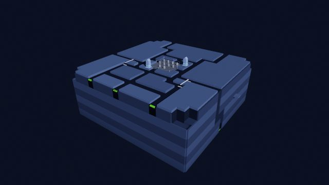</a> | **[Sepulcra's first playthrough over MCP](2026-10-13-sepulcra-s-first-playthrough-over-mcp/entry.json)** (+4): The first whole game of Sepulcra played by a script the way an agent would: the floating slab with its cliff lanes, the centre build, a busy wave, the bone colossus and the end, under a moonlit night. |
| 2026-10-14<br>M2 | <a href="2026-10-14-sepulcra-gets-ssao-bloom-and-grading/01-frame-00006.jpg">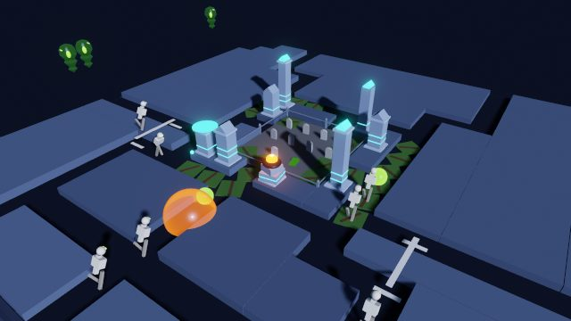</a> | **[Sepulcra gets SSAO, bloom and grading](2026-10-14-sepulcra-gets-ssao-bloom-and-grading/entry.json)** (+2): The post lane's A/B check on the game: the same busy-wave view before and after its SSAO, bloom and grading changes (the difference is too subtle to see at thumbnail size), and a brazier up close with the full stack. |
| 2026-10-15<br>M2 | <a href="2026-10-15-sepulcra-on-the-igpu-with-the-post-stack/01-frame-00006.jpg"></a> | **[Sepulcra on the iGPU with the post stack](2026-10-15-sepulcra-on-the-igpu-with-the-post-stack/entry.json)** (+1): The scripted playthrough on the Intel iGPU after the post lane merged. At this size it looks like the 2026-10-13 run on the discrete GPU: the iGPU draws the same frames. |
| 2026-10-16<br>M2 | <a href="2026-10-16-sepulcra-at-the-m2-exit/01-frame-00002.jpg">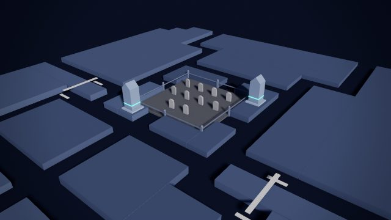</a> | **[Sepulcra at the M2 exit](2026-10-16-sepulcra-at-the-m2-exit/entry.json)** (+2): The scripted playthrough at the M2 exit review. The game looks much as it did on 2026-10-13: M2's later work went into sight, tools and the exit proof rather than the game's look. |
| 2026-10-16<br>M2 | <a href="2026-10-16-finding-sepulcra-s-night/01-frame-00001.jpg">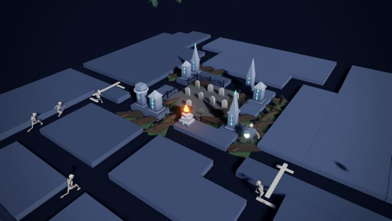</a> | **[Finding Sepulcra's night](2026-10-16-finding-sepulcra-s-night/entry.json)** (+3): Lighting tries made while tuning the night (dim moon, low blue fill, mist). The differences between tries are subtle at thumbnail size. |
| 2026-10-16<br>M2 | <a href="2026-10-16-the-slice-with-its-hud-readable-blue-shadows/01-sepulcra-slice-hud.jpg">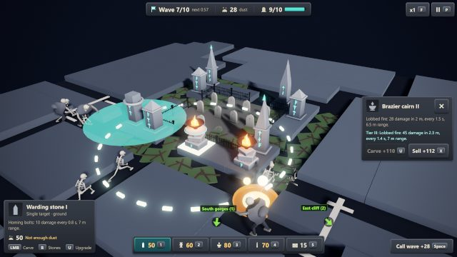</a> | **[The slice with its HUD: readable blue shadows](2026-10-16-the-slice-with-its-hud-readable-blue-shadows/entry.json)**: The fidelity capture of the vertical slice with its HUD: a selected brazier's panel, range ring and path dots. |
| 2026-10-16<br>M2 | <a href="2026-10-16-the-slice-with-its-hud-a-darker-night/01-sepulcra-slice-hud.jpg">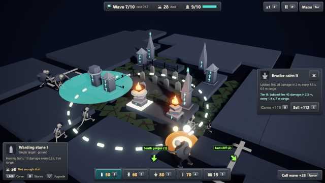</a> | **[The slice with its HUD: a darker night](2026-10-16-the-slice-with-its-hud-a-darker-night/entry.json)**: A dim moon and a low blue fill, so fire and runes carry the scene; retaken on the iGPU. At thumbnail size it looks almost the same as the previous capture; the HUD gains its Menu button. |
| 2026-10-16<br>M2 | <a href="2026-10-16-the-slice-with-its-hud-blue-fill-over-mist/01-sepulcra-slice-hud.jpg">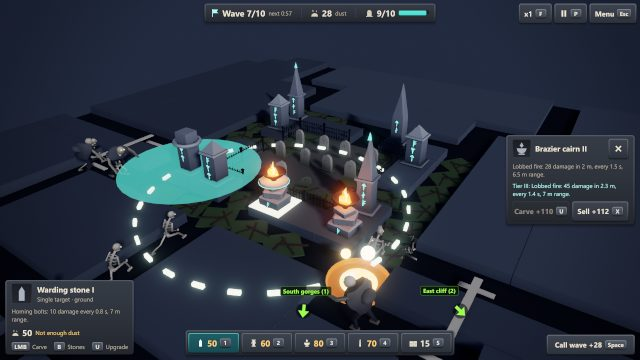</a> | **[The slice with its HUD: blue fill over mist](2026-10-16-the-slice-with-its-hud-blue-fill-over-mist/entry.json)**: The night's light now comes mostly from a blue fill under a dim moon, over blue mist: dark, but shadowed cliffs and their climbers stay readable. This is the capture in docs/fidelity. Again a subtle change at this size. |
| 2026-10-18<br>M3 | <a href="2026-10-18-headless-playtests-leave-captures-too/01-build.jpg">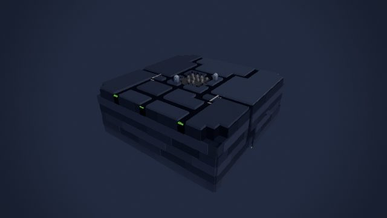</a> | **[Headless playtests leave captures too](2026-10-18-headless-playtests-leave-captures-too/entry.json)** (+2): Playtests as data: a playtest step can capture a frame, so a parallel suite of 26 playtests leaves small frames of each run (build, mid-game, end) next to its verified replay. |
| 2026-10-18<br>M3 | <a href="2026-10-18-sepulcra-played-from-its-lex-rules/01-frame-00003.jpg">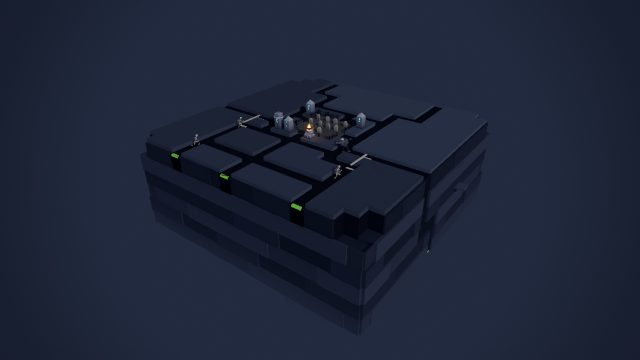</a> | **[Sepulcra played from its Lex rules](2026-10-18-sepulcra-played-from-its-lex-rules/entry.json)** (+2): From the Sepulcra-in-Lex lane, not merged yet: the scripted playthrough with the game's rules running live as Lex data (--rules lex) instead of hand-written Rust. Main has had the Lex slice since d2c04da, matching the hand-written sim tick for tick; live Lex play is that lane's work. |
| 2026-10-18<br>M3 | <a href="2026-10-18-sepulcra-now/01-frame-00001.jpg">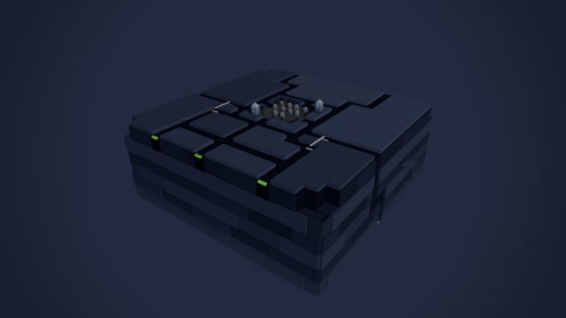</a> | **[Sepulcra now, on the Intel iGPU](2026-10-18-sepulcra-now/entry.json)** (+5): The current reference: main's scripted playthrough on the iGPU (won at tick 21852, replay verified, 0 validation errors). Creatures now run on animation graphs, the selection mark glows cyan, and the night keeps its blue fill. |
| 2026-10-18<br>M3 | <a href="2026-10-18-sepulcra-on-lex-the-hud-and-the-boss-wave/01-frame-00008.jpg">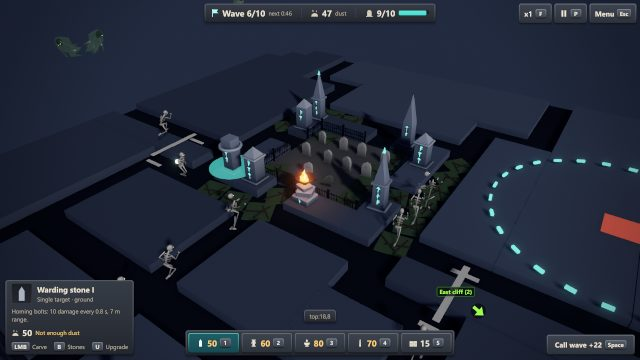</a> | **[Sepulcra on Lex: the HUD and the boss wave](2026-10-18-sepulcra-on-lex-the-hud-and-the-boss-wave/entry.json)** (+1): The --rules lex playthrough on the Intel iGPU after the Lex review rounds: the Lex run decides every command and the outcome, with the hand-written sim checked against it every tick (parity on all 21,852 ticks, won, replay verified). New since the last Lex entry: the HUD over a Lex-ruled game and the wave 10 colossus; the busy wave is unchanged since 2026-10-18-sepulcra-played-from-its-lex-rules. |
| 2026-10-18<br>M3 | <a href="2026-10-18-a-saved-sepulcra-run-loaded-in-a-fresh-engine/01-loaded-world.jpg">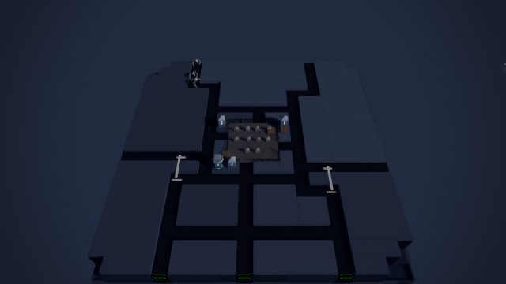</a> | **[A saved Sepulcra run loaded in a fresh engine](2026-10-18-a-saved-sepulcra-run-loaded-in-a-fresh-engine/entry.json)**: Save games: a seed-7 run with physics crates and a module, saved at tick 600 in one engine and loaded in another (save_check.py, headless). The slab, stones, walls and tombstones are adopted from the save's world and the enemies rebuilt from the game's state; desync_compare then matches the saving run on all 900 later ticks. |
| 2026-10-18<br>M3 | <a href="2026-10-18-boss-wave-with-streaming-on/01-frame-00009.jpg">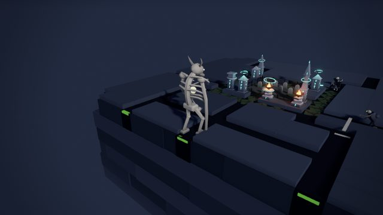</a> | **[Boss wave with streaming on](2026-10-18-boss-wave-with-streaming-on/entry.json)**: The bone colossus in the boss wave, with model streaming on (the default since M3 streaming): transient creatures upload first and captures wait for them; before the integrator's fix this colossus was missing (not resident) from this capture. |

### Interface and text over time

Text, specula-ui and Sepulcra's HUD, menus and screens.

| When | Shown | What changed |
|---|---|---|
| 2026-10-13<br>M2 | <a href="2026-10-13-first-text/01-out.jpg">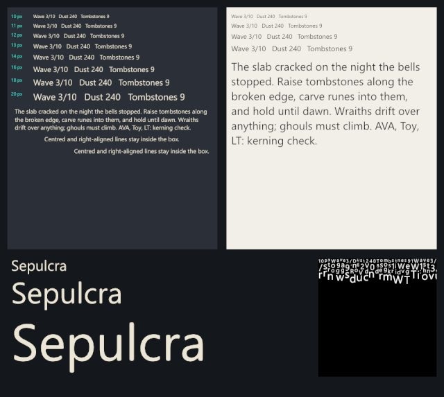</a> | **[First text: the TrueType glyph atlas](2026-10-13-first-text/entry.json)** (+1): specula-text's first output: TrueType fonts rasterised to a glyph atlas and laid out as quads on the CPU, at several sizes, zoomed to check hinting and spacing. |
| 2026-10-13<br>M2 | <a href="2026-10-13-sepulcra-s-hud-and-pause-menu-first-previews/01-sepulcra-hud-preview.jpg">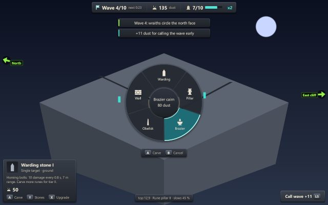</a> | **[Sepulcra's HUD and pause menu: first previews](2026-10-13-sepulcra-s-hud-and-pause-menu-first-previews/entry.json)** (+1): specula-ui's first screens for Sepulcra, rendered by the software rasteriser: the carved-stone theme, HUD, radial build menu and the pause menu, over a stand-in slab. |
| 2026-10-13<br>M2 | <a href="2026-10-13-hud-previews-after-the-first-ui-review/01-sepulcra-hud-preview.jpg">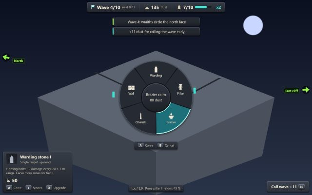</a> | **[HUD previews after the first UI review](2026-10-13-hud-previews-after-the-first-ui-review/entry.json)**: Threat labels rescale, the radial menu gets an opaque base so the world no longer shows through its gaps, scrolling lists draw a scroll bar. Small changes, hard to see at thumbnail size. The pause menu is unchanged since 2026-10-13-sepulcra-s-hud-and-pause-menu-first-previews. |
| 2026-10-13<br>M2 | <a href="2026-10-13-every-sepulcra-screen-desktop-and-phone/01-sepulcra-hud-1920x1080.jpg">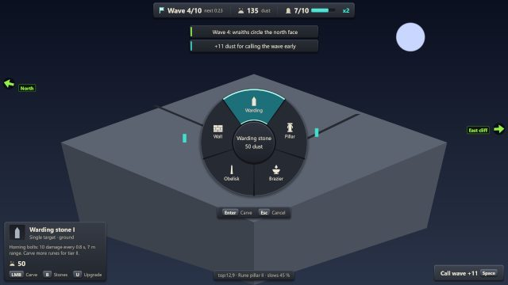</a> | **[Every Sepulcra screen, desktop and phone](2026-10-13-every-sepulcra-screen-desktop-and-phone/entry.json)** (+4): All of Sepulcra's screens at desktop size, plus the HUD laid out for a phone in portrait (foundation F6): HUD, title, settings, victory, and the phone HUD with its radial menu. |
| 2026-10-13<br>M2 | <a href="2026-10-13-hud-previews-in-linear-light/01-sepulcra-hud-preview.jpg"></a> | **[HUD previews in linear light](2026-10-13-hud-previews-in-linear-light/entry.json)** (+1): Blending and gradients move to linear light, as on the GPU, and all colour maths goes through dmath so previews are bit-identical across platforms. Panels read slightly lighter. |
| 2026-10-13<br>M2 | <a href="2026-10-13-the-hud-on-the-gpu-in-the-window/01-hud-window-100-0.jpg">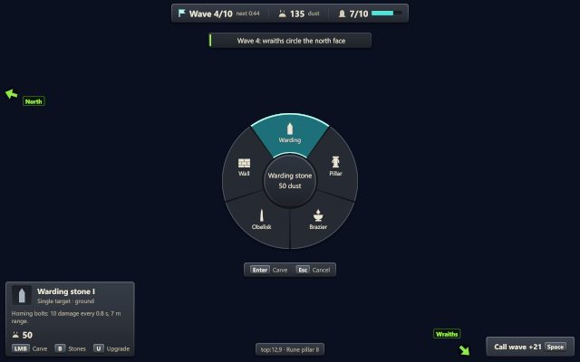</a> | **[The HUD on the GPU, in the window](2026-10-13-the-hud-on-the-gpu-in-the-window/entry.json)** (+2): specula-ui now draws through the GPU overlay in the live window (two runs of the hud_window example, 100 and 280 in their file names; the layout keeps its proportions), and GPU and software renderings of a test screen are compared pixel by pixel. |
| 2026-10-18<br>M3 | <a href="2026-10-18-saved-games/01-menu.jpg">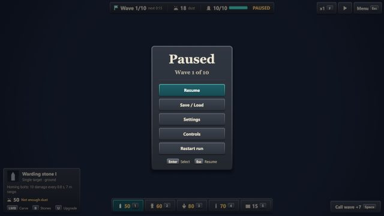</a> | **[Saved games](2026-10-18-saved-games/entry.json)** (+2): From the save-games lane: the pause menu with Save and Load, the saved games list and the overwrite confirmation. |
| 2026-10-18<br>M3 | <a href="2026-10-18-sepulcra-s-saved-games-screen/01-saves.jpg">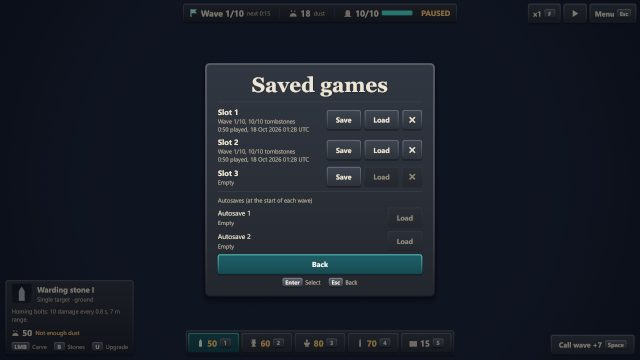</a> | **[Sepulcra's Saved games screen](2026-10-18-sepulcra-s-saved-games-screen/entry.json)** (+1): New: the pause menu's Save / Load screen, with three slots (what each holds, time played, when saved) and two wave-start autosaves; empty slots grey out Load and delete; saving over a slot asks first with No as the default. Captured headless by save_check.py through play_ui after two saves. |

### Creatures and animation over time

Sepulcra's creatures: clips, graphs, contact sheets.

| When | Shown | What changed |
|---|---|---|
| 2026-10-13<br>M2 | <a href="2026-10-13-the-first-animation-filmstrip/01-sepulcra-anim-filmstrip.jpg">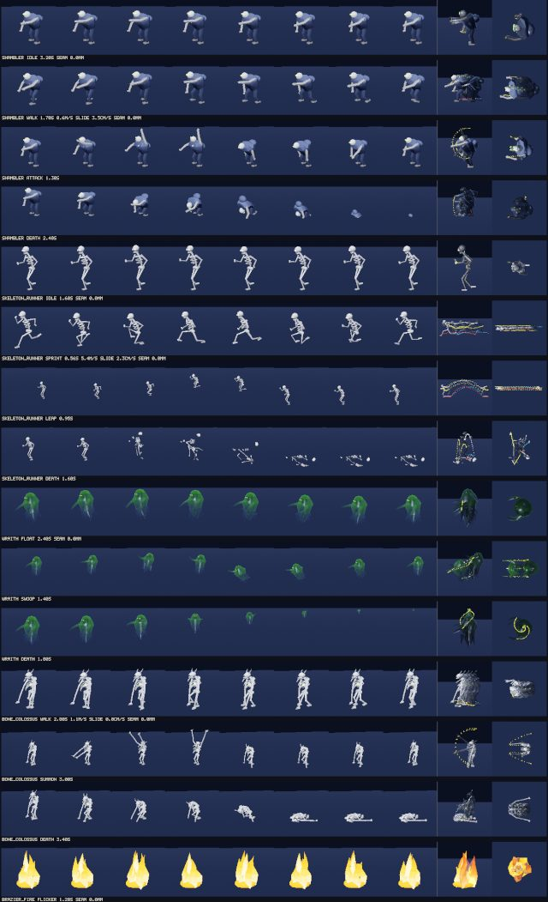</a> | **[The first animation filmstrip](2026-10-13-the-first-animation-filmstrip/entry.json)**: specula-anim's first contact sheet: every Sepulcra creature clip sampled across its cycle, with foot-slide checks. |
| 2026-10-13<br>M2 | <a href="2026-10-13-filmstrip-contact-found/01-sepulcra-anim-filmstrip.jpg">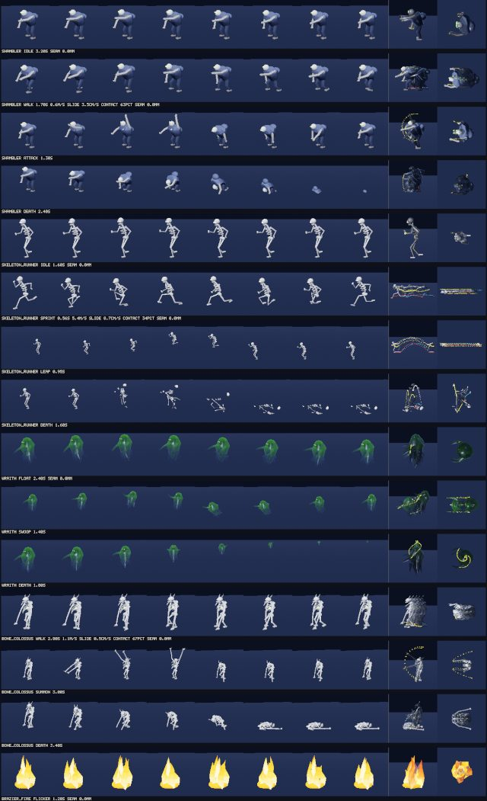</a> | **[Filmstrip: contact found](2026-10-13-filmstrip-contact-found/entry.json)**: The foot-slide check now measures sustained contact against a robust ground height, and the filmstrip can be filtered by clip. |
| 2026-10-13<br>M2 | <a href="2026-10-13-filmstrip-on-the-merged-renderer/01-sepulcra-anim-filmstrip.jpg">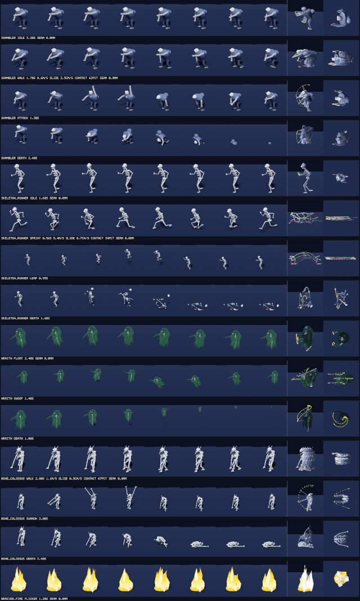</a> | **[Filmstrip on the merged renderer](2026-10-13-filmstrip-on-the-merged-renderer/entry.json)**: After the animation lane's review: the filmstrip renders with real vertex colours, moon shadows in each tile and bone-tip trails. |
| 2026-10-15<br>M2 | <a href="2026-10-15-gpu-skinning-the-creatures-in-3d/01-frame-00001.jpg">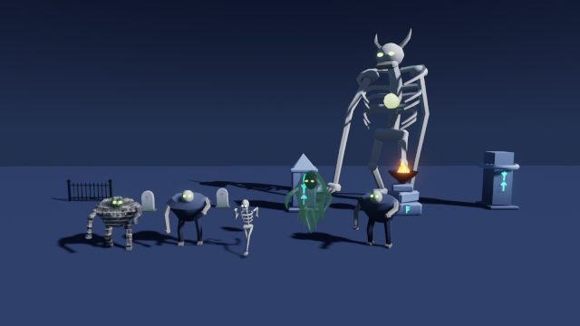</a> | **[GPU skinning: the creatures in 3D](2026-10-15-gpu-skinning-the-creatures-in-3d/entry.json)** (+2): Sepulcra's creatures skinned on the GPU and lit in a scene: the lineup (the bone colossus is the horned giant at the back), a shambler up close, and a crowd of 300 animated creatures for the skinning budget. |
| 2026-10-18<br>M3 | <a href="2026-10-18-animation-a3-graphs-ik-and-motion-checks/01-frame-00001.jpg">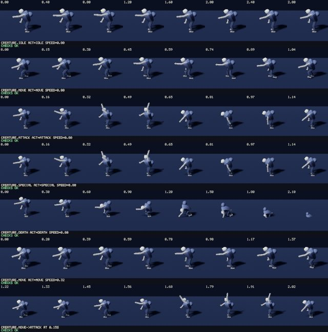</a> | **[Animation A3: graphs, IK and motion checks](2026-10-18-animation-a3-graphs-ik-and-motion-checks/entry.json)** (+3): From the A3 lane: per-creature contact sheets of clips, graph states and transitions with the motion checks attached, a live creature with its feet on the slab, and the new walk cycles side by side. |
| 2026-10-18<br>M3 | <a href="2026-10-18-creatures-now/01-frame-00001.jpg">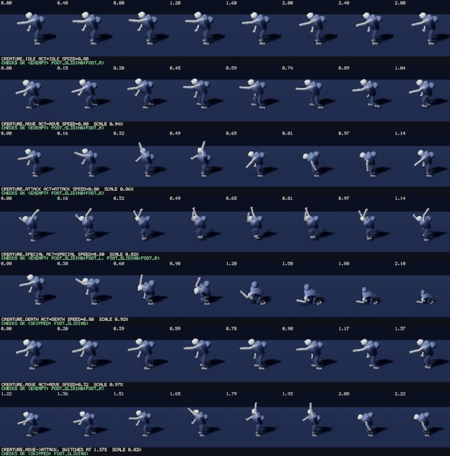</a> | **[Creatures now: graph contact sheets](2026-10-18-creatures-now/entry.json)** (+3): Main's animation check on the iGPU: every creature's clips and graph states pass style.toml's motion rules (some rows with the exemptions and skips style.toml allows, labelled on the sheets); a live shambler's graph state, and the step test with the feet IK on a raised step. |

### Procedural 3D assets over time

Recipes built by specula-model, from first shapes to tiers.

| When | Shown | What changed |
|---|---|---|
| 2026-10-13<br>M2 | <a href="2026-10-13-sepulcra-tier-1-assets-the-first-contact-sheet/01-sepulcra-t1-contact.jpg"></a> | **[Sepulcra tier-1 assets: the first contact sheet](2026-10-13-sepulcra-tier-1-assets-the-first-contact-sheet/entry.json)**: The first procedural assets from specula-model recipes: the four stones (tiers I-III), wall, tombstone, fence, the four creatures, brazier fire, a slab cliff chunk and rune parts, each as silhouette, turntable and game-distance views. |
| 2026-10-13<br>M2 | <a href="2026-10-13-tier-1-assets-after-the-first-review/01-sepulcra-t1-contact.jpg">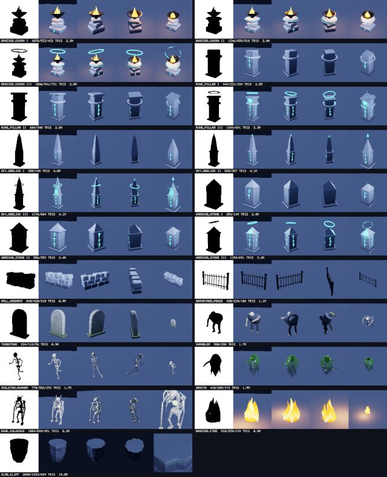</a> | **[Tier-1 assets after the first review](2026-10-13-tier-1-assets-after-the-first-review/entry.json)**: From an adversarial look at the sheet: the tier II brazier gets a wider capstone and a glowing rune band, the obelisk keeps its glowing tip at LOD, the boss ribcage is larger with a deeper green heart, enemy eyes are bigger. |
| 2026-10-13<br>M2 | <a href="2026-10-13-tier-1-assets-after-the-model-lane-review/01-sepulcra-t1-contact.jpg">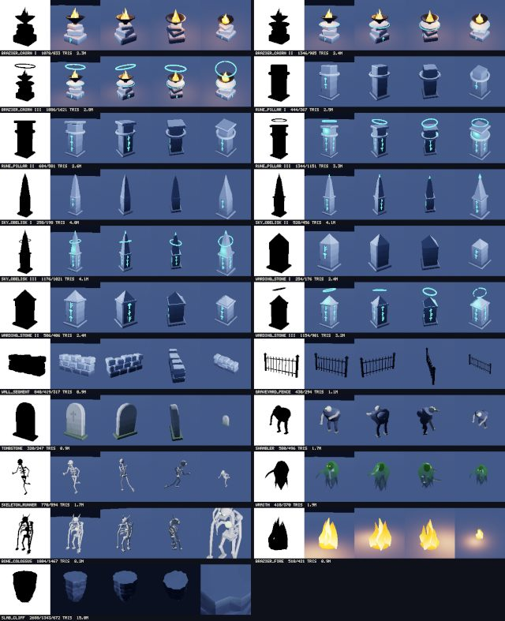</a> | **[Tier-1 assets after the model lane review](2026-10-13-tier-1-assets-after-the-model-lane-review/entry.json)**: Hostile recipes now fail cleanly and LODs are honest (no part vanishes, bounds and volume hold); the sheet is re-rendered with reverse-Z. Visually close to the previous version. |
| 2026-10-13<br>M2 | <a href="2026-10-13-the-first-model-gallery/01-frame-00001.jpg">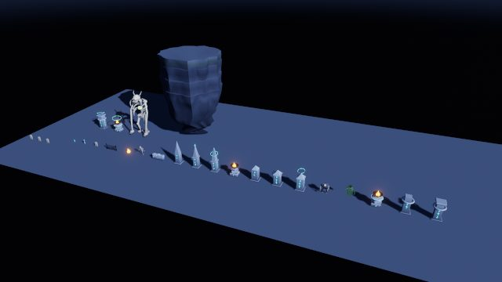</a> | **[The first model gallery](2026-10-13-the-first-model-gallery/entry.json)** (+1): Every Sepulcra recipe built by the engine (model_build) and spawned as model entities in a moonlit scene, captured with sight_frame: the whole lineup and a closer look at the stones. |
| 2026-10-18<br>M3 | <a href="2026-10-18-model-gallery-now/02-frame-00003.jpg">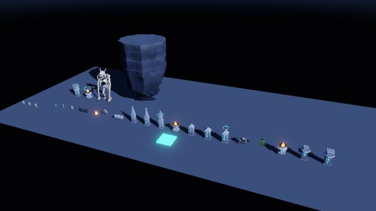</a> | **[The model gallery now](2026-10-18-model-gallery-now/entry.json)**: Main's model gallery with a ui marker in view. The recipe row and the stones up close are unchanged since 2026-10-13-the-first-model-gallery. |

### Lava lamps over time

The fidelity benchmark: three lamps from basic to as real as possible.

| When | Shown | What changed |
|---|---|---|
| 2026-10-13<br>M1 | <a href="2026-10-13-lava-lamps-the-original-benchmark/01-frame-00001.jpg">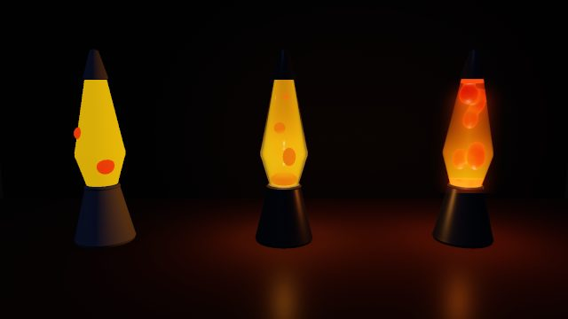</a> | **[Lava lamps: the original benchmark](2026-10-13-lava-lamps-the-original-benchmark/entry.json)** (+3): The owner's first asset challenge: three lamps from basic to as real as possible. L1 is opaque lathe shapes with glowing colour, L2 adds a metal base, a glass shell over tinted liquid and a point light, L3 is a ray-marched lava material with refraction and merging wax. The first frame (all three lamps) is byte-identical to docs/fidelity/lava_lamps_m0_original.png. |
| 2026-10-13<br>M2 | <a href="2026-10-13-lava-lamps-with-real-bloom-and-fxaa/01-lava-lamps-m2-bloom.jpg">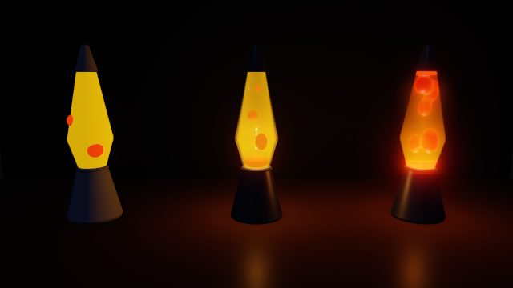</a> | **[Lava lamps with real bloom and FXAA](2026-10-13-lava-lamps-with-real-bloom-and-fxaa/entry.json)**: The same three lamps on the M2 renderer: real bloom and FXAA instead of the original's hand-made glow. The --plain run still reproduced the original frames pixel for pixel on both GPUs. |
| 2026-10-18<br>M3 | <a href="2026-10-18-lava-lamps-now/02-l3-t30.jpg">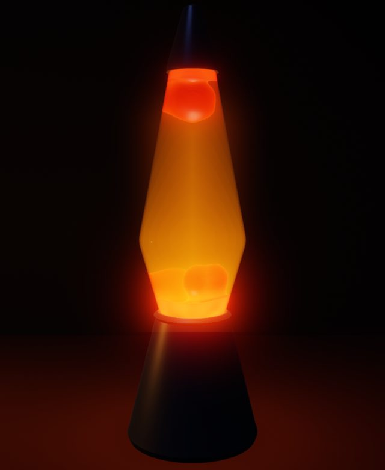</a> | **[Lava lamps now](2026-10-18-lava-lamps-now/entry.json)**: The benchmark on main on the iGPU. The overviews are unchanged since 2026-10-13-lava-lamps-with-real-bloom-and-fxaa (effects) and 2026-10-13-lava-lamps-the-original-benchmark (--plain), though the plain frames no longer match the originals byte for byte; L3 with effects is shown. |

### Engine test scenes over time

Window checks, GPU test renders, sight checks and exit proofs.

| When | Shown | What changed |
|---|---|---|
| 2026-10-12<br>M0 | <a href="2026-10-12-the-first-frame-an-agent-saw/01-frame-00001.jpg">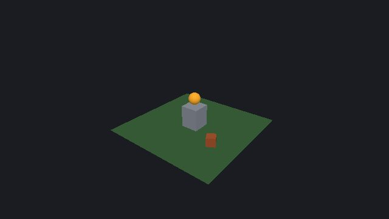</a> | **[The first frame an agent saw](2026-10-12-the-first-frame-an-agent-saw/entry.json)**: Specula's first sight_frame, from the M0 window check: a grey pillar topped with an orange sphere and a small rust-red cube on a green ground plate, flat shaded by the new runtime-loaded Vulkan renderer. Everything later in this gallery grew from this. |
| 2026-10-13<br>M1 | <a href="2026-10-13-window-check-and-the-gpu-test-cube/02-window-adapter0-restored.jpg"></a> | **[Window check and the GPU test cube](2026-10-13-window-check-and-the-gpu-test-cube/entry.json)** (+2): The window check now screenshots the real window on both GPUs, resizing, minimising and restoring it, and specula-gpu's headless test renders its lit cube on each adapter. The scene at its first size is unchanged since 2026-10-12-the-first-frame-an-agent-saw, so only the resized window is shown. |
| 2026-10-13<br>M1 | <a href="2026-10-13-point-lights-materials-and-instancing/01-crop-lights-wall.jpg"></a> | **[Point lights, materials and instancing](2026-10-13-point-lights-materials-and-instancing/entry.json)** (+2): Early renderer tests from the lava-lamp and GPU lanes: coloured point lights on PBR-lite spheres and a wall, mixed materials up close, and a grid of instanced cubes with a colour per instance. |
| 2026-10-13<br>M2 | <a href="2026-10-13-the-render-lane-shadows-bloom-fog-sky-and-overla/01-features-shadows-nvidia-geforce-rtx-4090-laptop.jpg">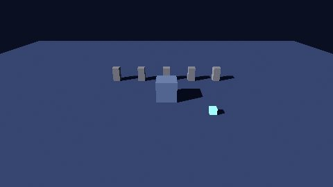</a> | **[The render lane: shadows, bloom, fog, sky and overlay](2026-10-13-the-render-lane-shadows-bloom-fog-sky-and-overla/entry.json)** (+5): specula-gpu's feature tests as the M2 render lane added them, on a small test stage: shadow maps, bloom, fog with a sky, a moon, and the debug overlay; last, everything at once at 1280x720. |
| 2026-10-13<br>M2 | <a href="2026-10-13-window-check-on-the-new-renderer/01-window-adapter0-initial.jpg"></a> | **[Window check on the new renderer](2026-10-13-window-check-on-the-new-renderer/entry.json)** (+1): After the render lane merged, the window check's scene gains a field of a few hundred small instanced spheres around the pillar (instancing and culling), drawn in the real window. |
| 2026-10-13<br>M2 | <a href="2026-10-13-sound-seen-the-audio-sheet/01-sound-sheet.jpg">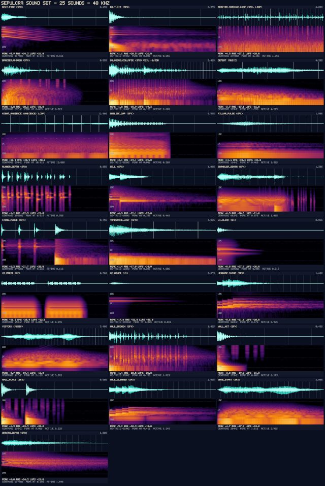</a> | **[Sound, seen: the audio sheet](2026-10-13-sound-seen-the-audio-sheet/entry.json)**: specula-audio's procedural sounds drawn as waveforms and spectrograms, so an agent can check sound as an image. |
| 2026-10-14<br>M2 | <a href="2026-10-14-performance-scenes/01-game.jpg">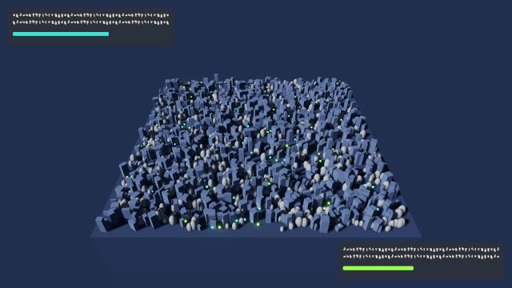</a> | **[Performance scenes](2026-10-14-performance-scenes/entry.json)** (+3): The scenes perf_baseline measures: a game-like crowd of blocks and creatures with its HUD bars, 10,000 cubes, 1,000 mixed objects and 16 coloured point lights. |
| 2026-10-14<br>M2 | <a href="2026-10-14-sight-check-what-the-agent-s-eyes-report/01-frame-reviewer-through-overview.jpg">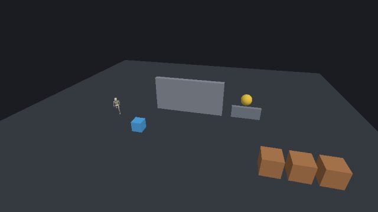</a> | **[Sight check: what the agent's eyes report](2026-10-14-sight-check-what-the-agent-s-eyes-report/entry.json)** (+3): The sight lane's check scene: a skeleton runner in the open, a wall hiding a box (which must report visible_px 0), captured from a named camera, as an 8-view turntable with bounds and bone overlays (sight_orbit), and as a before/after comparison strip (sight_compare). |
| 2026-10-16<br>M2 | <a href="2026-10-16-m2-exit-the-first-hero-shot/01-m2-exit-hero.jpg">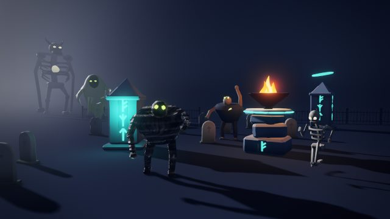</a> | **[M2 exit: the first hero shot](2026-10-16-m2-exit-the-first-hero-shot/entry.json)**: The M2 exit proof's scene: a moonlit Sepulcra graveyard with recipe props, imported GLBs and animated creatures. |
| 2026-10-16<br>M2 | <a href="2026-10-16-m2-exit-hero-rune-pillar-in-view/01-m2-exit-hero.jpg">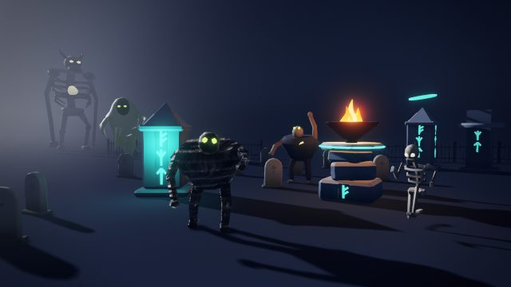</a> | **[M2 exit hero: rune pillar in view](2026-10-16-m2-exit-hero-rune-pillar-in-view/entry.json)**: Skeptic follow-ups: the rune pillar is brought into view and the shadow probes move off a shadow edge. |
| 2026-10-16<br>M2 | <a href="2026-10-16-m2-exit-hero-from-the-final-igpu-run/01-m2-exit-hero.jpg">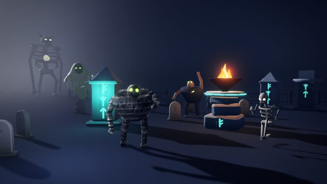</a> | **[M2 exit hero from the final iGPU run](2026-10-16-m2-exit-hero-from-the-final-igpu-run/entry.json)**: The hero shot retaken from the final run on the Intel iGPU, the reference device. |
| 2026-10-16<br>M2 | <a href="2026-10-16-m2-exit-proof-10-000-instances-and-a-hidden-obje/01-frame-00001.jpg">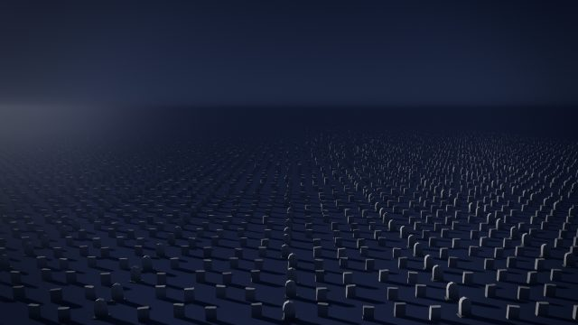</a> | **[M2 exit proof: 10,000 instances and a hidden object](2026-10-16-m2-exit-proof-10-000-instances-and-a-hidden-obje/entry.json)** (+1): Other frames from the exit run on the iGPU: a fogged field of 10,000 instanced entities in the window with the full night effect stack, and the hidden-object check (a box behind a wall reports visible_px 0). |
| 2026-10-17<br>Pre-M3 | <a href="2026-10-17-pre-m3-cleanup-the-sky-eases-into-the-horizon/02-features-sky-horizon-0.jpg"></a> | **[Pre-M3 cleanup: the sky eases into the horizon](2026-10-17-pre-m3-cleanup-the-sky-eases-into-the-horizon/entry.json)**: GPU feature tests after the pre-M3 cleanup: the sky now eases into the horizon instead of meeting it with a crisp line, as the horizon test shows. The everything-on scene is unchanged since 2026-10-13-the-render-lane-shadows-bloom-fog-sky-and-overla. |
| 2026-10-18<br>M3 | <a href="2026-10-18-a-hot-reloaded-game-module/01-frame-00001.jpg">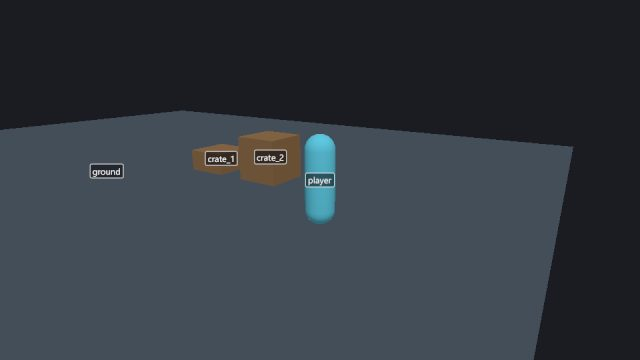</a> | **[A hot-reloaded game module](2026-10-18-a-hot-reloaded-game-module/entry.json)**: The module host's example game, Ambulo: game logic in a Rust cdylib, rebuilt and reloaded into the running engine in about a second. |
| 2026-10-18<br>M3 | <a href="2026-10-18-streaming-a-large-graveyard-field/01-frame-00001.jpg">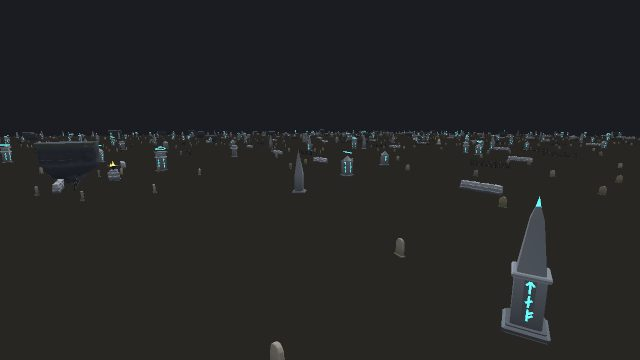</a> | **[Streaming: a large graveyard field](2026-10-18-streaming-a-large-graveyard-field/entry.json)** (+2): From the streaming and HLOD lane: a field of thousands of graves streamed in around the camera, and a strip of a comparison strip. |
| 2026-10-18<br>M3 | <a href="2026-10-18-window-check-now/02-window-adapter1-restored.jpg">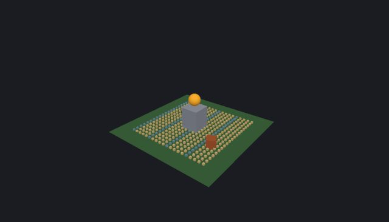</a> | **[Window check now](2026-10-18-window-check-now/entry.json)**: Main's window check on both GPUs: clean on each (0 validation messages), resized, minimised and restored. Unchanged since 2026-10-13-window-check-on-the-new-renderer: it is a regression check, so it should stay the same. |
| 2026-10-18<br>M3 | <a href="2026-10-18-sepulcra-s-rules-live-in-the-engine-lex-live/01-frame-00001.jpg">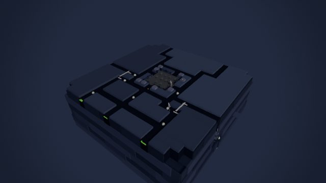</a> | **[Sepulcra's rules live in the engine (lex_live)](2026-10-18-sepulcra-s-rules-live-in-the-engine-lex-live/entry.json)**: The Sepulcra rule set run live by the engine with no hosted game (lex_live): the engine steps it on its own tick and presents its entities as world entities under /lex_live/sepulcra (here with the default present rules on the slab model), driven by agents' commands through tools alone. Mid-game at Lex tick 9017; the run won at tick 21852 like lex_simulate, and its journal replays headless to the same hash. |
| 2026-10-18<br>M3 | <a href="2026-10-18-streaming-and-hlod-proof-world/01-frame-00001.jpg">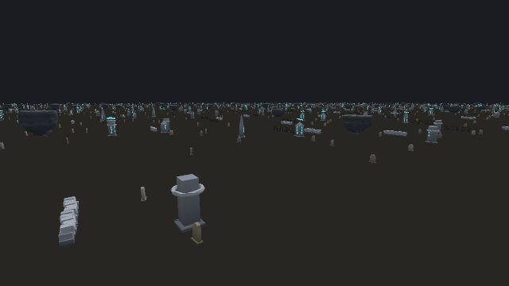</a> | **[Streaming and HLOD proof world](2026-10-18-streaming-and-hlod-proof-world/entry.json)** (+2): First entry for streaming: a 24 x 24-cell world of 8,316 procedural models under a 128 MB budget on the Intel iGPU (stream_check.py). Near view fully resident; far view drawn through 579 merged HLOD cell proxies; HLOD on vs off differ in 0 pixels at 2,573 vs 7,350 draw calls. |

### 2D over time

Sprites, tilemaps and vector shapes.

| When | Shown | What changed |
|---|---|---|
| 2026-10-15<br>M2 | <a href="2026-10-15-2d-tilemaps-sprites-and-an-isometric-scene/01-frame-00001.jpg">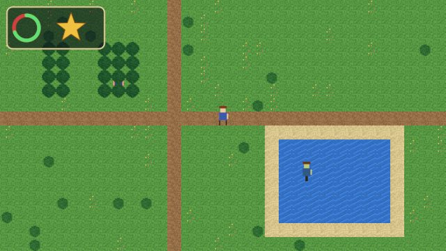</a> | **[2D: tilemaps, sprites and an isometric scene](2026-10-15-2d-tilemaps-sprites-and-an-isometric-scene/entry.json)** (+2): two_d_check's scenes: a top-down tilemap with a pond and paths, and a patch of tree sprites and a road, seen in perspective and under an orthographic isometric camera. |

### Physics over time

specula-physics scenes with their collider and contact overlays.

| When | Shown | What changed |
|---|---|---|
| 2026-10-18<br>M3 | <a href="2026-10-18-physics-p1-p3-the-first-physics-check/01-frame-00001.jpg">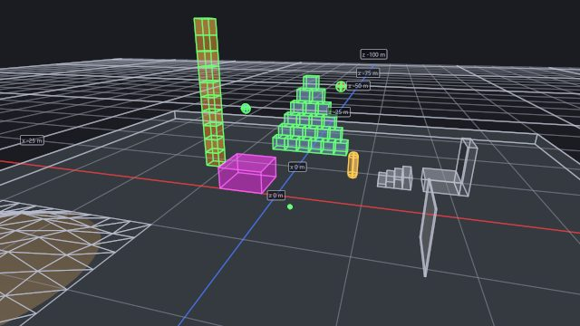</a> | **[Physics P1-P3: the first physics check](2026-10-18-physics-p1-p3-the-first-physics-check/entry.json)** (+3): specula-physics' check scene with the collider and contact overlays: a tower of boxes, a pyramid, a bouncing ball, a fast sphere against a thin wall, a ramp and stairs for the character, a heightfield mound and a hull rock. |
| 2026-10-18<br>M3 | <a href="2026-10-18-physics-now/01-run0-start.jpg"></a> | **[Physics now, on the Intel iGPU](2026-10-18-physics-now/entry.json)**: Main's physics check on the iGPU: two runs end in the same world and physics hashes. Unchanged since 2026-10-18-physics-p1-p3-the-first-physics-check (which ran on the discrete GPU), so one frame is enough. |
| 2026-10-18<br>M3 | <a href="2026-10-18-ragdolls-the-shambler-falls-and-gets-up/01-run0-joints-start.jpg">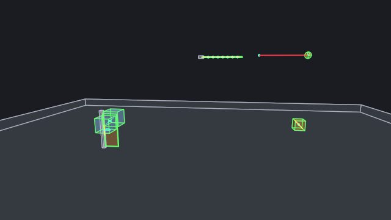</a> | **[Ragdolls: the shambler falls and gets up](2026-10-18-ragdolls-the-shambler-falls-and-gets-up/entry.json)** (+5): From the ragdoll lane: the joint test, then the shambler as a ragdoll built from joints: standing, gone limp (with the joint overlay), held up by powered joints, and getting back up. |

### Navigation over time

Navmeshes, paths and agents.

| When | Shown | What changed |
|---|---|---|
| 2026-10-18<br>M3 | <a href="2026-10-18-the-first-navmesh/01-frame-00001.jpg"></a> | **[The first navmesh](2026-10-18-the-first-navmesh/entry.json)** (+1): From the navigation lane: a navmesh baked over a test level, with paths and agents drawn as overlays, from above and in perspective. |
| 2026-10-18<br>M3 | <a href="2026-10-18-navigation-on-sepulcra-s-slab/01-slab-top.jpg"></a> | **[Navigation on Sepulcra's slab](2026-10-18-navigation-on-sepulcra-s-slab/entry.json)** (+2): The navmesh baked over Sepulcra's slab and cliff lanes, from above and in perspective. |

### Before Specula: the Bevy era

Grok-Bevy, the tooling Specula grew out of.

| When | Shown | What changed |
|---|---|---|
| 2026-07-25<br>Bevy era (0.2.x) | <a href="2026-07-25-grok-bevy-crystal-drift-under-agent-control/01-crystal-drift-mcp-loop.jpg"></a> | **[Grok-Bevy: Crystal Drift under agent control](2026-07-25-grok-bevy-crystal-drift-under-agent-control/entry.json)** (+1): Before Specula was its own engine: Grok-Bevy drove a Bevy game (Crystal Drift) through Bevy's remote protocol over MCP. Left: the query, mutate and screenshot loop an agent ran; right: the game it captured, flat shapes on grey. |

## Newest first

### Streaming and HLOD proof world

*2026-10-18 13:05 (run id)* · M3 · performance · integrated GPU · from `scripts/stream_check.py` · [entry](2026-10-18-streaming-and-hlod-proof-world/entry.json)

First entry for streaming: a 24 x 24-cell world of 8,316 procedural models under a 128 MB budget on the Intel iGPU (stream_check.py). Near view fully resident; far view drawn through 579 merged HLOD cell proxies; HLOD on vs off differ in 0 pixels at 2,573 vs 7,350 draw calls.

<p>
<a href="2026-10-18-streaming-and-hlod-proof-world/01-frame-00001.jpg"></a>
<a href="2026-10-18-streaming-and-hlod-proof-world/02-frame-00003.jpg"></a>
<a href="2026-10-18-streaming-and-hlod-proof-world/03-frame-00005.jpg"></a>
</p>

<sub>1. Near view: everything it shows waited for and resident 2. Far view: 579 cells drawn as HLOD proxies (7,137 entities merged) 3. HLOD on \| off \| difference: 0 pixels over threshold (no popping)</sub>

### Boss wave with streaming on

*2026-10-18 13:04 (run id)* · M3 · game · integrated GPU · from `scripts/sepulcra_play.py` · [entry](2026-10-18-boss-wave-with-streaming-on/entry.json)

The bone colossus in the boss wave, with model streaming on (the default since M3 streaming): transient creatures upload first and captures wait for them; before the integrator's fix this colossus was missing (not resident) from this capture.

<p>
<a href="2026-10-18-boss-wave-with-streaming-on/01-frame-00009.jpg"></a>
</p>

<sub>1. Boss wave: the colossus 19 m away, drawn (12.5k pixels)</sub>

### Sepulcra's rules live in the engine (lex_live)

*2026-10-18 12:29 (run id)* · M3 · engine test · integrated GPU · from `scripts/sepulcra_lex_tools.py` · [entry](2026-10-18-sepulcra-s-rules-live-in-the-engine-lex-live/entry.json)

The Sepulcra rule set run live by the engine with no hosted game (lex_live): the engine steps it on its own tick and presents its entities as world entities under /lex_live/sepulcra (here with the default present rules on the slab model), driven by agents' commands through tools alone. Mid-game at Lex tick 9017; the run won at tick 21852 like lex_simulate, and its journal replays headless to the same hash.

<p>
<a href="2026-10-18-sepulcra-s-rules-live-in-the-engine-lex-live/01-frame-00001.jpg"></a>
</p>

<sub>1. Lex tick 9017: enemies and stones shown from the live run</sub>

### Sepulcra's Saved games screen

*2026-10-18 12:28 (run id)* · M3 · UI · commit `db6359b` · from `scripts/save_check.py` · [entry](2026-10-18-sepulcra-s-saved-games-screen/entry.json)

New: the pause menu's Save / Load screen, with three slots (what each holds, time played, when saved) and two wave-start autosaves; empty slots grey out Load and delete; saving over a slot asks first with No as the default. Captured headless by save_check.py through play_ui after two saves.

<p>
<a href="2026-10-18-sepulcra-s-saved-games-screen/01-saves.jpg"></a>
<a href="2026-10-18-sepulcra-s-saved-games-screen/02-confirm-overwrite.jpg"></a>
</p>

<sub>1. Saved games: two slots saved, one empty, autosaves empty 2. Saving over slot 1 asks first</sub>

### A saved Sepulcra run loaded in a fresh engine

*2026-10-18 12:28 (run id)* · M3 · game · commit `db6359b` · from `scripts/save_check.py` · [entry](2026-10-18-a-saved-sepulcra-run-loaded-in-a-fresh-engine/entry.json)

Save games: a seed-7 run with physics crates and a module, saved at tick 600 in one engine and loaded in another (save_check.py, headless). The slab, stones, walls and tombstones are adopted from the save's world and the enemies rebuilt from the game's state; desync_compare then matches the saving run on all 900 later ticks.

<p>
<a href="2026-10-18-a-saved-sepulcra-run-loaded-in-a-fresh-engine/01-loaded-world.jpg"></a>
</p>

<sub>1. The loaded run, from above</sub>

### Sepulcra on Lex: the HUD and the boss wave

*2026-10-18 11:47 (run id)* · M3 · game · integrated GPU · from `scripts/sepulcra_play.py` · [entry](2026-10-18-sepulcra-on-lex-the-hud-and-the-boss-wave/entry.json)

The --rules lex playthrough on the Intel iGPU after the Lex review rounds: the Lex run decides every command and the outcome, with the hand-written sim checked against it every tick (parity on all 21,852 ticks, won, replay verified). New since the last Lex entry: the HUD over a Lex-ruled game and the wave 10 colossus; the busy wave is unchanged since 2026-10-18-sepulcra-played-from-its-lex-rules.

<p>
<a href="2026-10-18-sepulcra-on-lex-the-hud-and-the-boss-wave/01-frame-00008.jpg"></a>
<a href="2026-10-18-sepulcra-on-lex-the-hud-and-the-boss-wave/02-frame-00009.jpg"></a>
</p>

<sub>1. Wave 6 with the HUD (Lex decides the refusals: Not enough dust) 2. The wave 10 colossus climbs the slab</sub>

### Ragdolls: the shambler falls and gets up

*2026-10-18 10:20 (file time)* · M3 · physics · from `joints check (ragdoll lane)` · [entry](2026-10-18-ragdolls-the-shambler-falls-and-gets-up/entry.json)

From the ragdoll lane: the joint test, then the shambler as a ragdoll built from joints: standing, gone limp (with the joint overlay), held up by powered joints, and getting back up.

<p>
<a href="2026-10-18-ragdolls-the-shambler-falls-and-gets-up/01-run0-joints-start.jpg"></a>
<a href="2026-10-18-ragdolls-the-shambler-falls-and-gets-up/02-ragdoll-limp-001.jpg"></a>
<a href="2026-10-18-ragdolls-the-shambler-falls-and-gets-up/03-ragdoll-limp-075.jpg"></a>
<a href="2026-10-18-ragdolls-the-shambler-falls-and-gets-up/04-ragdoll-powered-040.jpg"></a>
<a href="2026-10-18-ragdolls-the-shambler-falls-and-gets-up/05-ragdoll-getup-001.jpg"></a>
<a href="2026-10-18-ragdolls-the-shambler-falls-and-gets-up/06-ragdoll-getup-024.jpg"></a>
</p>

<sub>1. Joint test 2. Standing 3. Limp, joints overlay 4. Powered joints 5. Down 6. Getting up</sub>

### Navigation on Sepulcra's slab

*2026-10-18 10:16 (run id)* · M3 · navigation · from `nav check (navigation lane)` · [entry](2026-10-18-navigation-on-sepulcra-s-slab/entry.json)

The navmesh baked over Sepulcra's slab and cliff lanes, from above and in perspective.

<p>
<a href="2026-10-18-navigation-on-sepulcra-s-slab/01-slab-top.jpg"></a>
<a href="2026-10-18-navigation-on-sepulcra-s-slab/02-slab-perspective.jpg"></a>
<a href="2026-10-18-navigation-on-sepulcra-s-slab/03-features-link.jpg"></a>
</p>

<sub>1. From above 2. Perspective 3. Test level: an off-mesh link</sub>

### Saved games

*2026-10-18 10:06 (file time)* · M3 · UI · from `save check (save-games lane)` · [entry](2026-10-18-saved-games/entry.json)

From the save-games lane: the pause menu with Save and Load, the saved games list and the overwrite confirmation.

<p>
<a href="2026-10-18-saved-games/01-menu.jpg"></a>
<a href="2026-10-18-saved-games/02-saves.jpg"></a>
<a href="2026-10-18-saved-games/03-confirm-overwrite.jpg"></a>
</p>

<sub>1. Pause menu 2. Saved games 3. Confirm overwrite</sub>

### Creatures now: graph contact sheets

*2026-10-18 10:02 (run id)* · M3 · animation · integrated GPU · commit `ee02487` · from `scripts/anim_graph_check.py` · [entry](2026-10-18-creatures-now/entry.json)

Main's animation check on the iGPU: every creature's clips and graph states pass style.toml's motion rules (some rows with the exemptions and skips style.toml allows, labelled on the sheets); a live shambler's graph state, and the step test with the feet IK on a raised step.

<p>
<a href="2026-10-18-creatures-now/01-frame-00001.jpg"></a>
<a href="2026-10-18-creatures-now/02-frame-00004.jpg"></a>
<a href="2026-10-18-creatures-now/03-frame-00006.jpg"></a>
<a href="2026-10-18-creatures-now/04-frame-00007.jpg"></a>
</p>

<sub>1. Shambler 2. Bone colossus 3. Live shambler 4. Step test</sub>

### Lava lamps now

*2026-10-18 10:01 (file time)* · M3 · effects · integrated GPU · commit `ee02487` · from `scripts/lava_lamps.py` · [entry](2026-10-18-lava-lamps-now/entry.json)

The benchmark on main on the iGPU. The overviews are unchanged since 2026-10-13-lava-lamps-with-real-bloom-and-fxaa (effects) and 2026-10-13-lava-lamps-the-original-benchmark (--plain), though the plain frames no longer match the originals byte for byte; L3 with effects is shown.

<p>
<a href="2026-10-18-lava-lamps-now/02-l3-t30.jpg"></a>
</p>

<sub>1. L3, effects</sub>

### The model gallery now

*2026-10-18 10:00 (run id)* · M3 · 3D asset · commit `ee02487` · from `scripts/model_gallery.py` · [entry](2026-10-18-model-gallery-now/entry.json)

Main's model gallery with a ui marker in view. The recipe row and the stones up close are unchanged since 2026-10-13-the-first-model-gallery.

<p>
<a href="2026-10-18-model-gallery-now/02-frame-00003.jpg"></a>
</p>

<sub>1. With a ui marker</sub>

### Physics now, on the Intel iGPU

*2026-10-18 09:59 (run id)* · M3 · physics · integrated GPU · commit `ee02487` · from `scripts/physics_check.py` · [entry](2026-10-18-physics-now/entry.json)

Main's physics check on the iGPU: two runs end in the same world and physics hashes. Unchanged since 2026-10-18-physics-p1-p3-the-first-physics-check (which ran on the discrete GPU), so one frame is enough.

<p>
<a href="2026-10-18-physics-now/01-run0-start.jpg"></a>
</p>

<sub>1. Start</sub>

### Sepulcra now, on the Intel iGPU

*2026-10-18 09:58 (run id)* · M3 · game · integrated GPU · commit `ee02487` · from `scripts/sepulcra_play.py` · [entry](2026-10-18-sepulcra-now/entry.json)

The current reference: main's scripted playthrough on the iGPU (won at tick 21852, replay verified, 0 validation errors). Creatures now run on animation graphs, the selection mark glows cyan, and the night keeps its blue fill.

<p>
<a href="2026-10-18-sepulcra-now/01-frame-00001.jpg"></a>
<a href="2026-10-18-sepulcra-now/02-frame-00002.jpg"></a>
<a href="2026-10-18-sepulcra-now/03-frame-00006.jpg"></a>
<a href="2026-10-18-sepulcra-now/04-frame-00008.jpg"></a>
<a href="2026-10-18-sepulcra-now/05-frame-00009.jpg"></a>
<a href="2026-10-18-sepulcra-now/06-frame-00011.jpg"></a>
</p>

<sub>1. Build phase 2. Build, close up 3. Busy wave 4. Busy wave with the HUD 5. Boss wave 6. The end</sub>

### Window check now

*2026-10-18 09:57 (run id)* · M3 · engine test · both · commit `ee02487` · from `scripts/window_check.py` · [entry](2026-10-18-window-check-now/entry.json)

Main's window check on both GPUs: clean on each (0 validation messages), resized, minimised and restored. Unchanged since 2026-10-13-window-check-on-the-new-renderer: it is a regression check, so it should stay the same.

<p>
<a href="2026-10-18-window-check-now/02-window-adapter1-restored.jpg"></a>
</p>

<sub>1. NVIDIA after resize</sub>

### The first navmesh

*2026-10-18 07:29 (run id)* · M3 · navigation · commit `553b3ba` · from `nav check (navigation lane)` · [entry](2026-10-18-the-first-navmesh/entry.json)

From the navigation lane: a navmesh baked over a test level, with paths and agents drawn as overlays, from above and in perspective.

<p>
<a href="2026-10-18-the-first-navmesh/01-frame-00001.jpg"></a>
<a href="2026-10-18-the-first-navmesh/02-frame-00002.jpg"></a>
</p>

<sub>1. From above 2. Perspective</sub>

### Sepulcra played from its Lex rules

*2026-10-18 06:27 (run id)* · M3 · game · integrated GPU · from `scripts/sepulcra_play.py (Sepulcra-in-Lex lane)` · [entry](2026-10-18-sepulcra-played-from-its-lex-rules/entry.json)

From the Sepulcra-in-Lex lane, not merged yet: the scripted playthrough with the game's rules running live as Lex data (--rules lex) instead of hand-written Rust. Main has had the Lex slice since d2c04da, matching the hand-written sim tick for tick; live Lex play is that lane's work.

<p>
<a href="2026-10-18-sepulcra-played-from-its-lex-rules/01-frame-00003.jpg"></a>
<a href="2026-10-18-sepulcra-played-from-its-lex-rules/02-frame-00006.jpg"></a>
<a href="2026-10-18-sepulcra-played-from-its-lex-rules/03-frame-00007.jpg"></a>
</p>

<sub>1. Wave 3 2. Busy wave 3. Busy wave, overview</sub>

### Streaming: a large graveyard field

*2026-10-18 04:40 (run id)* · M3 · performance · from `streaming lane check` · [entry](2026-10-18-streaming-a-large-graveyard-field/entry.json)

From the streaming and HLOD lane: a field of thousands of graves streamed in around the camera, and a strip of a comparison strip.

<p>
<a href="2026-10-18-streaming-a-large-graveyard-field/01-frame-00001.jpg"></a>
<a href="2026-10-18-streaming-a-large-graveyard-field/02-frame-00003.jpg"></a>
<a href="2026-10-18-streaming-a-large-graveyard-field/03-frame-00005.jpg"></a>
</p>

<sub>1. Close 2. Wide 3. Comparison strip</sub>

### Headless playtests leave captures too

*2026-10-18 04:17 (file time)* · M3 · game · from `scripts/playtest_suite.py` · [entry](2026-10-18-headless-playtests-leave-captures-too/entry.json)

Playtests as data: a playtest step can capture a frame, so a parallel suite of 26 playtests leaves small frames of each run (build, mid-game, end) next to its verified replay.

<p>
<a href="2026-10-18-headless-playtests-leave-captures-too/01-build.jpg"></a>
<a href="2026-10-18-headless-playtests-leave-captures-too/02-mid.jpg"></a>
<a href="2026-10-18-headless-playtests-leave-captures-too/03-end.jpg"></a>
</p>

<sub>1. Build 2. Mid-game 3. End</sub>

### Physics P1-P3: the first physics check

*2026-10-18 03:28 (run id)* · M3 · physics · discrete GPU · from `scripts/physics_check.py` · [entry](2026-10-18-physics-p1-p3-the-first-physics-check/entry.json)

specula-physics' check scene with the collider and contact overlays: a tower of boxes, a pyramid, a bouncing ball, a fast sphere against a thin wall, a ramp and stairs for the character, a heightfield mound and a hull rock.

<p>
<a href="2026-10-18-physics-p1-p3-the-first-physics-check/01-frame-00001.jpg"></a>
<a href="2026-10-18-physics-p1-p3-the-first-physics-check/02-frame-00003.jpg"></a>
<a href="2026-10-18-physics-p1-p3-the-first-physics-check/03-frame-00004.jpg"></a>
<a href="2026-10-18-physics-p1-p3-the-first-physics-check/04-frame-00005.jpg"></a>
</p>

<sub>1. Overview with colliders 2. Tower and pyramid 3. Stairs and ramp 4. Heightfield and rock</sub>

### A hot-reloaded game module

*2026-10-18 02:45 (run id)* · M3 · tooling · from `scripts/module_reload.py` · [entry](2026-10-18-a-hot-reloaded-game-module/entry.json)

The module host's example game, Ambulo: game logic in a Rust cdylib, rebuilt and reloaded into the running engine in about a second.

<p>
<a href="2026-10-18-a-hot-reloaded-game-module/01-frame-00001.jpg"></a>
</p>

<sub>1. Ambulo after a reload</sub>

### Animation A3: graphs, IK and motion checks

*2026-10-18 01:48 (run id)* · M3 · animation · integrated GPU · from `scripts/anim_graph_check.py` · [entry](2026-10-18-animation-a3-graphs-ik-and-motion-checks/entry.json)

From the A3 lane: per-creature contact sheets of clips, graph states and transitions with the motion checks attached, a live creature with its feet on the slab, and the new walk cycles side by side.

<p>
<a href="2026-10-18-animation-a3-graphs-ik-and-motion-checks/01-frame-00001.jpg"></a>
<a href="2026-10-18-animation-a3-graphs-ik-and-motion-checks/02-frame-00004.jpg"></a>
<a href="2026-10-18-animation-a3-graphs-ik-and-motion-checks/03-frame-00006.jpg"></a>
<a href="2026-10-18-animation-a3-graphs-ik-and-motion-checks/04-walkers.jpg"></a>
</p>

<sub>1. Shambler sheet 2. Bone colossus sheet 3. Live creature, feet on the slab 4. Walkers</sub>

### Pre-M3 cleanup: the sky eases into the horizon

*2026-10-17 14:57 (file time)* · Pre-M3 · effects · commit `5282929` · from `specula-gpu tests` · [entry](2026-10-17-pre-m3-cleanup-the-sky-eases-into-the-horizon/entry.json)

GPU feature tests after the pre-M3 cleanup: the sky now eases into the horizon instead of meeting it with a crisp line, as the horizon test shows. The everything-on scene is unchanged since 2026-10-13-the-render-lane-shadows-bloom-fog-sky-and-overla.

<p>
<a href="2026-10-17-pre-m3-cleanup-the-sky-eases-into-the-horizon/02-features-sky-horizon-0.jpg"></a>
</p>

<sub>1. Horizon test</sub>

### The slice with its HUD: blue fill over mist

*2026-10-16 13:59 (commit)* · M2 · game · integrated GPU · commit `89360a1` · from `scripts/sepulcra_play.py` · [entry](2026-10-16-the-slice-with-its-hud-blue-fill-over-mist/entry.json)

The night's light now comes mostly from a blue fill under a dim moon, over blue mist: dark, but shadowed cliffs and their climbers stay readable. This is the capture in docs/fidelity. Again a subtle change at this size.

<p>
<a href="2026-10-16-the-slice-with-its-hud-blue-fill-over-mist/01-sepulcra-slice-hud.jpg"></a>
</p>

<sub>1. Slice with HUD</sub>

### The slice with its HUD: a darker night

*2026-10-16 13:51 (commit)* · M2 · game · integrated GPU · commit `a223236` · from `scripts/sepulcra_play.py` · [entry](2026-10-16-the-slice-with-its-hud-a-darker-night/entry.json)

A dim moon and a low blue fill, so fire and runes carry the scene; retaken on the iGPU. At thumbnail size it looks almost the same as the previous capture; the HUD gains its Menu button.

<p>
<a href="2026-10-16-the-slice-with-its-hud-a-darker-night/01-sepulcra-slice-hud.jpg"></a>
</p>

<sub>1. Slice with HUD</sub>

### The slice with its HUD: readable blue shadows

*2026-10-16 13:11 (commit)* · M2 · game · commit `36cb5a1` · from `scripts/sepulcra_play.py` · [entry](2026-10-16-the-slice-with-its-hud-readable-blue-shadows/entry.json)

The fidelity capture of the vertical slice with its HUD: a selected brazier's panel, range ring and path dots.

<p>
<a href="2026-10-16-the-slice-with-its-hud-readable-blue-shadows/01-sepulcra-slice-hud.jpg"></a>
</p>

<sub>1. Slice with HUD</sub>

### Finding Sepulcra's night

*2026-10-16 11:29 (run ids 11:29-13:56)* · M2 · effects · from `scratch lighting scripts (env*, hero*)` · [entry](2026-10-16-finding-sepulcra-s-night/entry.json)

Lighting tries made while tuning the night (dim moon, low blue fill, mist). The differences between tries are subtle at thumbnail size.

<p>
<a href="2026-10-16-finding-sepulcra-s-night/01-frame-00001.jpg"></a>
<a href="2026-10-16-finding-sepulcra-s-night/02-frame-00002.jpg"></a>
<a href="2026-10-16-finding-sepulcra-s-night/03-frame-00001.jpg"></a>
<a href="2026-10-16-finding-sepulcra-s-night/04-frame-00002.jpg"></a>
</p>

<sub>1. An early try 2. The whole slab 3. A later try 4. Hero framing with the HUD</sub>

### Sepulcra at the M2 exit

*2026-10-16 11:10 (run id)* · M2 · game · commit `1e288b3` · from `scripts/sepulcra_play.py` · [entry](2026-10-16-sepulcra-at-the-m2-exit/entry.json)

The scripted playthrough at the M2 exit review. The game looks much as it did on 2026-10-13: M2's later work went into sight, tools and the exit proof rather than the game's look.

<p>
<a href="2026-10-16-sepulcra-at-the-m2-exit/01-frame-00002.jpg"></a>
<a href="2026-10-16-sepulcra-at-the-m2-exit/02-frame-00006.jpg"></a>
<a href="2026-10-16-sepulcra-at-the-m2-exit/03-frame-00008.jpg"></a>
</p>

<sub>1. Build, close up 2. Busy wave 3. Boss wave</sub>

### M2 exit proof: 10,000 instances and a hidden object

*2026-10-16 09:52 (run ids 09:52-09:53)* · M2 · performance · integrated GPU · commit `701f3b1` · from `scripts/m2_exit.py` · [entry](2026-10-16-m2-exit-proof-10-000-instances-and-a-hidden-obje/entry.json)

Other frames from the exit run on the iGPU: a fogged field of 10,000 instanced entities in the window with the full night effect stack, and the hidden-object check (a box behind a wall reports visible_px 0).

<p>
<a href="2026-10-16-m2-exit-proof-10-000-instances-and-a-hidden-obje/01-frame-00001.jpg"></a>
<a href="2026-10-16-m2-exit-proof-10-000-instances-and-a-hidden-obje/02-frame-00011.jpg"></a>
</p>

<sub>1. 10,000 instances 2. Hidden object behind a wall</sub>

### M2 exit hero from the final iGPU run

*2026-10-16 09:39 (commit)* · M2 · engine test · integrated GPU · commit `701f3b1` · from `scripts/m2_exit.py` · [entry](2026-10-16-m2-exit-hero-from-the-final-igpu-run/entry.json)

The hero shot retaken from the final run on the Intel iGPU, the reference device.

<p>
<a href="2026-10-16-m2-exit-hero-from-the-final-igpu-run/01-m2-exit-hero.jpg"></a>
</p>

<sub>1. Hero shot</sub>

### M2 exit hero: rune pillar in view

*2026-10-16 08:47 (commit)* · M2 · engine test · commit `98b427b` · from `scripts/m2_exit.py` · [entry](2026-10-16-m2-exit-hero-rune-pillar-in-view/entry.json)

Skeptic follow-ups: the rune pillar is brought into view and the shadow probes move off a shadow edge.

<p>
<a href="2026-10-16-m2-exit-hero-rune-pillar-in-view/01-m2-exit-hero.jpg"></a>
</p>

<sub>1. Hero shot</sub>

### M2 exit: the first hero shot

*2026-10-16 08:41 (commit)* · M2 · engine test · commit `09976fd` · from `scripts/m2_exit.py` · [entry](2026-10-16-m2-exit-the-first-hero-shot/entry.json)

The M2 exit proof's scene: a moonlit Sepulcra graveyard with recipe props, imported GLBs and animated creatures.

<p>
<a href="2026-10-16-m2-exit-the-first-hero-shot/01-m2-exit-hero.jpg"></a>
</p>

<sub>1. Hero shot</sub>

### Sepulcra on the iGPU with the post stack

*2026-10-15 03:19 (run id)* · M2 · game · integrated GPU · commit `a73c3bb` · from `scripts/sepulcra_play.py` · [entry](2026-10-15-sepulcra-on-the-igpu-with-the-post-stack/entry.json)

The scripted playthrough on the Intel iGPU after the post lane merged. At this size it looks like the 2026-10-13 run on the discrete GPU: the iGPU draws the same frames.

<p>
<a href="2026-10-15-sepulcra-on-the-igpu-with-the-post-stack/01-frame-00006.jpg"></a>
<a href="2026-10-15-sepulcra-on-the-igpu-with-the-post-stack/02-frame-00008.jpg"></a>
</p>

<sub>1. Busy wave 2. Boss wave</sub>

### GPU skinning: the creatures in 3D

*2026-10-15 03:06 (run ids 03:06-07:43)* · M2 · animation · integrated GPU · commit `cf68899` · from `scripts/anim_check.py` · [entry](2026-10-15-gpu-skinning-the-creatures-in-3d/entry.json)

Sepulcra's creatures skinned on the GPU and lit in a scene: the lineup (the bone colossus is the horned giant at the back), a shambler up close, and a crowd of 300 animated creatures for the skinning budget.

<p>
<a href="2026-10-15-gpu-skinning-the-creatures-in-3d/01-frame-00001.jpg"></a>
<a href="2026-10-15-gpu-skinning-the-creatures-in-3d/02-frame-00007.jpg"></a>
<a href="2026-10-15-gpu-skinning-the-creatures-in-3d/03-frame-00001.jpg"></a>
</p>

<sub>1. Lineup 2. Shambler up close 3. Crowd of 300</sub>

### 2D: tilemaps, sprites and an isometric scene

*2026-10-15 03:00 (run id)* · M2 · 2D · commit `387c260` · from `scripts/two_d_check.py` · [entry](2026-10-15-2d-tilemaps-sprites-and-an-isometric-scene/entry.json)

two_d_check's scenes: a top-down tilemap with a pond and paths, and a patch of tree sprites and a road, seen in perspective and under an orthographic isometric camera.

<p>
<a href="2026-10-15-2d-tilemaps-sprites-and-an-isometric-scene/01-frame-00001.jpg"></a>
<a href="2026-10-15-2d-tilemaps-sprites-and-an-isometric-scene/02-frame-00004.jpg"></a>
<a href="2026-10-15-2d-tilemaps-sprites-and-an-isometric-scene/03-frame-00005.jpg"></a>
</p>

<sub>1. Top-down tilemap 2. Sprites in perspective 3. Isometric, orthographic</sub>

### Sepulcra gets SSAO, bloom and grading

*2026-10-14 23:35 (file times 10-14 23:35 to 10-15 02:45)* · M2 · effects · from `scripts/sepulcra_play.py (post lane A/B)` · [entry](2026-10-14-sepulcra-gets-ssao-bloom-and-grading/entry.json)

The post lane's A/B check on the game: the same busy-wave view before and after its SSAO, bloom and grading changes (the difference is too subtle to see at thumbnail size), and a brazier up close with the full stack.

<p>
<a href="2026-10-14-sepulcra-gets-ssao-bloom-and-grading/01-frame-00006.jpg"></a>
<a href="2026-10-14-sepulcra-gets-ssao-bloom-and-grading/02-frame-00006.jpg"></a>
<a href="2026-10-14-sepulcra-gets-ssao-bloom-and-grading/03-frame-00003.jpg"></a>
</p>

<sub>1. Before 2. After 3. Brazier close up, full stack</sub>

### Sight check: what the agent's eyes report

*2026-10-14 23:18 (file time)* · M2 · sight · both · commit `c3d9ff5` · from `scripts/sight_check.py` · [entry](2026-10-14-sight-check-what-the-agent-s-eyes-report/entry.json)

The sight lane's check scene: a skeleton runner in the open, a wall hiding a box (which must report visible_px 0), captured from a named camera, as an 8-view turntable with bounds and bone overlays (sight_orbit), and as a before/after comparison strip (sight_compare).

<p>
<a href="2026-10-14-sight-check-what-the-agent-s-eyes-report/01-frame-reviewer-through-overview.jpg"></a>
<a href="2026-10-14-sight-check-what-the-agent-s-eyes-report/02-frame-00007.jpg"></a>
<a href="2026-10-14-sight-check-what-the-agent-s-eyes-report/03-frame-00011.jpg"></a>
<a href="2026-10-14-sight-check-what-the-agent-s-eyes-report/04-compare-diff.jpg"></a>
</p>

<sub>1. Named camera 2. Turntable with overlays 3. Another capture 4. sight_compare strip</sub>

### Performance scenes

*2026-10-14 20:55 (file time)* · M2 · performance · discrete GPU · from `scripts/perf_baseline.py` · [entry](2026-10-14-performance-scenes/entry.json)

The scenes perf_baseline measures: a game-like crowd of blocks and creatures with its HUD bars, 10,000 cubes, 1,000 mixed objects and 16 coloured point lights.

<p>
<a href="2026-10-14-performance-scenes/01-game.jpg"></a>
<a href="2026-10-14-performance-scenes/02-cubes-10k.jpg"></a>
<a href="2026-10-14-performance-scenes/03-mixed-1000.jpg"></a>
<a href="2026-10-14-performance-scenes/04-lights-16.jpg"></a>
</p>

<sub>1. Game-like scene 2. 10,000 cubes 3. 1,000 mixed objects 4. 16 point lights</sub>

### Sepulcra's first playthrough over MCP

*2026-10-13 21:51 (run id)* · M2 · game · discrete GPU · commit `688ecb6` · from `scripts/sepulcra_play.py` · [entry](2026-10-13-sepulcra-s-first-playthrough-over-mcp/entry.json)

The first whole game of Sepulcra played by a script the way an agent would: the floating slab with its cliff lanes, the centre build, a busy wave, the bone colossus and the end, under a moonlit night.

<p>
<a href="2026-10-13-sepulcra-s-first-playthrough-over-mcp/01-frame-00001.jpg"></a>
<a href="2026-10-13-sepulcra-s-first-playthrough-over-mcp/02-frame-00002.jpg"></a>
<a href="2026-10-13-sepulcra-s-first-playthrough-over-mcp/03-frame-00006.jpg"></a>
<a href="2026-10-13-sepulcra-s-first-playthrough-over-mcp/04-frame-00008.jpg"></a>
<a href="2026-10-13-sepulcra-s-first-playthrough-over-mcp/05-frame-00010.jpg"></a>
</p>

<sub>1. Build phase 2. Build, close up 3. Busy wave 4. Boss wave 5. The end</sub>

### The first model gallery

*2026-10-13 21:08 (run id)* · M2 · 3D asset · commit `4627b7a` · from `scripts/model_gallery.py` · [entry](2026-10-13-the-first-model-gallery/entry.json)

Every Sepulcra recipe built by the engine (model_build) and spawned as model entities in a moonlit scene, captured with sight_frame: the whole lineup and a closer look at the stones.

<p>
<a href="2026-10-13-the-first-model-gallery/01-frame-00001.jpg"></a>
<a href="2026-10-13-the-first-model-gallery/02-frame-00004.jpg"></a>
</p>

<sub>1. All recipes in a row 2. Stones and brazier up close</sub>

### The HUD on the GPU, in the window

*2026-10-13 20:55 (file times 20:55-21:07)* · M2 · UI · both · commit `c37be12` · from `hud_window example, specula-gpu ui tests` · [entry](2026-10-13-the-hud-on-the-gpu-in-the-window/entry.json)

specula-ui now draws through the GPU overlay in the live window (two runs of the hud_window example, 100 and 280 in their file names; the layout keeps its proportions), and GPU and software renderings of a test screen are compared pixel by pixel.

<p>
<a href="2026-10-13-the-hud-on-the-gpu-in-the-window/01-hud-window-100-0.jpg"></a>
<a href="2026-10-13-the-hud-on-the-gpu-in-the-window/02-hud-window-280-0.jpg"></a>
<a href="2026-10-13-the-hud-on-the-gpu-in-the-window/03-ui-gpu-0.jpg"></a>
</p>

<sub>1. GPU HUD (run 100) 2. GPU HUD (run 280) 3. GPU rendering of the UI test screen</sub>

### Filmstrip on the merged renderer

*2026-10-13 20:31 (commit)* · M2 · animation · commit `25e213d` · from `specula-anim filmstrip` · [entry](2026-10-13-filmstrip-on-the-merged-renderer/entry.json)

After the animation lane's review: the filmstrip renders with real vertex colours, moon shadows in each tile and bone-tip trails.

<p>
<a href="2026-10-13-filmstrip-on-the-merged-renderer/01-sepulcra-anim-filmstrip.jpg"></a>
</p>

<sub>1. Filmstrip</sub>

### HUD previews in linear light

*2026-10-13 20:29 (commit)* · M2 · UI · commit `ffdb3b1` · from `specula-ui hud_preview example` · [entry](2026-10-13-hud-previews-in-linear-light/entry.json)

Blending and gradients move to linear light, as on the GPU, and all colour maths goes through dmath so previews are bit-identical across platforms. Panels read slightly lighter.

<p>
<a href="2026-10-13-hud-previews-in-linear-light/01-sepulcra-hud-preview.jpg"></a>
<a href="2026-10-13-hud-previews-in-linear-light/02-sepulcra-pause-preview.jpg"></a>
</p>

<sub>1. HUD 2. Pause menu</sub>

### Lava lamps with real bloom and FXAA

*2026-10-13 20:21 (commit)* · M2 · effects · discrete GPU · commit `bda082e` · from `scripts/lava_lamps.py` · [entry](2026-10-13-lava-lamps-with-real-bloom-and-fxaa/entry.json)

The same three lamps on the M2 renderer: real bloom and FXAA instead of the original's hand-made glow. The --plain run still reproduced the original frames pixel for pixel on both GPUs.

<p>
<a href="2026-10-13-lava-lamps-with-real-bloom-and-fxaa/01-lava-lamps-m2-bloom.jpg"></a>
</p>

<sub>1. All three lamps, bloom and FXAA</sub>

### Every Sepulcra screen, desktop and phone

*2026-10-13 20:16 (file time)* · M2 · UI · commit `b4a9306` · from `specula-ui hud_preview example` · [entry](2026-10-13-every-sepulcra-screen-desktop-and-phone/entry.json)

All of Sepulcra's screens at desktop size, plus the HUD laid out for a phone in portrait (foundation F6): HUD, title, settings, victory, and the phone HUD with its radial menu.

<p>
<a href="2026-10-13-every-sepulcra-screen-desktop-and-phone/01-sepulcra-hud-1920x1080.jpg"></a>
<a href="2026-10-13-every-sepulcra-screen-desktop-and-phone/02-sepulcra-title-1280x800.jpg"></a>
<a href="2026-10-13-every-sepulcra-screen-desktop-and-phone/03-sepulcra-settings-1280x800.jpg"></a>
<a href="2026-10-13-every-sepulcra-screen-desktop-and-phone/04-sepulcra-victory-1280x800.jpg"></a>
<a href="2026-10-13-every-sepulcra-screen-desktop-and-phone/05-sepulcra-hud-radial-1080x2400.jpg"></a>
</p>

<sub>1. HUD, 1920x1080 2. Title 3. Settings 4. Victory 5. Phone, HUD and radial menu</sub>

### HUD previews after the first UI review

*2026-10-13 20:02 (commit)* · M2 · UI · commit `b4a9306` · from `specula-ui hud_preview example` · [entry](2026-10-13-hud-previews-after-the-first-ui-review/entry.json)

Threat labels rescale, the radial menu gets an opaque base so the world no longer shows through its gaps, scrolling lists draw a scroll bar. Small changes, hard to see at thumbnail size. The pause menu is unchanged since 2026-10-13-sepulcra-s-hud-and-pause-menu-first-previews.

<p>
<a href="2026-10-13-hud-previews-after-the-first-ui-review/01-sepulcra-hud-preview.jpg"></a>
</p>

<sub>1. HUD</sub>

### Filmstrip: contact found

*2026-10-13 20:00 (commit)* · M2 · animation · commit `dfae4b7` · from `specula-anim filmstrip` · [entry](2026-10-13-filmstrip-contact-found/entry.json)

The foot-slide check now measures sustained contact against a robust ground height, and the filmstrip can be filtered by clip.

<p>
<a href="2026-10-13-filmstrip-contact-found/01-sepulcra-anim-filmstrip.jpg"></a>
</p>

<sub>1. Filmstrip</sub>

### Sound, seen: the audio sheet

*2026-10-13 19:57 (file time)* · M2 · audio · commit `740a12a` · from `specula-audio sound sheet` · [entry](2026-10-13-sound-seen-the-audio-sheet/entry.json)

specula-audio's procedural sounds drawn as waveforms and spectrograms, so an agent can check sound as an image.

<p>
<a href="2026-10-13-sound-seen-the-audio-sheet/01-sound-sheet.jpg"></a>
</p>

<sub>1. Sound sheet</sub>

### The first animation filmstrip

*2026-10-13 19:55 (commit)* · M2 · animation · commit `cd464e3` · from `specula-anim filmstrip` · [entry](2026-10-13-the-first-animation-filmstrip/entry.json)

specula-anim's first contact sheet: every Sepulcra creature clip sampled across its cycle, with foot-slide checks.

<p>
<a href="2026-10-13-the-first-animation-filmstrip/01-sepulcra-anim-filmstrip.jpg"></a>
</p>

<sub>1. Filmstrip</sub>

### Sepulcra's HUD and pause menu: first previews

*2026-10-13 19:43 (commit)* · M2 · UI · commit `c4a7a98` · from `specula-ui hud_preview example` · [entry](2026-10-13-sepulcra-s-hud-and-pause-menu-first-previews/entry.json)

specula-ui's first screens for Sepulcra, rendered by the software rasteriser: the carved-stone theme, HUD, radial build menu and the pause menu, over a stand-in slab.

<p>
<a href="2026-10-13-sepulcra-s-hud-and-pause-menu-first-previews/01-sepulcra-hud-preview.jpg"></a>
<a href="2026-10-13-sepulcra-s-hud-and-pause-menu-first-previews/02-sepulcra-pause-preview.jpg"></a>
</p>

<sub>1. HUD with the radial build menu 2. Pause menu</sub>

### Window check on the new renderer

*2026-10-13 19:31 (file times 19:31-19:32)* · M2 · engine test · both · commit `be82816` · from `scripts/window_check.py` · [entry](2026-10-13-window-check-on-the-new-renderer/entry.json)

After the render lane merged, the window check's scene gains a field of a few hundred small instanced spheres around the pillar (instancing and culling), drawn in the real window.

<p>
<a href="2026-10-13-window-check-on-the-new-renderer/01-window-adapter0-initial.jpg"></a>
<a href="2026-10-13-window-check-on-the-new-renderer/02-window-adapter1-restored.jpg"></a>
</p>

<sub>1. Intel iGPU window 2. NVIDIA window after resize</sub>

### Tier-1 assets after the model lane review

*2026-10-13 15:39 (commit)* · M2 · 3D asset · commit `b7829d5` · from `specula-model preview example` · [entry](2026-10-13-tier-1-assets-after-the-model-lane-review/entry.json)

Hostile recipes now fail cleanly and LODs are honest (no part vanishes, bounds and volume hold); the sheet is re-rendered with reverse-Z. Visually close to the previous version.

<p>
<a href="2026-10-13-tier-1-assets-after-the-model-lane-review/01-sepulcra-t1-contact.jpg"></a>
</p>

<sub>1. Contact sheet</sub>

### Tier-1 assets after the first review

*2026-10-13 15:02 (commit)* · M2 · 3D asset · commit `7b35ebe` · from `specula-model preview example` · [entry](2026-10-13-tier-1-assets-after-the-first-review/entry.json)

From an adversarial look at the sheet: the tier II brazier gets a wider capstone and a glowing rune band, the obelisk keeps its glowing tip at LOD, the boss ribcage is larger with a deeper green heart, enemy eyes are bigger.

<p>
<a href="2026-10-13-tier-1-assets-after-the-first-review/01-sepulcra-t1-contact.jpg"></a>
</p>

<sub>1. Contact sheet</sub>

### Sepulcra tier-1 assets: the first contact sheet

*2026-10-13 14:54 (commit)* · M2 · 3D asset · commit `3fd2e96` · from `specula-model preview example` · [entry](2026-10-13-sepulcra-tier-1-assets-the-first-contact-sheet/entry.json)

The first procedural assets from specula-model recipes: the four stones (tiers I-III), wall, tombstone, fence, the four creatures, brazier fire, a slab cliff chunk and rune parts, each as silhouette, turntable and game-distance views.

<p>
<a href="2026-10-13-sepulcra-tier-1-assets-the-first-contact-sheet/01-sepulcra-t1-contact.jpg"></a>
</p>

<sub>1. Contact sheet</sub>

### The render lane: shadows, bloom, fog, sky and overlay

*2026-10-13 14:48 (file times 14:48-15:37)* · M2 · effects · both · from `specula-gpu tests (features_*)` · [entry](2026-10-13-the-render-lane-shadows-bloom-fog-sky-and-overla/entry.json)

specula-gpu's feature tests as the M2 render lane added them, on a small test stage: shadow maps, bloom, fog with a sky, a moon, and the debug overlay; last, everything at once at 1280x720.

<p>
<a href="2026-10-13-the-render-lane-shadows-bloom-fog-sky-and-overla/01-features-shadows-nvidia-geforce-rtx-4090-laptop.jpg"></a>
<a href="2026-10-13-the-render-lane-shadows-bloom-fog-sky-and-overla/02-features-bloom-nvidia-geforce-rtx-4090-laptop-gp.jpg"></a>
<a href="2026-10-13-the-render-lane-shadows-bloom-fog-sky-and-overla/03-features-fog-sky-nvidia-geforce-rtx-4090-laptop.jpg"></a>
<a href="2026-10-13-the-render-lane-shadows-bloom-fog-sky-and-overla/04-features-moon-0.jpg"></a>
<a href="2026-10-13-the-render-lane-shadows-bloom-fog-sky-and-overla/05-features-overlay-direct-0.jpg"></a>
<a href="2026-10-13-the-render-lane-shadows-bloom-fog-sky-and-overla/06-features-all-0.jpg"></a>
</p>

<sub>1. Shadows 2. Bloom 3. Fog and sky 4. Moon 5. Overlay 6. All features</sub>

### First text: the TrueType glyph atlas

*2026-10-13 14:40 (file time)* · M2 · UI · from `specula-text example` · [entry](2026-10-13-first-text/entry.json)

specula-text's first output: TrueType fonts rasterised to a glyph atlas and laid out as quads on the CPU, at several sizes, zoomed to check hinting and spacing.

<p>
<a href="2026-10-13-first-text/01-out.jpg"></a>
<a href="2026-10-13-first-text/02-render-text-zoom.jpg"></a>
</p>

<sub>1. Atlas and layout 2. Sizes, zoomed</sub>

### Point lights, materials and instancing

*2026-10-13 12:48 (file times 12:48-12:57)* · M1 · effects · from `specula-gpu tests (scratch crops)` · [entry](2026-10-13-point-lights-materials-and-instancing/entry.json)

Early renderer tests from the lava-lamp and GPU lanes: coloured point lights on PBR-lite spheres and a wall, mixed materials up close, and a grid of instanced cubes with a colour per instance.

<p>
<a href="2026-10-13-point-lights-materials-and-instancing/01-crop-lights-wall.jpg"></a>
<a href="2026-10-13-point-lights-materials-and-instancing/02-crop-mixed-yellow.jpg"></a>
<a href="2026-10-13-point-lights-materials-and-instancing/03-grow-0.jpg"></a>
</p>

<sub>1. Point lights on spheres and a wall 2. Mixed materials 3. Instanced grid</sub>

### Window check and the GPU test cube

*2026-10-13 12:42 (file times 12:42-12:49)* · M1 · engine test · both · from `scripts/window_check.py, specula-gpu tests` · [entry](2026-10-13-window-check-and-the-gpu-test-cube/entry.json)

The window check now screenshots the real window on both GPUs, resizing, minimising and restoring it, and specula-gpu's headless test renders its lit cube on each adapter. The scene at its first size is unchanged since 2026-10-12-the-first-frame-an-agent-saw, so only the resized window is shown.

<p>
<a href="2026-10-13-window-check-and-the-gpu-test-cube/02-window-adapter0-restored.jpg"></a>
<a href="2026-10-13-window-check-and-the-gpu-test-cube/03-cube-0-nvidia-geforce-rtx-4090-laptop-gpu.jpg"></a>
<a href="2026-10-13-window-check-and-the-gpu-test-cube/04-cube-1-intel-r-raptorlake-s-mobile-graphics-cont.jpg"></a>
</p>

<sub>1. After resize and restore 2. GPU test cube, NVIDIA 3. GPU test cube, Intel</sub>

### Lava lamps: the original benchmark

*2026-10-13 12:15 (run id)* · M1 · effects · discrete GPU · from `scripts/lava_lamps.py` · [entry](2026-10-13-lava-lamps-the-original-benchmark/entry.json)

The owner's first asset challenge: three lamps from basic to as real as possible. L1 is opaque lathe shapes with glowing colour, L2 adds a metal base, a glass shell over tinted liquid and a point light, L3 is a ray-marched lava material with refraction and merging wax. The first frame (all three lamps) is byte-identical to docs/fidelity/lava_lamps_m0_original.png.

<p>
<a href="2026-10-13-lava-lamps-the-original-benchmark/01-frame-00001.jpg"></a>
<a href="2026-10-13-lava-lamps-the-original-benchmark/02-frame-00002.jpg"></a>
<a href="2026-10-13-lava-lamps-the-original-benchmark/03-frame-00003.jpg"></a>
<a href="2026-10-13-lava-lamps-the-original-benchmark/04-frame-00005.jpg"></a>
</p>

<sub>1. All three lamps 2. L1 basic 3. L2 transparent 4. L3 realistic, 30 s in</sub>

### The first frame an agent saw

*2026-10-12 21:16 (file time)* · M0 · engine test · from `scripts/window_check.py` · [entry](2026-10-12-the-first-frame-an-agent-saw/entry.json)

Specula's first sight_frame, from the M0 window check: a grey pillar topped with an orange sphere and a small rust-red cube on a green ground plate, flat shaded by the new runtime-loaded Vulkan renderer. Everything later in this gallery grew from this.

<p>
<a href="2026-10-12-the-first-frame-an-agent-saw/01-frame-00001.jpg"></a>
</p>

<sub>1. window_check scene, 640x360</sub>

### Grok-Bevy: Crystal Drift under agent control

*2026-07-25 18:27 (commit)* · Bevy era (0.2.x) · tooling · commit `2efad7b` · from `docs/archive/bevy-era` · [entry](2026-07-25-grok-bevy-crystal-drift-under-agent-control/entry.json)

Before Specula was its own engine: Grok-Bevy drove a Bevy game (Crystal Drift) through Bevy's remote protocol over MCP. Left: the query, mutate and screenshot loop an agent ran; right: the game it captured, flat shapes on grey.

<p>
<a href="2026-07-25-grok-bevy-crystal-drift-under-agent-control/01-crystal-drift-mcp-loop.jpg"></a>
<a href="2026-07-25-grok-bevy-crystal-drift-under-agent-control/02-crystal-drift-play.jpg"></a>
</p>

<sub>1. The MCP loop: query, mutate, re-query, screenshot 2. Crystal Drift as the agent saw it</sub>

## Gallery: adding entries

After any live run (window check, playtest, asset or animation check, a new scene), add a few
representative captures, so the history keeps growing as the engine and games improve:

```
python scripts/gallery.py add --date 2026-10-18 --subject sepulcra --topic game \
    --title "Sepulcra: boss wave" --note "What is shown; what changed since the last entry." \
    --milestone M3 --commit <sha> --adapter integrated --source scripts/sepulcra_play.py \
    path/to/05-boss.png::"Boss wave" path/to/06-end.png::"The end"
```

- **Pick, don't dump.** Two to six frames per entry: the ones that show what changed. For repeated runs
  of one script keep the first, the latest and the visibly different ones.
- **Look first.** Open every image before adding it; leave out black or broken frames, or say in the
  note that the entry shows a failure.
- **Honest dates.** Use the date the capture was made (commit date, file time or the run id in the
  capture folder, which is a Unix time). Pass `--approximate` and a `--date-source` when unsure.
- **Notes say what changed** since the subject's previous entry, in a sentence or two. `add` warns
  when a thumbnail repeats an earlier entry of the same subject: leave it out and write
  "unchanged since <entry>" instead (`python scripts/gallery.py dupes` lists repeats).
- **Committed entries are history.** Don't rebuild them: `drop ENTRY FILE...` removes thumbnails, and
  `add --force-replace` (which keeps the old originals) is for mistakes caught before a commit, since
  replaced thumbnails stay in git history.
- **Budgets:** 200 KiB per image, 900 KiB per entry, 24 MiB for the gallery. `python scripts/gallery.py check` and
  `crates/specula/tests/gallery.rs` enforce them. Thumbnails are JPEG (`--png` for pixel art).
- Subjects and topics are listed by `python scripts/gallery.py subjects`; add a subject to
  `SUBJECTS` in the script when a new kind of work starts.
